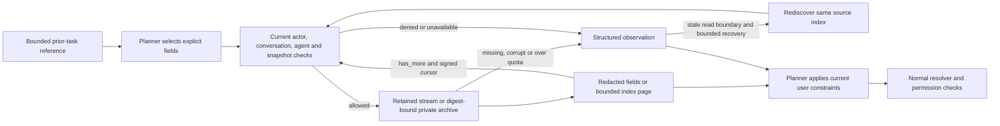
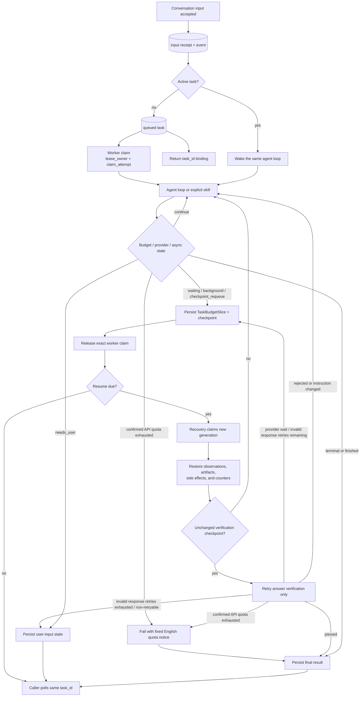
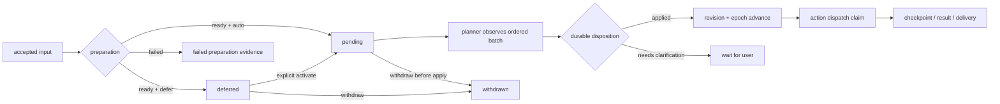
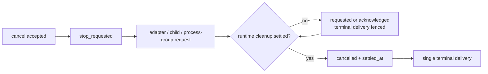
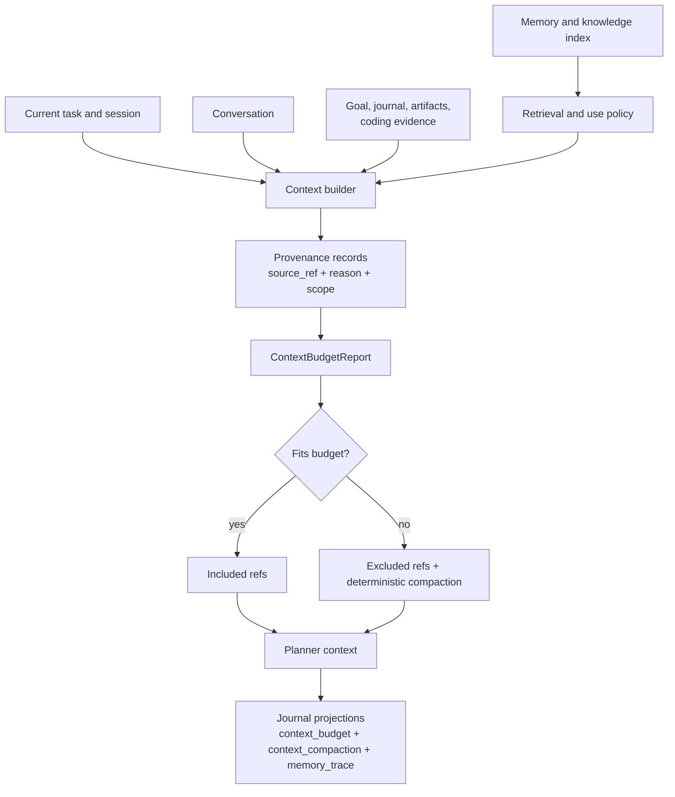

# Task State and Context

<!-- ai-learning-stage: context-memory -->
<!-- ai-learning-audience: operator,developer -->

<!-- ai-learning-navigation:start -->
Previous: [Security and execution](02-security-execution.md) |
[Architecture index](README.md) |
Next: [Coding and observability](04-coding-observability.md)

<!-- ai-learning-navigation:end -->

A client or HTTP timeout does not by itself terminate a persisted task. Workers
use fenced leases and heartbeats, while resumable work is represented by
checkpoints and machine lifecycle fields.

## Verification and Authorized Recall

`task_journal.summary` and `trace` expose independent `execution_status` and
`answer_verification` records. Verification has four states: `not_required`,
`passed`, `failed`, and `unavailable`. The record is SHA-256-bound to the candidate
answer. Missing prompts or provider failures are never treated as a pass.
An unavailable provider preserves completed action fingerprints, observations,
budgets and metrics in a verification-stage checkpoint; missing configuration
requires user intervention. Recovery first checks the candidate, evidence,
request and conversation-revision bindings, current authorization and task claim.
Unchanged work resumes answer verification without a planner or tool turn. A
changed instruction or rejected candidate returns to the agent loop with the
completed mutation fingerprints intact. Provider outages respect the provider's
cooldown, or wait 60 seconds when no cooldown is available. Invalid verifier
responses use candidate-bound counts persisted in the checkpoint: the first two
failures schedule verification-only retries after 2 and 5 seconds; a third leaves
the checkpoint in `needs_user`. Non-retryable errors and malformed retry metadata
also require user intervention. Repeated finalization does not consume another
attempt. Only accepted verification publishes the candidate. Rewritten answers require
explicit acceptance. Private checkpoint clones share an immutable snapshot rather
than copying its full JSON tree.

Confirmed model/API quota exhaustion is terminal rather than recoverable provider
waiting. The task fails with the sole fixed English operational notice from
`configs/provider_failure_notices.toml`; no error composer or model retry runs.
Completed evidence remains available. This exception does not apply to temporary
rate limiting, transport failures, local budgets or resource-capacity waits.

Invalid responses include schema failures and internally contradictory operation
audits, such as an audit claiming success while marking the same observed method
as blocked. The host classifies these as `answer_verifier_response_invalid`;
it does not change an audit boolean to force acceptance. The same candidate-bound
retry counter applies, ending in `needs_user` after exhaustion. A subprocess probe
that successfully records an expected child-test failure is evaluated from the
outer execution receipt and captured child result separately. This distinction
does not turn an actual failed execution or missing method into success.

The UI and CLI show execution, verification and delivery independently. Completed
execution does not imply a verified answer or a delivered channel message.

Plan-verifier notes are separate from failures. Default creation-path anchoring
and preferred-action hints remain visible as `severity=info`, without a failed
action or repair envelope. `blocked_*` codes identify the first genuinely
blocking issue, including shadow evidence in observe-only records. A pending
confirmation remains actionable through `needs_confirmation` and its permission
signal, not a fabricated blocking failure. Round `repair_signals` contain only
blocking issues or confirmation requests; informational notes do not request a
replan or consume a recovery attempt.

Recent execution anchors publish bounded `task-context:v1:<UUID>` references.
The planner may use `task_control.recall_context` to read 1-8 explicit JSON
pointer fields from a prior task's request or capability arguments/data.
`POST /v1/tasks/:current_task_id/context-recall` rechecks the current enabled key,
principal, channel, user/chat IDs, external recipient and conversation. Admin
access does not bypass these conversation checks. Credentials are removed;
missing fields, deleted results and responses above 24 KiB return machine errors.
The result declares `instruction_authority=none` and
`current_execution_evidence=false`: recalled content is not an instruction,
permission grant, or proof that a new action executed.

Stored capability arguments use a separate bounded evidence projection, not the
locator-stripped summary preview. It keeps ordinary paths, public URLs and field
selections, while removing credentials and internal authorization controls.
The `continuation_args_projection` schema version 2 records `truncated` and
`complete_fields`. An intact top-level field can be selected even when another
argument was omitted; an incomplete object, array or whole argument map returns
`context_field_compacted`. Bounds remain 2 KiB, 32 object fields, 16 array items,
512 bytes per string and depth 5. This is redacted retained evidence, not an
unbounded raw argument archive; omitted historical values are never reconstructed
from logs or by replaying the original action.

`/capabilities` is a paged index, with `pagination.has_more` and an opaque
`next_cursor`; `page_size` defaults to 64 and may be 1-64. Follow the exact cursor
with the same field selection and page size. The signed cursor binds the current
task/scope, source snapshot and selection, expires after 15 minutes, and becomes
invalid after a runtime restart. Selected fields beyond the first page can be
read directly; pass `source_digest` to fence them to the observed snapshot.
Each page/read repeats authorization, including the agent scope. Before a
capability stream is compacted for API delivery, task finalization publishes
redacted immutable entries and a SHA-256-bound manifest in the task-owned
canonical-evidence namespace. Normal, failed, checkpoint and seeded-resume paths
use the same publisher. A stale worker claim cannot publish a new reference.
The result keeps only the manifest identity and bounds; index reads load that
manifest, while exact field reads open only the selected entries. Directory-fd
no-follow operations, private permissions and digest checks apply to publication
and reuse. Publication atomically creates the destination only if absent; it
never replaces an existing evidence object. Concurrent identical publishers
verify and reuse the retained object; conflicting content fails explicitly.
Limits are 4,096 entries, 1 MiB per object and 32 MiB per archive;
budget/write failures are explicit unavailable records, not complete histories.
Task-owned deletion removes these objects. Missing or corrupted archived objects
return explicit errors. Earlier histories without a complete archive return
`context_source_compacted`; whole-trace compaction alone does not deny an
unchanged stream whose original checksum still matches.
Absent retained evidence returns
`context_source_unavailable`. Diagnostic logs are not a context data store.
Prior execution summaries expose `prior_context_projection` with preview,
truncation and source-compaction flags plus an authorized discovery reference.
An omitted preview value is not an absent historical value or proof of failure.

An invalid/expired cursor or changed snapshot returns structured, effect-free
`replan_arguments` facts. The loop may rediscover the same source index without
the old cursor/digest, within its existing recovery budget. It must not repeat
the stale call or re-execute the source task. Revoked authorization and missing
or compacted evidence do not grant automatic retry.

Failure state is independent from its presentation. The model may explain a
failure in the user's language or return explicitly requested JSON. Structured
JSON is bounded and checked for credentials, internal payloads and nested error
wrappers; the response-contract validator still applies. Except for the confirmed
API quota exhaustion notice described above, if presentation is
unavailable, the runtime emits a flat public machine record rather than a raw
provider body or fixed language-specific sentence. Completed actions stay
completed and remaining actions stay paused.

### Evidence Used During Finalization

When the current loop has canonical capability results, terminal synthesis and
the observed-output fallback use the same `canonical_capability_evidence`
catalog. Each result retains its ordinal, evidence identity, digest and status,
including early observations and errors. Raw step text cannot replace a
canonical result. Before a model sees a result, retrieval references are verified
and sensitive fields are removed.

The catalog's `model_view_complete` describes the budgeted model view, not whether
an operation succeeded. Oversized filtered data is stored in an immutable
task-owned artifact and exposed through a verified range handle with explicit
partial-view metadata. The model must not invent omitted values; unavailable or
invalid evidence cannot be represented as a complete observation. Artifact-write
failures remain explicit. This catalog is a finalization view, not a replacement
for the separately authorized historical recall API or an instruction to repeat
an operation.

The teaching panel shows the included memory/KB evidence count and pages of 12
items. Each item can reveal its complete source reference and inclusion reason;
the raw machine record remains separately expandable. Changing the task resets
the evidence page, and displayed references are data, not executable links.

Conversation input state is independent from task lifecycle state. A message
can be accepted before task creation, deferred without running, or withdrawn
before the planner applies it. Ready inputs are ordered by `input_seq` and
become effective only when a durable planner decision records their disposition
and advances the instruction revision. `execution_epoch` fences action dispatch
and terminal presentation; it is not a user-visible task status.

Manual pause has no automatic wake time. Timed waiting and provider/async-job
waiting retain their explicit wake condition. Cancellation applies a stable
input cutoff: earlier pending inputs are preserved as deferred records rather
than silently creating replacement work after the canceled task ends.

Cancellation lifecycle is deliberately more precise than task status:

Parent termination projects this lifecycle onto active children. Queued
children with no registered runtime may settle immediately; active children
remain `cancel_requested` until runtime unregistration or reconciliation proves
cleanup. Internal children have no conversation reply owner, so they settle as
machine state without fabricating a user reply item.

Context is assembled from explicit sources with provenance and a deterministic
budget. Memory and knowledge retrieval supply candidates; they do not select a
semantic route.

After a successful task result is persisted, Agent Runtime stores eligible short-term
turn records and starts preference/fact extraction asynchronously. Durable
preference and fact changes use a structured memory-intent schema. Users can
inspect, expire, or delete the stored records.
