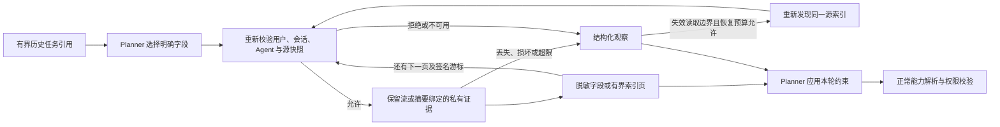
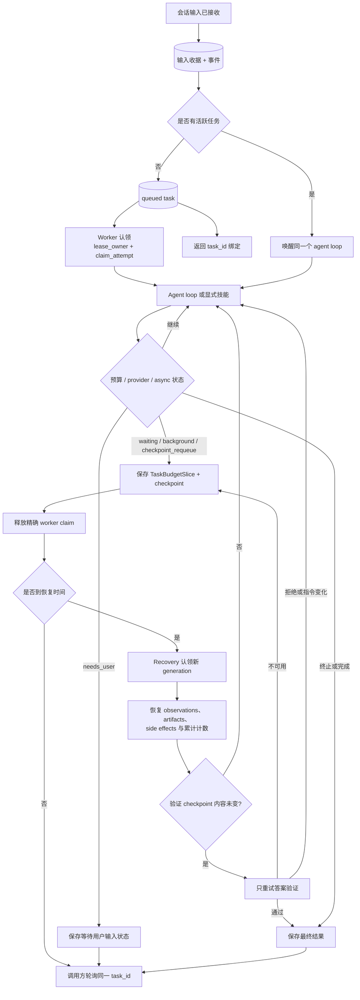
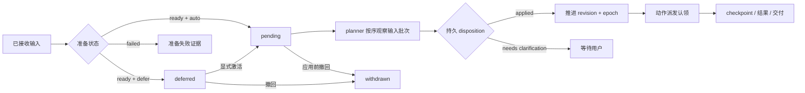
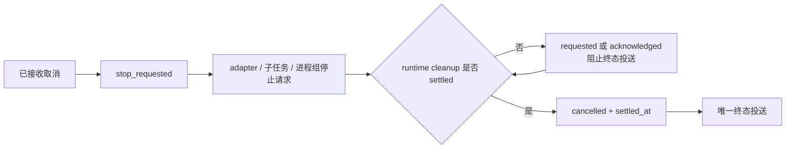
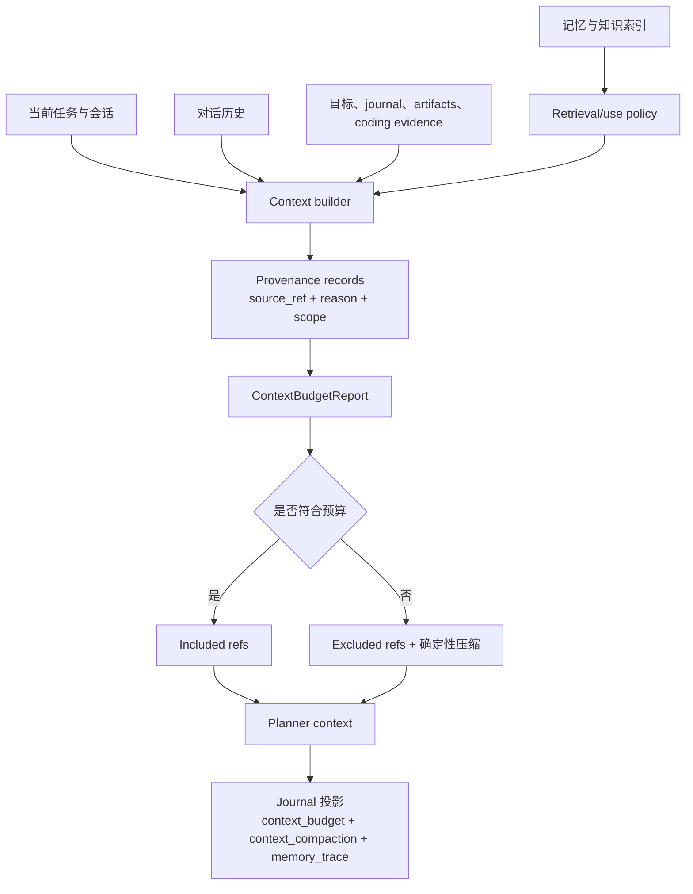

# 任务状态与上下文

<!-- ai-learning-stage: context-memory -->
<!-- ai-learning-audience: operator,developer -->

<!-- ai-learning-navigation:start -->
上一页：[安全与执行](02-security-execution.zh-CN.md) |
[架构索引](README.md) |
下一页：[编码与可观测性](04-coding-observability.zh-CN.md)

<!-- ai-learning-navigation:end -->

客户端或 HTTP 等待超时本身不会终止已经持久化的任务。Worker 使用带 fencing 语义的 lease 与 heartbeat；需要续跑的工作通过 checkpoint 和机器生命周期字段表达。

## 验证状态与授权回查

任务 journal 的 summary 与 trace 分别记录 `execution_status` 和 `answer_verification`。
验证状态包括 `not_required`、`passed`、`failed`、`unavailable`，通过 SHA-256 绑定被验证的
候选答案。缺少提示词或模型请求失败不等于验证通过。验证服务不可用时，已完成动作的指纹、
观察、预算和调用统计会保存到验证阶段 checkpoint；配置缺失则等待用户处理。恢复时核对
候选答案、证据、请求与会话版本的绑定，并重新检查权限和任务租约。内容未变时只重试答案
验证，不再调用 planner 或工具；指令变化或验证拒绝时，携带已完成动作指纹返回 agent loop。
验证仍不可用则继续等待，只有获得接受才发布候选答案。改写后的答案必须获得明确接受。
私有 checkpoint 的克隆共享不可变快照，避免重复复制完整 JSON 树。

UI 和 CLI 独立显示执行、答案验证与投送状态：执行完成不代表答案已通过验证，也不代表
通信端已经收到消息。

近期执行锚点提供有限数量的 `task-context:v1:<UUID>` 引用。Planner 可以调用
`task_control.recall_context`，用 1-8 个 JSON pointer 指定读取旧请求或能力参数、结果字段。
`POST /v1/tasks/:current_task_id/context-recall` 每次重新核对有效 key、主体、通信端、
用户/聊天 ID、外部接收方及会话。管理员也不能绕过会话隔离。凭据会被移除；字段缺失、
结果已删除或响应超过 24 KiB 时，返回结构化错误，不静默截断后让模型猜测。
结果明确标记 `instruction_authority=none`、`current_execution_evidence=false`：
历史内容只补充上下文，不是新指令、权限授予或本轮执行证据。

`/capabilities` 返回分页索引及 `pagination.has_more`、不透明的 `next_cursor`。
`page_size` 默认 64，允许 1-64；翻页时保持字段选择和页大小不变，原样使用游标。
签名游标绑定当前任务、作用域、源快照和字段选择，15 分钟后或运行时重启后失效。
首屏以后的字段也可以按索引读取；传入返回的 `source_digest` 可拒绝已变化的快照。
每次读取重新鉴权，包括 agent 隔离。API 投影需要裁剪能力流之前，任务收尾会把脱敏的
不可变条目和 SHA-256 绑定的清单写入该任务自己的 canonical-evidence 目录；正常、失败、
checkpoint 和 seeded-resume 路径复用同一发布器，过期 worker claim 不能发布新引用。
结果只保留清单身份和范围信息：查索引只读清单，查具体字段只打开选中的条目。
发布和复用均检查摘要，使用目录描述符、no-follow 与私有文件权限。发布只在目标不存在时
原子创建，不覆盖已有证据；并发发布相同内容时校验并复用原对象，内容冲突则明确失败。
上限为 4,096 个条目、
单个对象 1 MiB、整份存储 32 MiB；写入或预算失败明确记为不可用，不冒充完整历史。
删除任务私有产物会一并删除这些对象，丢失或损坏会返回明确错误。
没有完整存储的较早历史在能力流被裁剪时返回 `context_source_compacted`；若只是其他 trace
字段压缩，能力流与持久化的原始流摘要一致，仍可正常回查。
缺少持久化证据时返回 `context_source_unavailable`，不会从诊断日志重建历史。
执行摘要中的 `prior_context_projection` 明确标记预览、截断、源压缩状态及授权回查入口。
摘要未展示某个值，不代表历史中没有该值，也不代表执行失败。

持久化的能力参数使用独立、有界的证据投影，不复用剥离定位符的摘要预览。普通路径、
公开 URL 和字段选择会保留，凭据和内部授权控制会过滤。版本 2 的
`continuation_args_projection` 标记 `truncated` 和 `complete_fields`：即使另一个参数
被省略，完整保留的顶层字段仍可单独读取；不完整的对象、数组或整份参数返回
`context_field_compacted`。上限仍为 2 KiB、32 个对象字段、16 个数组项、单字符串
512 字节和深度 5。这是脱敏的保留证据，不是无限保存的原始参数；省略的历史值不会
通过诊断日志或重放原动作来补造。

游标无效、过期或源快照变化时，返回无副作用的 `replan_arguments` 机器事实。Agent 可以
在现有恢复预算内丢弃旧游标和摘要，重新发现同一历史任务的索引；不能重复失效调用，
也不能重跑源任务。权限撤销、证据缺失或裁剪不构成自动重试的授权。

失败状态与失败说明分开处理。模型可以按用户语言解释，也可以返回用户明确要求的 JSON。
结构化 JSON 受大小限制，并检查凭据、内部载荷和多层错误包装；回复合同验证仍然有效。
模型说明不可用时，运行时只返回扁平的公开机器记录，不输出原始服务商响应或固定语言句子。
已完成动作保持完成，剩余动作保持暂停。

教学面板展示纳入的记忆/知识库证据总数，每页 12 项；展开单项可以看到完整来源引用和
纳入依据，原始机器记录仍可单独展开。切换任务会重置页码，引用只作为数据展示，不会成为
可执行的链接。

会话输入状态与任务生命周期状态相互独立。消息可以在任务创建前被接收，可以延期而
不执行，也可以在 planner 应用前撤回。Ready 输入按 `input_seq` 排序；只有持久化的
planner 决策记录 disposition 并推进 instruction revision 后，它才成为有效约束。
`execution_epoch` 用于隔离动作派发和终态呈现，不是用户可见的任务状态。

人工暂停没有自动唤醒时间；定时等待、provider 等待和异步 job 等待保留各自明确的
唤醒条件。取消使用稳定的输入 cutoff：较早的 pending 输入会保存为 deferred 记录，
不会在已取消任务结束后静默创建替代工作。

取消生命周期比任务 status 更精确：

父任务终止会把该生命周期投影到活跃子任务。没有注册 runtime 的 queued 子任务可以立即
settle；活跃子任务保持 `cancel_requested`，直到 runtime 注销或 reconciliation 证明清理
完成。内部子任务没有会话 reply owner，因此只结算机器状态，不伪造面向用户的 reply item。

上下文从带 provenance 的显式来源组装，并受确定性预算约束。记忆和知识库检索只
提供候选内容，不参与语义路由。

任务成功结果持久化后，Agent Runtime 会保存符合策略的短期轮次记录，并异步启动偏好/事实提取。长期偏好和事实的变更使用结构化 memory-intent schema；用户可以查看、设为过期或删除这些记录。
