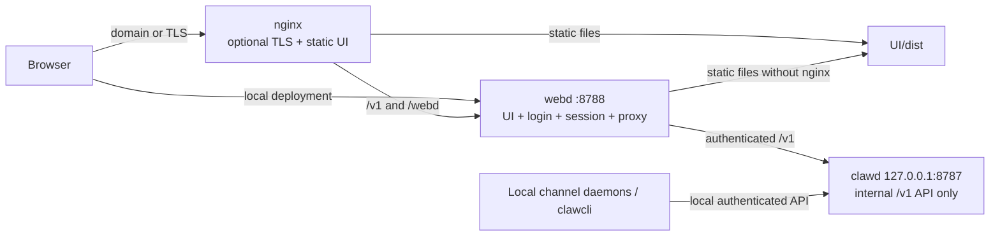
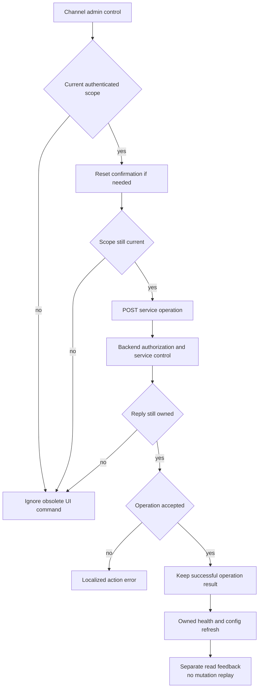

# Web Entry And Core Isolation

<!-- ai-learning-stage: safety-operations -->
<!-- ai-learning-audience: operator -->

<!-- ai-learning-navigation:start -->
Previous: [Interactive coding and presentation](09-interactive-coding.md) |
[Architecture index](README.md) |
Next: [Task artifact delivery](11-task-artifact-delivery.md)

<!-- ai-learning-navigation:end -->

Agent Runtime keeps browser-facing security in `webd` and keeps `clawd` as an
internal core API. This prevents a second public UI/API entry from bypassing
the browser session gateway.

## Current Access Topology



`clawd` does not serve `UI/dist` and cannot bind a non-loopback address. Its
address is not a user configuration field. The internal test override accepts
only loopback socket addresses, so parallel local test servers cannot reopen
the public interface.

## Ownership

- `webd` owns browser login, persisted sessions, credential injection,
  login-failure lockout, body limits, forwarded-client handling, and API proxying.
- `clawd` owns authenticated task and administration APIs, agent execution,
  tools, skills, and persistence.
- nginx is optional. It owns TLS/domain termination and static asset delivery,
  then forwards `/v1` and `/webd` to `webd`, never to `clawd`.

## webd listener scope

The dashboard's left entry card controls whether `webd` accepts direct device-IP
connections. The switch changes only `[webd].listen`, preserves its port and
other settings, writes the TOML atomically, and schedules a delayed restart so
the current API response can finish:

- direct access: `0.0.0.0:<port>`
- local/nginx-only access: `127.0.0.1:<port>`

On a native deployment, nginx and `webd` share the host network namespace, so
closing direct access does not affect the nginx route. A browser connected to
`IP:<port>` does disconnect. Container and sidecar deployments must keep the
listener reachable from their proxy network instead of assuming host loopback.
- Local channel daemons and `clawcli` may call the loopback core API directly;
  this is machine-local component communication, not a browser entry.

## Dashboard Operations

The dashboard reports whether nginx is installed, running, configured for
Agent Runtime, and serving a deployed UI. Admin-only actions use the existing
background workspace-operation state:

- **Enable/Repair nginx** checks the system package version, installs or updates
  nginx when needed, writes the Agent Runtime site, deploys existing `UI/dist`,
  validates configuration, and starts or reloads it. Linux package managers and
  Homebrew on macOS are handled explicitly.
- **Disable nginx** stops and disables the service, removes the Agent Runtime site and
  its dedicated UI deployment, and warns that a cloud/domain entry will become
  unreachable. nginx itself is not uninstalled.

Operations return machine status and error keys. Human-facing Chinese or
English guidance is rendered by the UI rather than parsed by runtime logic.

System-operation confirmations, response bodies and recovery checks belong to
the originating API endpoint and login epoch, including a new login with the
same role. After changing that scope, an old confirmation cannot submit a new
request, and an old acknowledgment cannot update the current page or initiate
follow-up reads or a diagnostic download. Repeated clicks share one pending
local action; distinct dependency installs remain independent. Diagnostic export
remains available to authenticated ordinary users; administrative writes still
require backend-confirmed administrator permission.

Workspace status reads wait for a pending start/cancel acknowledgment, and older
reads cannot replace the accepted state. Exposure changes likewise invalidate
older status reads. Changing browser scope only discards obsolete UI work: it
does not cancel an already accepted server operation. Returning to that device
reads its actual operation state again.
Portaled confirmation, choice and input dialogs read semantic theme colors
directly, so their warnings and controls remain legible in either theme.

## Channel Control Ownership

Channel start, stop, restart and reset controls share the current authenticated
UI scope, including endpoint, principal, role and login epoch. Reset confirmation
and response-body processing recheck that scope. Per-service claims prevent
duplicate or conflicting local submissions while allowing different services
to proceed independently. Backend administrator checks remain authoritative.

The shared notice follows the latest dispatched action or current explicit
notice update, rather than whichever older response arrives last. Success comes
from the service response: health/config refresh failures do not undo it or replay
the mutation. Scope changes clear local feedback, not accepted server work.
The WeChat enable/start/config/QR continuation checks ownership between steps,
so a new sign-in or device selection cannot continue the former setup request.

WeChat, Feishu, Lark and Telegram configuration snapshots use that same scope;
only the latest read for each channel may update its state. A pending save fences
older reads and duplicate saves for that channel without blocking other channels.
Telegram refreshes update the server snapshot without overwriting unsaved edits.
A save acknowledgment clears only the submitted draft: edits made while saving
remain unsaved. Changing identity or device clears obsolete local configuration
and secret drafts, but does not modify backend configuration or cancel a save
already accepted by the server. QR/login status has its own lifecycle.

WeChat sign-in status, QR generation and confirmation polls are bound to the
authenticated endpoint and login epoch. A scope change clears obsolete local
QR data and prevents old callbacks from submitting follow-up requests. Ordinary
authenticated users can still sign in under the backend's per-user session
checks. Hidden pages pause polling; a foreground refresh shares a pending status
read instead of adding another request. Repeated QR clicks share one pending
generation. A confirmed binding remains confirmed if its follow-up status read
is unavailable; pre-confirmation reads cannot overwrite that result, and the
generation request is not replayed.

WhatsApp Web status, QR visibility and sign-out requests share the authenticated
endpoint and login epoch too. Captured QR-panel callbacks cannot open or close
a new owner's view. Foreground refreshes share pending reads; the 2s QR-panel
poll and 5s background poll do not overlap, and periodic reads pause while hidden.
Sign-out clicks share one pending POST. Older reads cannot overwrite its later
status, and the settle-delay continuation checks ownership before proceeding.
An accepted sign-out remains accepted if the secondary status read fails. These
UI boundaries do not change the bridge's account model or backend permissions.

Feishu/Lark binding and reset require an authenticated administrator scope and
the matching platform/session. Scope changes discard obsolete local sessions
and QR images; delayed response bodies, encoders and confirmation callbacks
cannot update the new owner's view or launch follow-up reads. Each platform
serializes conflicting start/reset commands, including an open reset confirmation,
without blocking the other platform. A failed explicit start/reset retains the
last known session and resumes its existing polling cadence. Confirmed binding
or reset is independent of secondary configuration/health reads: both refreshes
are attempted while still owned, and neither can replay the primary operation.
These frontend checks do not replace server authorization or registration
idempotency, and do not imply automatic retry of a failed registration poll.

Authenticated users can read communication status/configuration metadata without
receiving application secrets: Feishu/Lark clear the secret field for non-admin
identities, Telegram masks bot credentials, and WeChat exposes configured flags.
Feishu/Lark configuration writes require the server-resolved administrator role
before reading or changing credentials; role fields supplied in request JSON do
not grant authority. Administrator editing and ordinary-user status reads remain
separate from account-owned QR login and binding. Configuration read failures
return machine error codes, never credential-bearing parser source excerpts;
diagnostic events contain only the channel and safe error code.

After official registration init/begin or poll I/O returns, the backend rereads
the active key, administrator role and owned platform/session before attaching
registration metadata or applying credentials. It
uses the current expiry, terminal status and registration code rather than the
pre-request snapshot. Missing/revoked keys, removed or reassigned sessions and
role changes return machine-coded authorization/not-found errors; expired,
already-bound or replaced registrations retain their current stored state
without applying the delayed result. A delayed upstream expiry or begin error
cannot replace an already-bound session or turn its response into a failure.
This eligibility check is not an atomic application
receipt or a guarantee of ordering against every concurrent configuration write.



## Deployment Rules

- Native Linux/macOS: `clawd` is loopback-only; `webd` is the browser entry.
- Docker: publish `8788`, not `8787`; `webd` and `clawd` communicate through
  loopback inside the same container.
- Local use does not require nginx. Open `webd` directly.
- Server/domain use should place nginx in front of `webd` and use trusted TLS.
- Never expose or port-forward `8787`.

## Verification

```bash
cargo test -p webd
cargo test -p clawd internal_listener_tests::
cargo test -p clawd workspace_nginx_tests::
cargo test -p clawd workspace_webd_tests::
python3 scripts/check_long_files.py
```

The webd tests prove that UI assets are served locally while `/v1` remains a
proxy path. The clawd listener test rejects wildcard and LAN addresses.
