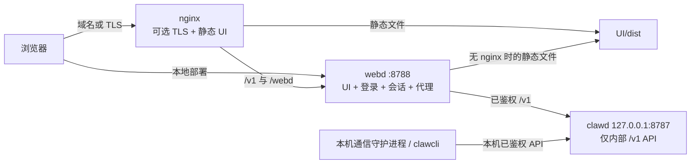
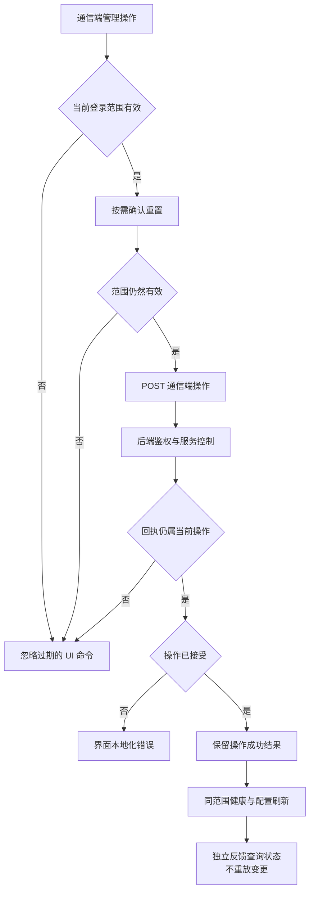

# Web 入口与核心隔离

<!-- ai-learning-stage: safety-operations -->
<!-- ai-learning-audience: operator -->

<!-- ai-learning-navigation:start -->
上一页：[交互式编码与输出呈现](09-interactive-coding.zh-CN.md) |
[架构索引](README.md) |
下一页：[任务产物交付](11-task-artifact-delivery.zh-CN.md)

<!-- ai-learning-navigation:end -->

Agent Runtime 把面向浏览器的安全边界集中在 `webd`，把 `clawd` 保留为内部核心
API。这样不会出现绕过浏览器会话网关的第二套公开 UI/API 入口。

## 当前访问拓扑



`clawd` 不再托管 `UI/dist`，也不能绑定非 loopback 地址。它的地址不是用户配置项。
内部测试 override 也只接受 loopback socket，因此并行本地测试不会重新打开对外端口。

## 责任归属

- `webd` 负责浏览器登录、持久会话、凭据注入、登录失败锁定、请求体限制、
  代理来源处理和 API 转发。
- `clawd` 负责已鉴权的任务/管理 API、agent 执行、工具、技能和持久化。
- nginx 是可选外层，负责 TLS/域名终止和静态资源，再把 `/v1` 与 `/webd` 转给
  `webd`，不直接连 `clawd`。

## webd 监听范围

首页左侧入口卡片控制 `webd` 是否接受设备 IP 直连。开关只修改
`[webd].listen`，保留原端口和其他设置，使用原子写入，并延迟重启以确保当前 API
响应先完整返回：

- 对外直连：`0.0.0.0:<端口>`
- 仅本机/nginx：`127.0.0.1:<端口>`

原生部署时 nginx 与 `webd` 位于同一主机网络命名空间，因此关闭直连不影响 nginx
入口；正在通过 `IP:<端口>` 访问的浏览器则会断开。容器或 sidecar 部署不能默认使用
主机 loopback，必须按代理所在网络保持上游可达。
- 本机通信守护进程和 `clawcli` 可以直连 loopback 核心 API；这是机器内部组件通信，
  不是浏览器入口。

## 首页操作

首页会显示 nginx 是否已安装、正在运行、已配置 Agent Runtime 站点，以及 UI 是否已部署。
仅管理员可执行下列后台操作：

- **启用/修复 nginx**：检查系统软件源版本，按需安装或更新 nginx，写入 Agent Runtime
  站点，部署已有 `UI/dist`，验证配置后启动或重载。Linux 使用对应包管理器，macOS
  使用 Homebrew。
- **关闭 nginx**：停止并禁用服务，删除 Agent Runtime 站点和专用 UI 部署，但不卸载 nginx；
  操作前会明确提示云服务器或域名入口将无法继续访问。

操作返回机器状态和错误键。面向用户的中英文说明由 UI 渲染，运行时不解析固定自然语言。

系统操作的确认弹窗、响应正文和恢复检查绑定最初的 API 地址和登录轮次，同角色重新登录
也会产生新轮次。切换范围后，旧确认不能再提交请求，旧响应不能更新当前页面、发起后续
查询或下载诊断文件。重复点击只保留一个等待确认或回执的本地操作；不同依赖的安装仍可
独立提交。已登录普通用户仍可导出诊断，管理写操作仍须通过后端管理员权限检查。

更新状态查询会等待启动或停止请求的回执，较早的查询不能覆盖已接受的操作状态；
修改 Web 访问范围也会使较早的状态查询失效。切换浏览器范围只丢弃过期的 UI 操作，
不会取消服务端已经接受的工作；回到该设备后重新读取真实操作状态。
确认、选项和输入弹窗直接读取主题语义色，即使通过 portal 显示在页面容器之外，
警告和操作控件在两种主题中仍保持可读。

## 通信端控制归属

通信端的启动、停止、重启和重置共用当前 UI 登录范围，包含服务地址、身份、角色和登录轮次。
重置确认和响应正文读取完成后会再次校验范围。同一通信端使用独立操作认领，阻止重复或
冲突提交，但允许不同通信端并行处理；管理员权限仍由后端校验。

共享提示跟随最近派发的操作或当前明确的提示更新，不取决于哪个旧响应最后到达。
成功依据来自通信端控制响应，后续健康或配置刷新失败不会推翻它，也不会重放变更请求。
切换范围只清除本地反馈，不取消服务端已接受的工作。微信启用、启动、刷新配置和生成
二维码之间也会检查归属，重新登录或切换设备后不会继续原来的接入请求。

微信、飞书、Lark 和 Telegram 配置快照使用相同的登录范围，每个通信端只有最近一次查询
可以更新状态。保存期间阻止该端的旧查询覆盖和重复保存，不阻塞其他通信端。
Telegram 刷新只更新服务端快照，不覆盖尚未保存的输入；保存回执只确认提交时的草稿，
保存期间继续编辑的内容仍保持未保存状态。切换身份或设备会清除过期的本地配置和密钥
草稿，不修改后端配置，也不取消服务端已接受的保存。二维码和登录状态有独立的生命周期。

微信登录状态、二维码生成和确认轮询绑定当前服务地址与登录轮次。切换范围会清除过期的
本地二维码，并阻止旧回调继续发起查询；普通登录用户仍按后端的用户会话规则扫码。
页面隐藏时暂停轮询，手动刷新复用正在进行的状态查询，不额外发请求；重复点击二维码
生成也共用一次待完成请求。已确认成功的绑定不会因后续查询暂不可用而显示为未连接，
确认前的旧查询不能覆盖这一结果，也不会自动重放二维码生成。

WhatsApp Web 的状态、二维码区域和退出登录请求同样绑定当前服务地址与登录轮次。
旧页面的回调不能打开或关闭新用户的二维码区域；手动刷新复用待完成查询，二维码区域的
2 秒轮询和后台 5 秒轮询不会并行运行，页面隐藏时暂停周期查询。重复退出只发送一次
POST，旧查询不能覆盖退出后的新状态，等待状态稳定后也会再次检查归属再继续。
后续状态查询失败不会推翻已接受的退出操作。这些前端边界不改变桥接账号模型或后端权限。

飞书/Lark 绑定和重置要求当前管理员登录范围有效，并匹配对应的平台和会话。
切换范围会丢弃过期的本地会话和二维码；迟到的响应正文、二维码编码结果和确认回调
不能更新新用户的页面，也不能继续发起后续查询。每个平台串行处理冲突的开始/重置操作，
包括尚未确认的重置弹窗，但不阻塞另一个平台。显式开始或重置失败时，保留最近一次
已知会话并恢复原有轮询节奏。已确认的绑定/重置不依赖后续配置和健康查询是否成功：
仍属于当前请求时会分别尝试两项刷新，刷新失败不会重放原操作。这些前端检查不替代
服务端鉴权或注册幂等性，也不表示失败的注册轮询会自动重试。

已登录用户可以读取通信端状态与配置元数据，但不会收到应用密钥：飞书/Lark 对
非管理员清空密钥字段，Telegram 对机器人凭据脱敏，微信只提供已配置标记。
飞书/Lark 的配置写入在读取或修改凭据前校验服务器确定的管理员角色，请求 JSON
中自称管理员的字段不授予权限。管理员编辑、普通用户状态读取与用户自己的扫码
登录和绑定分别处理。配置读取失败只返回机器错误码，不返回含凭据的解析源码；
诊断事件也只记录通信端和安全错误码。

注册触发的通信端启动结束后，后端会重新读取当前身份与会话，再返回状态或记录
启动失败。已完成绑定、终态和已替换的注册流程优先于旧请求；条件失败写入不能
覆盖同时完成的绑定。凭据已应用、服务可用、机器人侧账号已绑定仍是不同事实。
这次状态回读不代表已经实现持久化一次性应用或配置/服务操作的完整顺序控制。

官方注册初始化、开始或轮询的网络请求返回后，后端会重新读取有效 Key、管理员角色
和当前用户所属的平台会话，再决定是否保存注册信息或应用凭据；有效期、终态和注册码
以当前存储记录为准。Key 被撤销、会话被删除
或转移、角色变化时，返回机器错误码和相应的鉴权或未找到状态；会话已过期、绑定完成
或注册已被替换时，保留当前记录，不应用迟到结果。上游迟到的过期或开始注册错误不能
覆盖已绑定状态，也不能把它误报成失败。这项有效性回查不是原子应用回执，
也不等同于所有并发配置写入都已串行化。



## 部署规则

- Linux/macOS 原生部署：`clawd` 只绑定 loopback，`webd` 是浏览器入口。
- Docker：发布 `8788`，不发布 `8787`；`webd` 和 `clawd` 在容器内通过 loopback 通信。
- 本地使用不需要 nginx，直接打开 `webd`。
- 服务器/域名部署应在 `webd` 外层使用 nginx 和可信 TLS。
- 不要对外暴露或端口转发 `8787`。

## 验证

```bash
cargo test -p webd
cargo test -p clawd internal_listener_tests::
cargo test -p clawd workspace_nginx_tests::
cargo test -p clawd workspace_webd_tests::
python3 scripts/check_long_files.py
```

`webd` 测试证明 UI 资源由它自己提供，而 `/v1` 仍然是代理路径。`clawd` 监听测试会拒绝
wildcard 和局域网地址。
