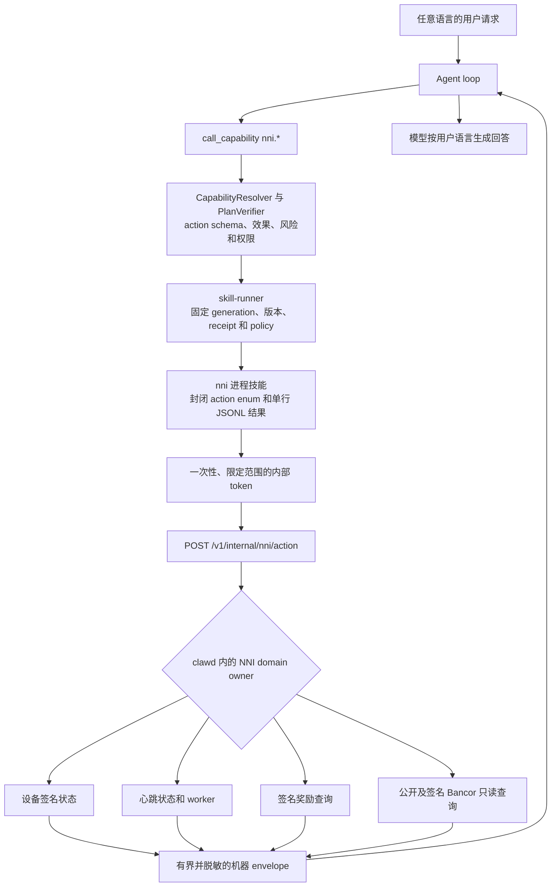

# NNI 能力与心跳控制

<!-- ai-learning-stage: capabilities-artifacts -->
<!-- ai-learning-audience: operator,developer -->

<!-- ai-learning-navigation:start -->
上一页：[浏览器媒体发现](12-media-discovery.zh-CN.md) |
[架构索引](README.md) |
下一页：[AiPP 技能配套界面](14-aipp-skill-companions.zh-CN.md)
<!-- ai-learning-navigation:end -->

固定内置的 `nni` 技能允许 Agent 查询 NNI 状态、控制心跳参与、读取设备奖励和 Bancor
数据，并预览 Bancor 报价。技能始终可以用于查询，是否持续发送心跳则是独立、由用户控制的
运行状态。

任何语言的普通请求都进入 agent loop。模型根据语义元数据选择已经注册的 `nni.*`
capability；运行时代码不匹配某种语言的固定短语来选择 NNI action，也不写死最终回复。

## 当前流程

技能进程不读取 NNI 状态文件，不运行硬件签名 helper，不继承 provider/admin 凭据，也不直接
访问远端节点。这些操作由 `clawd` 负责，技能只接收有界的结构化观察结果。

## 节点与界面请求归属

UI 保存节点目录；NNI 参与使用选定节点，BANCOR 和资产页面可分别指定服务节点，也可沿用
NNI 节点。本机 API 负责候选节点和允许的回退；签名操作始终绑定实际使用的节点与挑战，
不能混用账户、授权或签名上下文，也不能把已有签名拿到另一节点重放。

金融页面的异步结果绑定登录会话、服务地址、角色、业务节点和资产账户。切换范围会清空内存
视图、历史缓存和待确认报价；即使 A → B → A，也属于新的请求周期。旧结果、错误、结束状态
和签名挑战不会回填新范围，也不会继续发起下一次签名请求。公开 K 线磁盘缓存只按服务地址和
业务节点划分，不使用秘密凭据。NNI 节点的未保存草稿与已确认节点分开，奖励和网络统计结果
按已确认节点核对归属。

历史分页只接收当前选择页面的结果，报价修订号阻止较早预览覆盖较新或已清除的报价；同一范围
内的重复交易/转账提交会被阻止。旧登录请求的认证失败不能退出新会话，早于本机配置写入开始的
读取结果不能覆盖已确认的写入状态。

NNI 配置写入按会话串行，等待响应 JSON 解析并应用后才发送下一条；保存失败不会阻塞后续写入。
新增自定义节点会合并最新确认的节点目录，心跳保存只携带实际修改过的节点字段，不覆盖其他
正在保存的服务节点。取消或替换资产授权会使旧操作失效：迟到的挑战不能继续签名、验签、
派发排队中的后续保存或重新打开对话框。同一挑战的重复确认只发送一次验签请求；加载和错误
状态归属于当前操作，旧请求结束不能清除新操作的状态。

交易确认后，先推进观测版本再刷新市场、账户、成交记录与 K 线；这些刷新不会复用成交前的
在途查询。旧结果、错误、加载结束和报价预览不能覆盖成交后的状态，转账后的余额刷新也使用
同样的边界。签名交易确认与后续查询成功分开处理：刷新暂不可用时仍保留交易完成状态，提示
稍后刷新数据，不自动重新提交签名写请求。

这些只是界面和续步边界，不是授权或回滚。已经发出的签名写请求在切页后仍可能在服务端完成，
应以服务端账本为准；后端权限、验签、幂等和私钥传输保护保持独立且必须执行。

## 可用动作

| 范围 | Actions | 当前行为 |
| --- | --- | --- |
| 状态 | `status`、`device_status`、`heartbeat_status` | 查询本机签名和心跳机器字段。 |
| 心跳 | `heartbeat_enable`、`heartbeat_disable`、`heartbeat_now` | 在共享操作锁下改变或诊断心跳参与状态。 |
| 奖励 | `network_stats`、`my_rewards` | 无需 signer 查询公开的全网汇总，或使用设备签名查询当前设备的私有奖励历史。 |
| Bancor | `bancor_market`、`bancor_market_trades`、`bancor_candles` | 查询有界的公开市场数据。 |
| 私有 Bancor | `bancor_account` | 查询签名设备账户和该设备最近的成交。 |
| 报价 | `bancor_quote` | 预览预计到账和保护字段，不签名、不成交。 |

`bancor_account` 是自包含查询：它自行检查 signer 和远端授权，并同时返回余额与当前 signer
有界的最近成交。planner 不把 `device_status` 当作前置探测，也不会把公开的
`bancor_market_trades` 混进账户或“我的成交”回答。这样，私有查询失败不会被无关的本地或
公开成功观察覆盖。

技能 registry 中没有 `buy`、`sell` 或 `trade` capability。远端节点配置、模拟签名开启、
管理员策略和经济模型修改也不属于自然语言 NNI 能力面。

## 资产授权

UI 把资产所有权与硬件身份分开管理。一个 K1 资产公钥可以授权多台硬件设备，但每台硬件设备
最多只有一个生效中的资产所有者。奖励资格、奖励 grant 和账本 source 记录始终按硬件设备
分别建立；多台设备把奖励计入同一个资产账户时，服务端仍逐设备写入 grant 和不可变账本记录，
不把多份奖励合成一笔，只有账户余额是这些记录的聚合投影。

首次绑定自定义公钥和更换绑定都需要当前硬件签名与目标资产密钥签名。更换不需要原资产私钥，
避免原私钥丢失后设备被永久锁定在旧账户上；解绑只需要当前硬件设备签名。更换只改变当前设备后续
奖励的归属；解绑只撤销当前设备，并停止本机心跳期望状态。首次绑定、重新绑定和换机恢复都只
完成资产授权，不会开启心跳；用户必须随后显式点击“加入”才能开始心跳。换机恢复仍是
独立流程：它授权一台已进入白名单的新设备，并有意撤销该资产账户的旧设备授权。自定义公钥在
UI 中先完成 Base58 K1 全合同校验，对应私钥不会进入或
保存在系统中。

硬件单签解绑意味着设备签名控制权属于恢复边界。控制 signer 的人可以解绑当前设备，并把该设备
未来的奖励改绑到其能够签名的新资产账户；但没有目标资产签名时，不能绑定无关第三方的公钥。
现有余额和同一资产账户下的其他设备授权不会因此改变。

各平台的共用控制台在首次使用时默认关闭 NNI、BANCOR 和资产导航入口。管理员可在
“首页 > NNI”确认提示后启用，已保存的选择在刷新后保留。该导航设置不会自动加入或退出
网络、停止交易服务，也不会删除数据。

可视化控制台只向已认证的管理员显示 NNI、APR、BANCOR 和资产页面，`clawd` 的本机资产转账
接口也会再次校验管理员身份，不能依赖前端隐藏页面充当授权。公开 NNI 节点 API 及其密码学合同
不依赖控制台角色。

## 资产转账

资产页面可以把精确到 8 位小数的 AIC 或 USD 转入任意合规 K1 资产公钥，并可附带最多 256
个 UTF-8 字节的 memo。浏览器先校验完整 K1 envelope，阻止向自己转账和超余额转账，并在
确认前完整展示付款账户、收款账户、资产、金额、memo 和签名方式。用户可以使用当前绑定的
硬件设备代签，也可以输入与付款账户匹配的资产私钥完成一次内存签名；私钥不会持久化。

`clawd` 为一次用户提交生成 UUID 幂等键，并在候选 Edge 间复用；Core 将该键与规范化请求摘要
持久绑定，相同请求只返回原 challenge，不同内容复用同一键会被拒绝。节点返回短时有效的 v2
转账载荷后，`clawd` 在签名前核对精确字段集合、账户绑定、最小单位金额、memo、nonce、过期
时间、请求键和 SHA-256 摘要。验证响应因网络或 `5xx` 无法确认时，只使用同一签名向同一节点
重试一次，不会切换节点重复成交。

NNI Core 在同一事务中完成付款方扣款、收款方入账、两条不可变账本、带 memo 的不可变转账
记录、一次性任务消费和公开 Explorer 流水。完全相同的已接受签名再次提交时只返回已落账结果，
不会再次变更余额；其他签名或已拒绝任务不能复用。Core 在签名验证后、余额变更前执行付款账户
频率限制，Edge/Core 另按来源 IP 和业务类别削峰。数据库唯一索引和触发器继续阻止重复请求键、
重复 nonce、自转和 intent 身份字段篡改。收款公钥不需要事先绑定设备；公开资产浏览器仍保持
只读，但会立即在双方地址历史中显示 `asset_transfer` 交易及其 memo。

资产转账不会暴露为 `nni.*` 自然语言变更 capability。金融写入继续经过管理员 UI 的显式复核
和签名流程，Agent 仍可以使用结构化 capability 查询账户和市场数据。

## 设备合同

运行时使用多个独立事实，不再让一个芯片布尔值承担全部语义：

- `signer_kind`：`hardware`、`simulated` 或 `unavailable`
- `hardware_chip_present`：只有检测到真实硬件 signer 时才为 true
- `signer_available`：真实 signer 或用户已经显式开启的模拟 signer 可用
- `simulation_enabled`：模拟 signer 已由用户显式开启并且当前正在作为签名来源
- `simulation_enable_available`：当前没有 signer，但可以通过独立 UI 操作显式开启模拟
- `local_participation_eligible`：本地是否具备尝试签名操作的条件
- `network_authorization`：根据远端证据记录 `unknown`、`authorized` 或 `rejected`

系统绝不会自动开启模拟签名。模拟 signer 可以在本地具备资格，但不能绕过服务端公钥准入。
完整公钥、签名、challenge、helper 路径、节点 URL 和内部 token 在进入模型前会被删除或缩减为
安全预览。

所有真实芯片操作经过同一个异步串行门禁，排队时间不计入 helper 自身的执行超时。helper 超时
由 `APP_NNI_SIGNATURE_HELPER_TIMEOUT_SECONDS` 配置，默认 25 秒，并限制在 5 至 120 秒；UI
不承诺固定检测时长。已验证的不可变硬件公钥可缓存一个心跳周期，页面读取和 NNI capability
优先复用该证据。检测进程超时或设备负载过高只会产生 `detection_unavailable`，不得推导成
`signature_chip_missing`；只有 helper 完成检测并明确报告不可用时，才显示缺少芯片。

## 心跳状态

`heartbeat_enable` 先验证 signer 和节点配置，再保存期望状态并立即尝试一次心跳。成功进入
`active`；临时网络故障保留期望状态并进入 `waiting_network`，由既有 worker 后续重试；明确的
授权拒绝会回滚期望状态并进入 `rejected`。

`heartbeat_disable` 是幂等操作，并通过同一个异步锁与在途心跳协调。它停止后续尝试，但不删除
历史。持久状态分别记录 `last_attempt_at_ts`、`last_success_at_ts`、`last_error_code`、连续失败
次数、最后成功节点 host 和下一次预期心跳时间。运行时不会解析错误文案来推导这些字段。

### 独立工作通道

分布式任务默认关闭，部署时显式设置 `APP_NNI_WORK_PULL_ENABLED=true`，并在
`APP_NNI_WORK_ASSIGNMENT_VERIFY_KEYS` 固定 Core 的压缩 secp256k1 公钥。节点加入网络后，
独立 worker 通过出站 HTTPS `/work/request` 和 `/work/verify` 领取工作。空闲 verify 请求
最多等待 25 秒；匹配任务入队时立即返回。等待连接不持有数据库事务，不写空任务账本，
服务端只唤醒一个匹配节点。每个节点只保持一个工作请求，错误时按有界退避重连。

工作领取、执行续租和结果回报不依赖奖励心跳。运行中每 20 秒通过工作通道续租；完成后先
原子落盘，再唤醒通道立即回报。验签确认结果已接收后才删除本地待回报状态。正常奖励心跳
不再携带 worker 能力或结果，也不触发任务领取，原间隔、资产授权和奖励语义保持不变。

节点在签名前重新计算带 `nni-work-poll-v1` 域、请求 ID、随机数、完整能力和结果摘要的
challenge。Core 的 schema-v2 派单与控制信封继续绑定目标设备、平台、架构、payload、
attempt 和租约；既有 `heartbeat_task_id` 字段现在承载独立工作请求的关联 ID，不能跨请求
重放。Core 签名控制信封确认结果提交状态，Edge 不能伪造确认使节点丢失尚未提交的结果。

任务只支持既有 `command_v1` 与 `capability_v1`。受控命令保持本机程序白名单、无 shell、
清空环境和最多 300 秒上限。能力任务继续经过本机已认证执行身份、`CapabilityResolver`、
`PlanVerifier`、固定 generation、receipt、host grant 与 sandbox，不按技能名启动进程。
本地任务 ID 持久保存，重启后继续观察同一任务；能力任务不增加 wrapper 整体硬超时。

暂停接单或退出后不接受新的派单，在途任务保留原协调节点和本地状态以便收尾。旧版本通过
心跳领取任务的模式不再派发工作，两端须一起升级。签名 helper 仍使用硬件操作串行门禁，
不会因网络长轮询占用该门禁。大型结果文件需要另外的 artifact broker 合同，不进入控制 JSON。

## 进程与安全合同

- runner 根据已经注册的 `nni.*` capability 授予内部 NNI 入口，不依赖技能名硬编码分发。
- 内部入口只接受绑定 task、user、chat、channel 和 `skill_name` 的一次性 token。
- 输入采用封闭 action enum、有界列表、固定 K 线周期和十进制金额字符串。
- 输出采用 `extra.{schema_version,source_skill,status,action}`，再携带 `data`，或规范的
  `error_code/message_key/retryable/details`。
- 以 `_ts` 或 `_unix` 结尾的机器时间字段在进入模型前获得确定性的 RFC 3339 `_utc` 配套
  字段；回答直接使用该字段，不让模型自行换算日期。
- 失败还携带 `failure_phase`、`side_effect_applied` 和 `recovery_action`。明确的远端授权拒绝
  统一为无副作用的 `nni_device_not_authorized`；变更动作遇到无法确认结果的传输错误时保留
  uncertain，并要求先核对结果再重试。
- registry 和测试不存在 Bancor 真实成交 action，子进程也拿不到签名密钥或签名 helper 执行权。

Linux 与 macOS 使用相同的无芯片和模拟合同。真实 signer 验收只在树莓派等支持的硬件主机上
执行，桌面测试不会伪造真实芯片结论。
