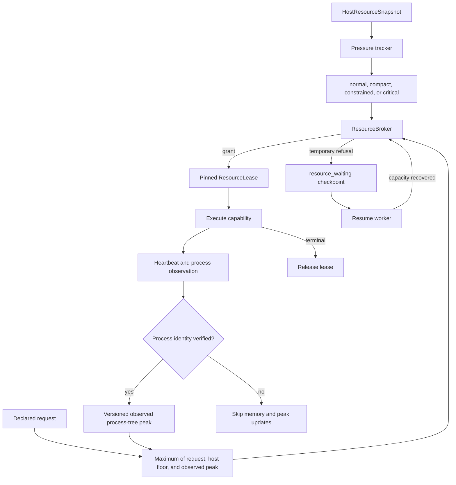

# Runtime Resource Admission and Recovery

<!-- ai-learning-stage: safety-operations -->
<!-- ai-learning-audience: operator,developer -->

<!-- ai-learning-navigation:start -->
Previous: [AiAPP development guide](15-aipp-development-guide.md) |
[Architecture index](README.md) |
Next: [RAG knowledge retrieval](17-rag-knowledge-retrieval.md)
<!-- ai-learning-navigation:end -->

The runtime uses one host-owned resource policy for tools, process skills, browser sessions, local
models, durable jobs, and model-provider calls. Resource control is based on machine contracts and
current host capacity. It never classifies user intent or parses user-visible text.

## Admission Flow

Admission reserves memory, CPU, network, provider, and browser slots atomically. A durable process
persists only non-secret lease metadata, process identity, heartbeat, and terminal markers. Startup
reconciliation rebuilds a live lease or releases a terminal one. It does not infer state from output
prose, skill names, executable extensions, or current package pointers.

The durable monitor invokes the process-memory collector only after the local process observer
returns `alive_verified`. Missing, mismatched, or unavailable identity does not contribute a memory
sample or a zero estimate, and cannot reduce the outstanding reservation using another process's
memory. This sampling decision does not prove that cancellation or process exit has completed;
an exit file cannot override a live or unknown process observation, and later release remains
subject to separate process-loss observations.

## Explicit Private-directory Boundaries

Process sandbox preparation accepts an explicit host-owned directory exclusion list. Linux applies
read-only empty masks after writable mounts, including remapped ancestor aliases; macOS adds escaped
read/write deny rules. The SDK build adapter, protocol smoke, and installed runner child use the same
directory admission policy. A nonempty list refuses direct execution rather than treating it as
isolated. Ordinary public workspace and artifact access remain separately controlled.

Linux also anchors writable intermediate ancestors before installing the private masks, so moving a
parent cannot redirect the next invocation to a replacement private pathname. Read-only scopes never
receive writable anchors. The inherited policy digest binds the platform isolation recipe and exact
directory list; a mismatched recipe is refused before child launch.

On Linux, a nonempty private-directory policy also requires an explicit `--unshare-user` in both
runtime and SDK sandbox launchers, including host-PID-visible profiles. It never uses the optional
`--unshare-user-try` fallback or relies on installation-specific implicit defaults. Host PID status
and public-file observations remain available; tests separately verify denial of an owned peer's
proc-root, file-descriptor and memory access. This Linux namespace requirement does not change
empty-exclusion recipes or macOS namespace handling.
This is a required process boundary, not proof of every deployment role or host-key custody.

macOS writable-path and private deny rules share one exact profile-string encoder. Valid Unicode,
quotes and backslashes retain their data representation; unrepresentable UTF-8 or NUL/LF/CR paths
are rejected with the existing structured path error before launch. Encoding does not admit a path
or grant access. Native Seatbelt permission checks remain separate from encoder/unit typechecks.

The runner requires the list on every machine request; it is not a skill argument, manifest grant,
or environment configuration. Reusing a trusted parent sandbox with nonempty exclusions also requires
its host-set policy digest to match this request. The child skill protocol and child environment do
not receive the host list or parent-boundary claims. The digest checks consistency, not authenticity
against a privileged host administrator.

One keyless `HostFilesystemPolicy` supplies the runner and foreground/durable command preparation,
including PTY command preparation. Native `read_file` checks directory descriptors against the same
pinned identities; renaming a protected directory does not make its contents readable. Authorized
public outside-workspace symlinks remain separate from private-directory access. Read results retain
the path captured alongside the opened handle instead of resolving a later replacement pathname.
Native `list_dir` uses the same policy and one opened directory for enumeration and relative
no-follow metadata lookup. Public directory aliases, broken symlink entries and sorted paging remain
supported. Guarded parent traversal requires search rather than directory-listing access; listing
still requires read access to its target directory. Authorized outside-workspace file reads open
nonblocking and admit only regular files, so a FIFO cannot wait for a writer at open time.

Linux PID-isolated commands finalize their private `/proc` view after workspace and ancestor
mounts; the explicitly selected host-visible process view remains separate. Binding `/dev` as
the workspace cannot replace the private device root. Explicit shared-memory data workspaces
such as `/dev/shm` retain scoped file reads and writes. These controls do not by themselves
establish complete process/descriptor or filesystem-alias admission.

Native write/append, directory creation/removal, replacement preview/application, patches,
transactions and child-patch merging receive that same filesystem policy explicitly. Empty-policy
root helpers exist only in tests. Snapshot preimages, checkpoint staging, backup/manifest access and
rewind also use guarded directory descriptors; a newly excluded checkpoint or target cannot reuse
an older authorization. Backup digests are verified before destructive restoration. A prepared
patch manifest is saved before execution; incomplete compensation retains recovery evidence and
reports unknown effects rather than deleting backups or claiming no effect. Private-path
denial remains a typed machine failure, not an invitation to retry different arguments. Public
append, parent-creation options, atomic replacement modes and administrator-authorized outside
paths remain subject to their ordinary contracts and the private exclusions.

Patch-shard idempotence binds the patch and canonical precondition hashes to its transaction
position. Returning an already-applied result also requires matching task/checkpoint state and
the composed current file hashes, including later shards that touched the same path. Missing
request evidence, rewound checkpoints, private-path changes or user edits do not authorize replay
or an automatic overwrite. Status and rewind report their own actions. Only a typed pre-dispatch
refusal with explicit no-effect evidence permits corrected continuation; unknown failure and
failed rollback require inspection rather than another write. Historical records remain readable
and rewindable but cannot fabricate a missing request binding. Transaction reads are bounded,
record indexes must form a contiguous prefix, and dependency-error previews have a fixed bound.
These controls do not establish concurrent transaction/crash atomicity or full attribute rollback.
Hash-only checks stream admitted regular files through a fixed-size buffer rather than loading
their entire contents. Missing-file evidence comes from opening the path; a later read failure
remains an error, not an invented missing/empty file. Snapshot content budgets remain separate.

Patch and structured-mutation checkpoint manifests read through the admitted
regular-file descriptor with a 2MiB limit plus one overflow byte before JSON
decoding. Missing/private/nonregular/IO failures remain distinct from a typed
size refusal. Oversize details report `max_bytes` and
`manifest_bytes_at_least`, not an invented exact size for unread contents.
This bounds metadata buffering, not slow-filesystem wall time or every content
backup/restore allocation.

Transaction manifests use the same 2MiB encoded-byte limit for reads and writes.
Before reserving an intent or invoking a shard, the runtime checks the exact
projected successful record through the same bounded JSON encoder used for
publication. Oversized metadata is refused before payload execution without
replacing the previous manifest. A later IO/publication failure is still unknown;
the capacity check does not turn it into a no-effect result.

Before a shard can execute, the runtime durably creates an immutable intent receipt binding the
task, transaction, position, request digest and fresh checkpoint identifier. The native patch
uses that exact identifier. A retained unconfirmed receipt prevents another execution even if the
transaction manifest is missing. `transaction_status` can inspect one exact receipt using its
optional `shard_index`; receipt evidence alone always reports an unknown execution outcome.
Status reads do not create transaction directories. A matching applied record still requires
its receipt, current checkpoint and file evidence before returning idempotent success.

Cooperating apply/transaction-rewind operations hold one nonblocking descriptor lock for the
entire synchronous call. Its ownership, mode, link count and close-on-exec property are checked;
it is not a host-admission or permission grant and does not serialize unrelated filesystem tools
or protect against a privileged host administrator replacing control storage. Receipts survive
caller exit; only the currently owned receipt with an actual typed pre-dispatch refusal may be
retired after that refusal is recorded. Unknown attempts prevent transaction rewind as well.

A post-application publication error may occur after atomic replacement became visible. The
runtime therefore does not blindly rewind. It keeps the applied checkpoint and receipt, reports
`transaction_commit_unconfirmed` with canonical nonretryable facts, and leaves inspection or
explicit recovery to the agent/operator. This is not an automatic replay or a claim of full
daemon/Git-descendant recovery, adversarial concurrency isolation or power-loss atomicity.

Ordinary native patch and structured mutation calls also preserve the workspace when their final
checkpoint-manifest publication fails after successful execution. They report
`checkpoint_commit_unconfirmed`, an unknown effect, no automatic retry or compensation, and a
checkpoint reference for read-only inspection. Not attempting cleanup is not proof that all
backup contents remain intact; the response does not invent that evidence. Execution errors,
after-state capture failures and complete attribute recovery are separate recovery boundaries.

Patch checkpoint manifests have a dedicated 2MiB metadata limit shared by their reader and
bounded streaming encoder. Before payload dispatch, a projection includes every possible
after-file digest and the longer recovery-failure state. An oversized projection is rejected
with structured pre-dispatch/no-effect facts, rather than applying files and then producing
an unreadable checkpoint. An encoder overflow cannot replace an existing manifest. This is
a serialized metadata bound, not a disk-space reservation or a content/IO timeout budget.
Structured mutation after-state projection has its own contract and is not inferred from
the native/Git patch file list.

Structured mutation producers explicitly declare a single regular file, empty directory or
missing target. Their pre-dispatch projection reserves the after entry, fixed-width mutation
digest and maximum encoded file-size field under the same 2MiB reader/writer limit. Successful
execution is followed by a single-entry snapshot and shape validation. Unverifiable observation,
unexpected shape or final publication failure preserves the payload and checkpoint and reports
nonretryable unknown state; it never automatically compensates a successful operation.
The structured phases distinguish after-state capture, validation and manifest commit.
Authorized host-scope operations retain their explicit nonreversible contract. Content-limit
preflight, operation-error compensation, full attribute fidelity and crash recovery are separate
boundaries; fitting metadata is not proof of those properties.

Structured checkpoint restoration validates the complete single-target tree before removing the
current target: normalized paths must be unique and connected, missing-parent cleanup is limited
to strict ancestors, and the preimage retains the producer's 4096-entry and 64MiB aggregate limits.
Each regular-file backup is read through the admitted descriptor with its declared length as the
bound; size and digest checks for every backup finish before destructive restoration begins.
Malformed metadata, oversized backups and corrupt content therefore cannot trigger target removal.
Recursive preimage capture also validates every descendant against the reserved-path contract,
refusing nested `.git` or runtime-state components before dispatch rather than publishing an
unrestorable checkpoint. Ordinary hidden names remain supported. These checks do not establish
attribute fidelity, arbitrary concurrent-writer isolation or atomic recovery after write/power loss.

Snapshot directory metadata is enumerated lazily through the admitted directory descriptor.
Capture reads at most the remaining entry budget plus one overflow witness, then sorts the bounded
selection. An explicit depth-first work stack counts pending siblings against the same aggregate
budget and avoids recursive capture frames. Nested directories cannot each allocate a separate
full-budget listing. Empty/exact-boundary trees and depth-first backup ordinals remain valid.
This bounds entry-metadata accumulation and capture stack growth, not arbitrary filesystem latency,
concurrent content changes or power-loss durability.

Structured checkpoint schema 2 records ordinary Unix access modes from the admitted content and
directory descriptors. Content and mode changes both participate in no-effect and rewind checks;
privileged or malformed modes are rejected rather than restored from mutable metadata. File modes
are applied to the temporary file before atomic publication. Directory reconstruction uses a
depth-first stack of admitted handles, applies each final mode after its descendants, and reuses
handles across siblings. A descriptor-headroom check precedes deletion; it is not a process-wide
reservation against concurrent descriptor allocation. Restoration verifies the resulting content,
modes and cleanup of previously missing parents before reporting success. An unrelated new file
prevents empty-parent cleanup and is preserved without claiming no effect.

Schema-1 content checkpoints remain readable and rewindable, but absent original modes stay
explicitly unknown (`unix_mode_restoration=not_recorded`). New files use private creation modes;
the runtime does not infer original permissions from a replacement path. ACLs, ownership, extended
attributes, adversarial concurrent writers, extreme umask behavior, cancellation and power-loss
atomicity remain separate boundaries; ordinary access-mode recovery is not full attribute fidelity.

Structured mutation path records preserve native UTF-8 spelling on Linux/macOS, including literal
backslashes in filenames. Target, descendant and missing-parent serialization do not rewrite them
into directory separators. A name that cannot be represented in the JSON path contract is refused
before operation dispatch instead of being replaced with a different Unicode name. Configured
macOS root aliases still rebase to the trusted canonical root. This does not reconstruct original
names already lost by older serialized records or establish case/normalization alias isolation.

Checkpoint-specific patch diff returns the saved patch, not a newly calculated working-tree diff.
It re-admits current regular or missing paths without reading their contents, reads the saved
patch under the producer's existing 2MiB limit, checks UTF-8, and verifies the patch digest.
Oversize data reports an observed lower-bound byte count; missing/invalid-UTF8/private-path
failures retain their typed contracts. Corrupt or malformed digest metadata cannot produce a
successful saved diff, and error diagnostics echo only bounded digest tokens, not arbitrary
manifest strings. This read-only contract does not impose a Git preimage limit, bound live Git
command output, or complete snapshot/restore content and cancellation acceptance.

Patch snapshot producers refuse duplicate normalized targets before creating backups. Restore
rejects an empty file set and preflights every entry's normalized target uniqueness, canonical ordinal backup reference and
digest shape before backup IO or target effects. A missing preimage cannot carry file payload
metadata. Public rewind performs the same preflight before current-content checks, while failed
compensation retains its checkpoint and observed failure contract. Empty, binary, missing and
create/edit/delete roundtrips remain supported. This structural contract does not authenticate
mutable checkpoint metadata, impose a new Git content limit or complete bounded-memory restore,
concurrent-writer fencing, attribute fidelity or power-loss acceptance.

Git patch commands use the selected backend, private-directory masks, a cleared whitelisted OS
environment and denied network. This preparation is not complete cancellation, output-bound,
blocking-config or independent-owner/lease acceptance. Held parent descriptors prevent reopening a
substituted pathname; they do not alone prove all concurrent ancestry/entry moves are fenced.
Native non-Git patches determine the absence of root Git metadata through guarded inspection and
do not require a process backend. An unavailable backend never permits unsandboxed Git execution.

Startup explicitly constructs this policy without authority directories until complete host admission
is implemented. Repository indexing also re-admits cached paths and uses this policy for source,
context, cache and Git-query boundaries; exclusion/partial evidence remains explicit. Native
mutation acceptance, other adapters, pre-existing processes and authority
bootstrap require their own complete integration and acceptance. This API is not proof that live
authority storage is isolated. Filesystem masks
alone do not fence inherited descriptors, process inspection, private-root replacement, or journal
DB/WAL/SHM admission; those are separate production-activation requirements.

The independent-owner module also requires process privacy before private input.
On Linux, helper-only protection disables dumpability; scope admission validates
it without resetting it. Active and cached-terminal scope observations refuse
lost protection or a forked caller. This does not change daemon-wide debugging
policy, close inherited descriptors, revoke previously opened inspection handles,
or protect against a privileged host administrator. Linux scope admission
separately enumerates real open descriptors and rejects non-stdio descriptors
without CLOEXEC before any spawn or subreaper mutation; it never closes or
rewrites them. This requires the exclusive helper context through spawn, not a
concurrent daemon FD scan. Payload stdio remains explicit data or null streams,
never implicit inheritance of the helper's control streams.

The installed executable has an internal `--process-owner` entry before daemon threads/config
initialization. Its empty inherited bootstrap socket receives private authority/control descriptors
only after a protected-ready barrier. A bound durable-reference commit is required before payload
launch. Lost host/ACK delivery does not release a running scope. Actual scope-terminal evidence and
an observed startup failure use distinct authenticated records competing for one immutable outcome
slot. Consuming the sole unstarted preparation after private bootstrap/control/authority validation,
or a prepared launch before any attempt, creates separate no-commit evidence; the
helper checks that the writer is the exact bound process birth and persists that authenticated
result against the existing exact reference before releasing received package custody. Invalid
bootstrap/control/authority or a missing/corrupt reference cannot manufacture a result. A copied creator identity cannot publish
from another process; reading an already authenticated result does not require the original owner
to remain alive. It is not
startup failure, scope success or an automatic retry grant. Startup failure is neither task success
nor proof that no side effect occurred. If outcome
storage refuses publication, the helper retains custody and retries only publication with bounded
backoff, never the payload. Invalid/missing authority is not repaired or replaced automatically.
The one-operation protected authority entry publishes job references after admitting the expected
authority epoch and exact live owner birth. Publication is immutable: an identical stored binding
can be reloaded after owner exit, but a conflicting binding is never overwritten. The keyless host
accepts the private control credential only through its pinned helper channel, after strict
publication and a confirmed helper exit; initialization/resume still return public fingerprints
only. Reference publication is not payload execution, current liveness or terminal evidence, and
a lost response never authorizes another spawn. Master keys stay in the protected helper rather
than the ordinary host state. The same reference is used by the bound startup commit.
Recovery and terminal lookup use the same protected authority entry with an existing authenticated
reference, expected epoch, exact job, owner birth and execution digest. A missing/corrupt reference
is an error, not a fresh publication or completion. Recovery uses an explicit non-publishing
reference loader, even when the recorded owner is still alive; it never invokes first publication
as a missing-record fallback. Replies distinguish no authenticated outcome
yet, scope terminal, startup failure and not committed; no control nonce is included. The host accepts typed
evidence only after the pinned channel, reply role, binding and helper exit are checked. A startup
failure is not a successful task or an effect-free retry grant. Live inspection stays on the
private owner channel, rather than launching a journal-writing helper on every normal poll.
Host owner preparation uses the same pinned executable producer as authority operations. It
validates a control endpoint within the admitted private directories, waits for the exact owner's
protected-ready barrier, publishes its bound reference, then transfers private bootstrap handles.
Abandoning preparation closes the channel and reaps only its immediate child before any launch
transfer. The explicit child/channel/reference handoff is not a resource reservation or a commit;
the caller must retain that custody through the existing launch/commit protocol.
Ordinary-task host bootstrap, private journal fencing, producer/consumer/lease/service integration
and native macOS scope support remain activation prerequisites; the independent entry alone does
not switch ordinary tasks to this ownership model.

The independent entry receives an explicit exact-job package-lease frame before the payload
launch frame, including an explicit empty frame when no lease applies. A populated frame carries
two read/write, regular, CLOEXEC handles: the version lock and its private durable custody record.
They are owner custody, not payload IO, a permission grant or completion evidence. The helper keeps
them through live descendants, lost startup ACKs and
terminal-outcome persistence retries. SDK dispatch guards close their own handle before collection
rather than explicitly unlocking shared copies transferred to another process. Ordinary guards
still allow collection after their last handle closes. SDK collection and the actual helper's
kernel lock lifetime are separate from ordinary producer-to-helper activation.

SDK owner custody combines the shared version handle with a private durable record bound to the
exact job, execution digest, owner-reference digest and version-lock inode. The protected owner
receives both CLOEXEC handles through the versioned private channel, never payload IO. Custody has
no elapsed-time expiry: owner death, a missing version directory or corrupt metadata cannot prove
completion. GC checks records under the exact version's exclusive lock and preserves unresolved
records. Publication is serialized without blocking indefinitely; a competing initializer is refused
until it can obtain a committed record and repeat the durability barriers. Prepared or attempted
dispatches release only after authenticated terminal/startup-failure persistence or persisted
unstarted-preparation or prepared-launch no-commit evidence. The host can release its sole exact-bound
capsule while it has never entered a transfer attempt. This local guard is disarmed before calling
the transport, including calls that fail or return uncertain delivery. Binding mismatch/corruption
cannot authorize release. Child registration precedes the admission-deadline check only to retain
the already prepared helper for cleanup; no package/launch may be transferred after expiry.
Ordinary host
producer integration, resource reservations and private-host admission remain activation gates;
these package records are not a public task-status or authorization source.

## Runner Startup and Long Operations

Durable `run_cmd` prepares a typed sandbox invocation, one explicit whitelisted OS-environment
snapshot, null control stdio, and an opened working-directory descriptor before materializing the
process command. The directory stays bound across a later replacement of its pathname; environment
values and script arguments preserve raw OS bytes without interpolation or implicit parent secrets.
The existing allowlists, sandbox policies and process-group behavior are unchanged. This does not
pin sandbox mount/chdir path strings or script contents, nor activate the independent process owner.

Foreground, warm-pool and durable skill dispatch keep their sandbox invocation, effective raw-OS
environment and open working directory in an explicit launch specification until the final spawn
boundary. Host backend grants and task-private temporary paths are applied after package-projected
environment values. Durable startup adds its own data output handles before materializing the
command; ordinary/warm startup supplies protocol pipes at spawn. Replacing or renaming the outer
runner's cwd pathname cannot select a new directory. Sandbox mount/chdir strings remain separate
path-based inputs; this specification does not pin those paths or transfer package/resource leases.

The runtime and SDK share one raw-OS `ProcessInvocation` type. SDK sandbox preparation returns a
typed invocation and explicit backend/cwd metadata, used by build adapters, protocol smoke and the
installed runner. The runner transfers the resulting standard command directly into Tokio rather
than reconstructing it from getters. These types do not implement generic `Debug` or `Serialize`;
arguments may contain credentials. A private, versioned handoff can encode explicitly admitted
parts. These recipes are not authorization grants,
pinned filesystem authority, or proof of independent-owner activation.

Runner admission uses one 120-second window for request transmission and, for durable jobs, lease
handoff. Writing the JSON line, closing durable stdin, and waiting for handoff share that window;
task cancellation can interrupt each asynchronous wait. Ordinary and warm runners also bound request
transmission before their separate response timeout begins. The same existing read-only eligibility
policy governs conversation interruption during sending and response waiting; mutating and durable
operations do not gain this interruption permission. Interrupted or failed transmissions are not
retried on the same stream, and the process is not returned to the warm pool. I/O failures retain
machine error codes, operation, unavailable completion proof, and OS error metadata in the shared
structured error contract, not a fixed reply or an effect-free assertion.

A successful durable handoff returns `accepted`, not completed. Its operation has no implicit
120-second runtime limit; retention time is not an execution deadline. A startup timeout is not proof
that no side effect occurred. Authenticated process ownership, terminal evidence, restart recovery,
and the independent-helper activation requirements above remain separate boundaries.

The actual startup function owns its preparation guard and retains job/PID/output/binding evidence
before attempting spawn, not only after a successful lease handoff. Dropping the dispatch future
during sending or lease waiting therefore cannot delete an attempted job's recovery directory.
Pre-launch refusal can still clean its own preparation; failed/uncertain attempts retain evidence.
This is not a cancellation request, terminal proof or transfer of package-version/resource leases;
those require the independent-owner integration rather than inference from dispatch-future lifetime.

Cancellation requests and completion are separate observations. While the local process is
observed live, or its PID evidence is unavailable, cancellation polling stays non-terminal and
renews retention. It carries `cancellation_requested` and bounded output cursors, not a completed
cancellation result. An early exit file or an `already_terminal` token cannot override a live or
unknown observation in cancellation settlement. These negative liveness checks are not
authenticated ownership or proof that the entire scope has stopped; the independent-owner and
resource-lease activation requirements remain separate.

An early exit file cannot release an existing durable resource reservation while its process is
observed live or unknown. The monitor retains the PID association captured at handoff or restore;
missing or changed PID records remain unknown and cannot retarget memory sampling. Restore still
requires a matching metadata PID and a live verified observation, even with an exit file present;
unknown records cannot admit a new reservation. These checks are not authenticated ownership,
whole-scope completion, or crash/abort-safe transfer of the actual producer's resources.

Queue-permit observation also captures its PID association before scheduling the monitor. A
missing directory, missing/changed PID record, public exit or startup-failure marker cannot
release the permit while its matching process observation is live or unknown. Verified liveness
clears an earlier loss timestamp; stopped-process release and the bounded loss grace remain
separate controls. A missing initial PID is unbound, not an automatically terminal startup.
This negative observation fence is not authenticated whole-scope completion, durable queue
restoration or caller/runtime-shutdown-safe custody; those require the protected owner handoff.

Verified liveness clears a prior process-loss observation. A later absence without an exit file
starts a new observation grace instead of inheriting an old deadline. Unknown observations keep
the existing reservation but do not claim verified recovery. The existing grace is a bounded
legacy observation rule,not authenticated proof that the whole process scope has completed.

The protected host launch API takes an already admitted resource lease through package/launch
transfer and Ready. Before Commit transmission it associates that reservation with the exact
authenticated owner and execution binding in the existing resource broker. Abandoning an
launch before resource escrow releases its ordinary reservation; dropping an escrowed/uncertain startup
channel does not. Only a matching authenticated terminal, startup-failure or persisted no-commit outcome settles
escrow; public files, PIDs, startup ACKs and time passing cannot do so. The broker keeps only
non-secret binding digests and resource accounting, not control credentials or a master key.
Before Commit, the protected authority also persists an immutable, separately authenticated
resource-budget record. Exact per-owner recovery reads that record together with the authenticated
outcome through the private helper, then restores a fresh broker idempotently or settles a closed
reservation. A persisted no-commit result also closes accounting without pretending that an
attempt ran or succeeded. Pending state without budget evidence is an error, never a zero-sized reservation.
The protected startup inventory uses a single exact-fingerprint/request-bound stream with explicit
begin, ordered unique pending-owner rows and a count/digest-checked end. A successful pinned helper
exit is required before decoded rows become an inventory proof. A fresh directory description
holds an exclusive record-set lock during enumeration; immutable record publishers share that
lock, so publication cannot change the directory being scanned. Orphan, corrupt, noncanonical or
unbudgeted pending records refuse the inventory instead of silently disappearing. Completed records
are verified and skipped; the pending-row wire/memory bound rejects overflow rather than truncating.

The startup resource API starts with admission closed and applies the complete inventory atomically
before opening ordinary resource admission. A failed/truncated inventory leaves that barrier closed;
per-owner reconciliation or public legacy restore cannot bypass it. Completion additionally requires
the caller's exclusive whole-host startup admission and drained prior observations. These conditions
are not inferred from directory modes, a decoded end frame or a set of per-owner proofs. Ordinary
daemon integration, full private/root/native admission and actual daemon-restart acceptance remain
separate gates; this API must not be described as already activated in the ordinary task path.
Authenticated closure is monotonic within a broker: older pending observations cannot restore
or re-escrow the same owner after settlement, even when the broker first learned about that owner
from its terminal result. This non-secret closure fence lasts for the broker's lifetime; safe
retirement requires the ordinary controller to drain outstanding observations, not a time limit.
Resource and outcome lookups carry the exact private credential; a different legitimate authority
with the same public owner header cannot supply proof for the original private reference. Private
control credentials remain off disk and out of status. Prepared abandonment retries only authenticated
closure publication, retaining package custody while storage refuses; a crash before publication
leaves unknown evidence, not a terminal result inferred from helper death or timeout.
Startup-wide enumeration before admitting new work,
ordinary runner/queue activation, private-host admission and
native platform acceptance remain separate requirements.
Before package/launch transfer and the Ready wait, the protected launch API transfers its exact
immediate Child into the pinned host's child reaper. One idle-blocking waiter retains actual
Child handles independently of caller futures, returned observers and the Tokio runtime. It
never adopts public PIDs, signals groups, or uses an ambient child reaper. Lost kernel ownership
remains unknown, not a fabricated exit; child reaping is not authenticated scope completion or
permission to release resource/package custody. Preparation's admission deadline is retained
through Ready and Commit; it does not become a runtime deadline for an accepted task.

Ready also returns a single caller-lifetime guard, kept in the awaiting caller rather than its
blocking operation. The blocking submit checks it before resource persistence and competes
atomically for the submit barrier after persistence. Caller abandonment before that barrier
refuses Commit; the owner must still publish authenticated no-commit before custody can close.
After the barrier, caller loss cannot revoke a possibly starting operation or release escrow.
The guard itself never proves completion, grants permission, or authorizes replay. This protects
the submission boundary; ordinary async producer/queue handoff and startup integration remain
separate requirements. The protected API's child waiter is not proof of that ordinary activation.

## Resource Tiers

| Tier | Runtime behavior |
| --- | --- |
| `normal` | Uses configured concurrency ceilings while retaining the safety reserve. |
| `compact` | Serializes heavy background work and keeps bounded foreground capacity. |
| `constrained` | Serializes heavy skills, browsers, and local models; idle pools are minimized. |
| `critical` | Refuses new heavy work, reclaims idle processes, and checkpoints recoverable work. Lightweight cancellation and status controls remain available. |

The tier comes from effective memory limit, available memory, cgroup events, and pressure metrics
with escalation and recovery hysteresis. Device brand, hostname, and CPU architecture are not policy
inputs. Unsupported platform metrics remain unavailable and activate conservative defaults.

## Waiting and Recovery

When capacity is temporarily unavailable, the runtime records a bounded machine checkpoint with the
reason, resource request, attempt count, next recovery time, and pinned execution binding. Repeated
refusals use bounded backoff. The task remains cancelable and steerable, and successful side effects
are not replayed. Recovery resumes the same task after capacity returns.

The UI, CLI, and communication channels present waiting from lifecycle machine fields. They do not
translate an English or Chinese error sentence back into control state. Raw cgroup paths, process
IDs, request bodies, credentials, and private artifacts are excluded from ordinary status output and
diagnostic exports.

## Administrator Overrides

The optional `[runtime_resources]` table in `configs/config.toml` is the only threshold override.
Supported values cover safety reserve, available-memory ratios, PSI thresholds, and escalation and
recovery sample counts. Invalid or non-monotonic values fail startup. Overrides may tighten or relax
capacity within host safety limits, but they cannot bypass permissions, confirmation, sandboxing,
receipt pinning, or task idempotency.

## Validation

The acceptance boundary includes:

- host/cgroup/macOS metric parsing, OOM-event escalation, and hysteresis;
- atomic memory, CPU, network, provider, and browser leases;
- panic, cancellation, timeout, browser-process loss, and daemon-restart recovery;
- 1 GiB, 1.5 GiB, 2 GiB, and 4 GiB isolated pressure runs without OOM or duplicate side effects;
- local Linux, Raspberry Pi aarch64, and macOS process-tree probes;
- file, web, browser, background resume, channel receipt, media, and local-model paths;
- registry-complete built-in natural-language coverage without phrase-specific routing patches.

Use `scripts/runtime_memory_probe.py` for process-tree evidence and
`docs/architecture/runtime_memory_profile.md` for measured storage and allocator details. A memory
report must compare equivalent workloads and include PSS plus SwapPss on Linux; RSS alone can make
swapped history look like an improvement.

## Rollback Boundaries

If a threshold change causes excessive waiting, revert only `[runtime_resources]` to automatic
policy or the previous validated values. If execution behavior regresses, roll back the complete
runtime package so the core, runner, registry contracts, and UI remain version-aligned. Do not work
around pressure by disabling authorization, verifier checks, durable journals, or skill receipt
validation.
