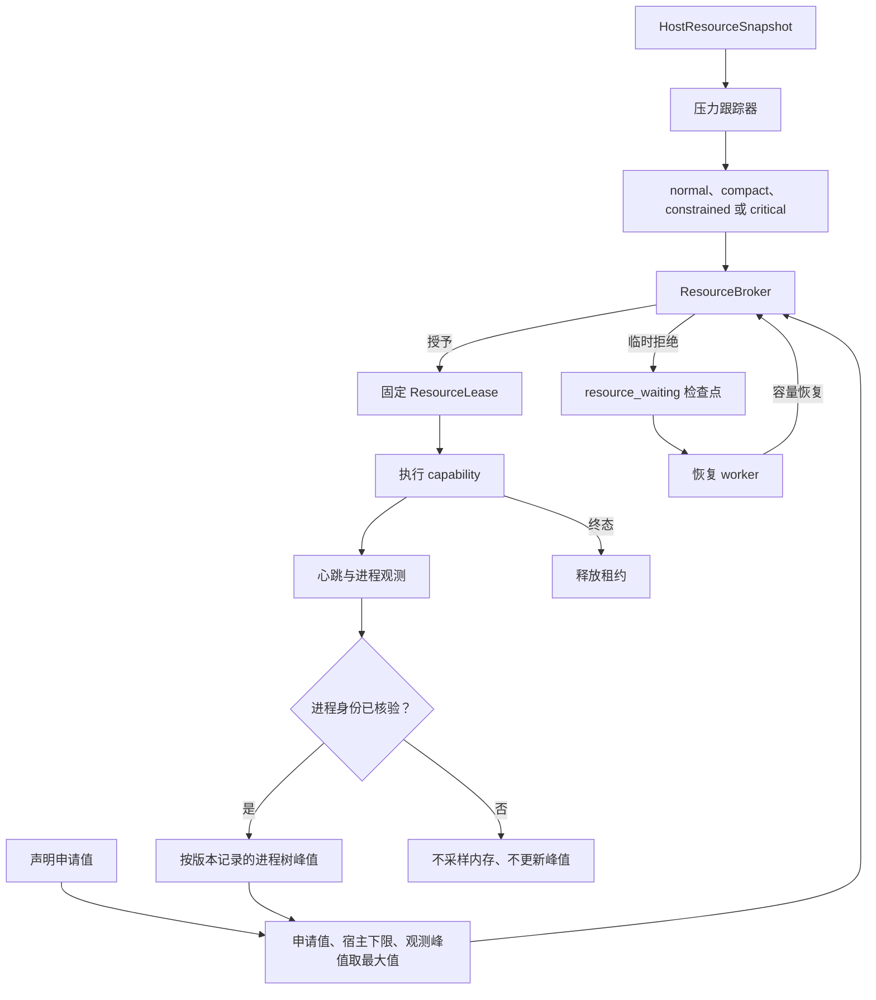

# 运行期资源准入与恢复

<!-- ai-learning-stage: safety-operations -->
<!-- ai-learning-audience: operator,developer -->

<!-- ai-learning-navigation:start -->
上一页：[AiAPP 开发手册](15-aipp-development-guide.zh-CN.md) |
[架构索引](README.md) |
下一页：[RAG 知识检索](17-rag-knowledge-retrieval.zh-CN.md)
<!-- ai-learning-navigation:end -->

运行时使用一套宿主拥有的资源策略，统一约束工具、进程型技能、浏览器、本地模型、持久任务和
模型供应商调用。资源控制只读取机器合同和当前宿主容量，不判断用户意图，也不解析用户可见文本。

## 准入流程

准入会原子预留内存、CPU、网络、供应商和浏览器 slot。持久进程只保存无敏感内容的租约元数据、
进程身份、心跳和终态标记。服务启动时核对这些记录，恢复仍存活的租约或释放已经结束的租约。
运行时不会从输出文案、技能名、可执行文件扩展名或当前包指针猜测状态。

持久任务监视器只有在本地进程观测返回 `alive_verified` 后，才会调用进程内存采样器。进程缺失、
身份不匹配或无法确认时，不生成内存样本，也不把缺失值当成零，避免用其他进程的内存抵扣当前
任务的预留量。这个采样决定不代表取消或进程退出已经完成；退出文件不能覆盖存活或未知的
进程观测，后续释放仍受独立的进程丢失观测约束。

## 显式私有目录边界

Linux 的非空私有目录策略还要求 runtime 与 SDK 启动器显式使用 `--unshare-user`，包含保留宿主
PID 视图的模式；不能使用可选的 `--unshare-user-try` 或依赖安装方式决定的隐含默认值。宿主
进程状态和公共文件查询仍可用；测试分别验证自建 peer 的 proc-root、文件描述符和内存访问
被拒绝。这个 Linux namespace 要求不改变空排除列表的启动参数或 macOS 的 namespace 处理。
这是必要的进程边界，不等于所有部署角色或宿主
密钥保管已经通过验收。

macOS 的可写路径与私有目录拒绝规则共用精确的 profile 字符串编码器，保留合法 Unicode、
引号与反斜杠的数据表示；不能精确表示的 UTF-8 或含 NUL/LF/CR 的路径在启动前返回原有的
结构化路径错误。编码不代表路径准入或权限授权；原生 Seatbelt 权限验证也不能用编码单测或
类型检查替代。

进程沙箱接收宿主明确提供的目录排除列表。Linux 在可写挂载完成后叠加只读空目录，覆盖重映射的
祖先路径别名；macOS 追加经过转义的读写拒绝规则。SDK 构建适配器、协议冒烟和已安装技能的
runner 子进程使用同一套目录准入规则。排除列表非空时，直接执行会被拒绝，不会被当作已经隔离。
普通工作区和工件的访问权限仍独立控制。

Linux 还会先固定可写中间祖先目录，再安装私有目录遮罩，避免移动父目录后，下一次调用只遮蔽
替换出来的同名路径。只读执行范围不会因此获得可写挂载。继承策略摘要同时绑定平台隔离实现和
精确目录列表；实现不匹配的声明会在子进程启动前被拒绝。

runner 的每次机器请求都必须显式携带列表；它不是技能参数、manifest 授权或环境变量配置。
非空列表复用可信父沙箱时，还要求宿主设置的策略摘要与本次请求一致。技能子进程的协议和环境
不会收到宿主列表或父边界声明。摘要用于检查一致性，不证明对特权宿主管理员的身份隔离。

同一份不持有密钥的 `HostFilesystemPolicy` 为 runner、前台与持久命令准备提供目录策略，也覆盖
PTY 的命令准备。原生 `read_file` 会逐级核对目录句柄与固定身份，受保护目录被改名后也不能读取
其中内容；已授权的工作区外公共符号链接仍独立处理。读取结果使用与打开句柄一起记录的路径，
不会再次解析后来替换出来的同名路径。
原生 `list_dir` 也使用同一策略，通过一个已打开的目录完成枚举和不跟随符号链接的相对元数据查询。
公共目录别名、失效符号链接条目、排序和分页仍受支持。受保护的父目录遍历只要求搜索权限，
列目录本身仍要求目标目录可读。已授权的工作区外文件读取使用非阻塞打开并只接收普通文件，
不会在打开 FIFO 时等待写入方。

Linux 的 PID 隔离命令在工作区及祖先目录挂载之后固定私有 `/proc` 视图；显式选择的宿主进程
可见模式独立处理。将 `/dev` 设为工作区不能覆盖私有设备根；`/dev/shm` 等明确授权的共享内存
数据工作区仍可按范围读写。这些控制本身不代表已经完成进程、描述符或文件系统别名的全部准入。

原生写入/追加、目录创建/删除、替换预览/执行、补丁、分片事务和子任务补丁合入，都显式接收
同一份文件系统策略；使用空策略的根目录便捷入口仅用于测试。原始快照、checkpoint 暂存、
备份/manifest 访问和回滚也使用受保护目录句柄；目标或 checkpoint 新增为禁止访问后，不能沿用
旧授权读取或恢复。破坏性恢复前先验证备份摘要。补丁执行前保存 prepared 清单；补偿未完成时
保留恢复证据，报告副作用未知，不删除备份或宣称没有副作用。私有路径拒绝保留独立机器错误码，不作为更换
参数重试的依据。公共追加、创建父目录选项、原子替换权限位和管理员授权的工作区外路径，仍遵守
各自操作合同及私有目录排除规则。

补丁分片的幂等请求将补丁和规范化的前置哈希绑定到事务中的固定位置。返回“已经应用”之前，
还要核对任务、检查点状态和当前文件的合成最终哈希，包括后续分片对同一路径的合法修改。
缺少请求证据、检查点已回滚、路径新被列为私有或用户修改了文件，都不能授权重放或自动覆盖。
状态查询与回滚结果使用各自的动作名。只有结构化证据确认在执行前拒绝且未产生效果时，才允许
提交修正后的后续分片；效果不明的失败及回滚失败需要先检查，不能继续写入。历史记录仍可查看和
回滚，但不能补造缺失的请求绑定。事务读取有字节上限，分片序号必须构成连续前缀，依赖错误只
展示有界的序号预览。这些规则不代表已证明并发事务、崩溃原子性或完整文件属性回滚。
仅计算哈希时，通过固定缓冲区流式读取已经准入的普通文件，不把整份文件读入内存。文件缺失由
打开路径的结果确定，后续读取失败仍是错误，不能补造成缺失或空文件；快照内容预算另行约束。

补丁和结构化文件变更的检查点清单，通过已准入的普通文件描述符读取，在 JSON 解码前限制为
2MiB 加一字节溢出检测。缺失、私有路径、特殊文件和 IO 错误与超限拒绝保持区分。超限字段使用
`max_bytes` 和 `manifest_bytes_at_least`，不把未读取内容的大小伪装成精确值。这限制元数据
缓冲区，不代表已约束慢文件系统的等待时间或所有内容备份、恢复过程的内存。

事务清单的读取和写入共用 2MiB 编码字节上限。创建执行意图和调用分片前，使用与最终发布相同的
有界 JSON 编码器核对预期成功记录。超限会在执行补丁前拒绝，不覆盖原清单；之后发生的 IO 或发布
失败仍可能是效果未知，不能因为容量预检通过就认定没有产生效果。

分片执行前，运行时先持久化不可覆盖的执行意图记录，绑定任务、事务、分片位置、请求摘要和新建的
检查点标识，原生补丁必须使用这个精确标识。即使事务清单丢失，保留的未确认记录也会阻止再次执行。
`transaction_status` 可用可选的 `shard_index` 查看单条精确记录；只有意图记录时，执行结果仍是未知，
状态查询不会创建事务目录。返回幂等成功还必须核对意图记录、当前检查点和文件状态。

协作式分片执行和事务回滚在整个同步调用期间持有同一非阻塞描述符锁，并检查所有者、权限、硬链接数
及 close-on-exec。它不授予宿主权限，不会隔离其他文件工具或阻止特权管理员替换控制存储。调用方退出
不会删除意图记录；只有当前持有者收到实际的结构化执行前拒绝、并记录该拒绝后，才能撤销自己的记录。
存在未确认尝试时，事务回滚同样拒绝操作。

补丁应用后的清单发布失败，可能发生在原子替换已经可见之后，因此运行时不会盲目回滚。它保留检查点
和意图记录，以 `transaction_commit_unconfirmed` 和规范的不可重试字段报告，供 agent 或用户先检查再
显式恢复。这不代表已完成完整 daemon/Git 后代恢复、对抗性并发隔离或断电原子性，也不会自动重放。

普通原生补丁和结构化修改在成功执行后的最终检查点清单发布失败时，同样保留工作区现场，返回
`checkpoint_commit_unconfirmed`、未知副作用、禁止自动重试和补偿，以及供只读检查的检查点引用。
未尝试清理不等于已证明备份内容完整，响应不会虚构这一证据。执行错误、执行后快照读取失败和完整
文件属性恢复仍是独立的恢复边界。

补丁检查点清单使用独立的 2MiB 元数据上限，读取端与有界流式编码端一致。执行文件修改前，
运行时会预估全部执行后文件摘要和更长的恢复失败状态；超限时返回结构化的执行前无副作用拒绝，
不会先修改文件再生成无法读取的检查点。编码超限也不会覆盖已有清单。这是序列化大小限制，
不等于预留磁盘空间、内容大小限制或 IO 超时。结构化修改的执行后状态需要独立合同，不能直接
从原生/Git 补丁文件列表推断。

结构化修改的调用方显式声明执行后是单个普通文件、空目录或目标不存在。执行前容量检查会预留执行后
条目、固定长度的修改摘要及文件大小字段的最长编码，读写端统一限制为 2MiB。成功执行后，只采集
一个条目并核对声明形态。观测无法验证、形态不符或最终清单发布失败时，保留文件现场和检查点，
返回不可自动重试的未知状态，不会自动撤回成功执行的操作；机器阶段明确区分快照采集、形态验证和
清单提交。已授权的工作区外操作仍使用明确的不可回滚合同。内容大小的执行前检查、操作自身报错后的
补偿、完整属性保真和崩溃恢复仍是独立边界，元数据能够存下并不证明这些性质。

结构化检查点在删除当前目标前，先校验完整的单目标恢复树：规范化路径不得重复或脱离父子关系，
缺失父目录的清理仅限目标的严格祖先，并沿用生成端的 4096 条目和 64MiB 总内容上限。
每个普通文件备份通过已准入的文件句柄读取，以声明长度约束读取量；全部备份的大小和摘要校验完成后，
才开始破坏性恢复。非法元数据、超大备份或损坏内容不会触发目标删除。递归采集执行前快照时，
每个子路径也使用保留路径规则：遇到嵌套的 `.git` 或运行时状态目录，必须在操作前拒绝，
不能先生成无法恢复的检查点再执行删除。普通隐藏名称仍可使用。这些检查不等于完整属性保真、
任意并发写入隔离，或写入失败及断电后的原子恢复。

在 Linux/macOS 上，结构化修改按原生 UTF-8 拼写记录路径，包括文件名中的反斜杠；目标、
子文件和缺失父目录的记录不会将它们改写为目录分隔符。无法用 JSON 路径合同表示的名称，
必须在操作执行前拒绝，不能用另一个 Unicode 名称替代。macOS 配置根目录的别名仍会映射到
可信的规范根目录。这不会重建旧记录已经丢失的原始名称，也不代表大小写或规范化别名已完全隔离。

指定检查点的补丁 diff 返回已保存的补丁，不是重新计算当前工作区差异。它只重新核对当前路径的
普通文件或缺失状态与访问准入，不读取这些文件的内容；保存的补丁沿用生成端已有的 2MiB 上限，
并核对 UTF-8 和补丁摘要。超限错误报告实际观测到的字节数下界；缺失、非法 UTF-8 和私有路径
拒绝保留各自的结构化合同。损坏或非法摘要不能产生成功结果，错误诊断也只回显有界摘要字段，
不会回显任意清单字符串。这不等于新增 Git 原文件大小上限、限制实时 Git 命令输出，或完成
全部快照、恢复内容与取消验收。

补丁快照生成端在创建备份前拒绝规范化后重复的目标。恢复端拒绝空文件清单，先整体校验目标唯一性、
按原始序号生成的备份引用和摘要格式，再读取备份或改变目标；原文件不存在时，不允许附带文件
内容的快照字段。公开回退入口在检查当前内容前也使用同一校验；补偿失败时仍保留检查点及真实
失败状态。空文件、二进制、缺失文件和创建、修改、删除后的回退仍可使用。这些结构校验不等于
可变检查点已经获得可信授权，也不代表新增 Git 内容上限、完成恢复内存预算、并发写隔离、
属性保真或断电验收。

Git 补丁命令使用选定后端、私有目录遮罩、清空后投影的白名单系统环境，以及禁止网络的策略。
这不等于已经完成取消、输出上限、阻塞配置或独立进程所有者/租约验收。持有父目录句柄可以避免
重新打开被替换的同名路径，但本身不能证明所有并发祖先移动和目录条目替换都已隔离。
非 Git 工作区通过受保护的元数据检查确认根目录不存在 Git 入口，纯原生补丁不要求进程后端。
后端不可用不会放行无沙箱 Git 命令。

启动阶段显式使用不包含权威目录的策略，等待完整宿主准入落地。仓库索引也通过同一策略
重新准入缓存路径，并保护源码、上下文、缓存和 Git 查询，明确报告排除与部分结果。原生修改验收、
其他适配器、此前已运行的进程以及权威存储初始化，仍需要完整接入和验收。因此，接口已经存在不代表
运行中的权威存储已经隔离。文件系统遮蔽也不能单独隔离继承的描述符、进程检查、私有根替换或
journal 数据库及 WAL/SHM 准入；这些仍是生产启用前的独立要求。

独立进程所有者模块还要求在接收私有输入前启用进程保护。Linux 仅对 helper 禁止转储，scope
准入只核验、不重新设置；保护丢失或调用方发生 fork 后，活动及已缓存终态的 scope 观测都会拒绝。
这不会修改主服务的调试策略，也不会关闭继承描述符、撤销此前已打开的检查句柄，或对抗特权宿主
管理员。Linux scope 准入会独立枚举真实描述符表，在启动载荷及修改 subreaper 前，拒绝非标准流中
未设置 CLOEXEC 的描述符；不会关闭或修改这些描述符。这个检查依赖直至启动时都独占的 helper
上下文，不能替换成在并发 daemon 中扫描 FD。载荷标准流仍须显式提供或设为空，不得隐式继承 helper
的控制流。

安装的可执行文件提供内部 `--process-owner` 入口，先于守护进程线程及配置初始化执行。
继承的空引导 socket 只有在进程保护就绪后，才接收私有 authority/control 描述符；载荷启动前必须
收到与持久引用绑定的提交。宿主或确认消息丢失不会释放正在运行的 scope。真实 scope 终态和实际
启动失败使用不同的认证记录，并竞争同一个不可覆盖的结果槽；启动失败既不是任务成功，也不是
无副作用证明。通过私有引导、控制通道及 authority 核验后的唯一未启动准备态，或准备好的启动
规格，在任何尝试前被消费后生成独立的未提交证据；helper 先针对已有精确引用持久化认证的未提交
结果，并核验写入者就是绑定的进程出生身份，再释放已收到的包托管。无效引导、控制通道、authority
或缺失、损坏的引用不能生成认证结果。
复制的创建者身份不能在另一个进程中发布结果；读取已有认证结果不要求原 owner 仍存活。
它不等于启动失败、scope 成功或自动重试许可。
结果存储拒绝写入时，helper 保留托管状态，以有上限的退避重试结果落盘，不重跑
载荷，也不自动修复或替换缺失、无效的 authority。
单次操作的受保护 authority 入口在核验预期 authority 代次及真实活动 owner 的出生身份后，
不可覆盖地发布任务引用。已存储的同一绑定可在 owner 退出后重新读取，冲突绑定则拒绝覆盖。
不持有主密钥的宿主只通过固定可执行文件的私有通道，在严格落盘及确认 helper 退出后接纳控制
凭据；初始化与恢复仍只返回公开指纹。发布引用不代表载荷已经执行、进程仍存活或已取得终态
证据，响应丢失也不能授权再次启动。主密钥保留在受保护 helper，不放入普通宿主状态；启动
提交继续绑定同一份持久引用。
恢复与终态查询复用同一个受保护 authority 入口，要求已有认证引用，并精确绑定预期代次、任务、
owner 出生身份和执行摘要。引用缺失或损坏会返回错误，不会新建引用或判断任务结束。恢复使用
明确不发布记录的引用读取入口，即使记录中的 owner 仍存活，也不会把首次发布当作缺失记录的兜底。
响应区分
尚无认证结果、scope 终态、启动失败及未提交，不携带控制 nonce；宿主核验固定通道、响应角色、绑定和
helper 退出结果后才接纳类型化证据。启动失败不是任务成功或无副作用重试许可。活动状态仍由
私有 owner 通道查询，不在每次普通轮询中启动会写 journal 的 helper。
宿主 owner 准备复用 authority 操作的固定可执行文件启动器。它先校验控制端点位于已准入的私有
目录内，等待精确 owner 的进程保护屏障，再发布绑定引用并传输私有引导句柄。放弃准备时先关闭
通道，再只回收自己持有的直接子进程，此时尚未传输载荷启动规格。显式交接的 child、channel 和
reference 本身不是资源预留或提交；调用者仍须在现有启动/提交协议中持续持有相应资源。
普通任务的宿主引导、私有 journal 隔离、
生产者/消费者/租约/服务接入，以及 macOS 原生 scope 支持仍是启用前的要求；独立入口本身不会
把普通任务切换到新的进程归属模型。

独立入口在载荷启动帧前接收绑定当前 job 的包版本租约帧，没有租约时也必须显式发送空帧。
非空帧携带两个可读写、普通文件、带 CLOEXEC 的句柄：版本锁和私有持久保留记录。它们属于
owner，不进入载荷 IO，也不授予权限或证明任务结束。helper 在子进程仍存活、启动 ACK 丢失
以及终态落盘重试时继续持有。
SDK 派发 guard 在回收前只关闭自己的句柄，不主动解除已经交接给其他进程的共享锁；没有交接
的普通租约仍在最后一个句柄关闭后允许回收。SDK 实际回收与真实 helper 的内核锁持有期分别
验证，普通派发到 helper 的启用仍需独立接入。

SDK 的 owner 保留机制同时使用共享版本句柄和私有持久记录，绑定具体任务、执行摘要、owner 引用
摘要及版本锁 inode。受保护 owner 通过版本化私有通道接收两个 CLOEXEC 句柄，不把它们交给载荷。
记录不会按时间自动过期：owner 死亡、版本目录丢失或元数据损坏都不能证明任务完成。GC 在持有
具体版本的独占锁后检查记录，并保留无法确认的状态。发布过程有非阻塞的初始化互斥；竞争调用必须
等到记录可用并重新完成持久化屏障，不能借用未完成的记录。准备态或已尝试启动的派发，只有
可信终态/启动失败已持久化，或未启动准备态/准备好的启动规格已消费且认证未提交结果已持久化，
才允许释放。宿主仅可释放自己独占、精确绑定且从未进入传输调用的包托管；调用传输前即解除本地
释放保护，包括随后失败或投送状态不明的调用。绑定不匹配或记录损坏不能授权释放。直接子进程在
准入截止检查前交给回收器，只为保留已准备 helper 的清理责任，不能允许过期后传输包或启动规格。
普通宿主派发、资源预留和私有宿主准入仍是启用门槛；这些包保留记录不
作为公开任务状态或授权来源。

## Runner 启动与长任务

后台 `run_cmd` 在生成进程命令前，先固定类型化沙箱调用、一次显式 OS 环境白名单快照、空控制
标准流和已打开的工作目录句柄。目录路径随后被替换时仍使用原目录；环境值和脚本参数保留原始
OS 字节，不做插值，也不隐式继承父进程密钥。现有白名单、沙箱策略和进程组行为不变。这不等于
固定了沙箱挂载/chdir 路径字符串或脚本内容，也不代表已经启用独立进程 owner。

前台、预热池和后台技能派发都把沙箱调用、最终原始 OS 环境和已打开的工作目录保留在显式启动
规格中，直到真正启动时才生成命令。宿主后端授权和任务私有临时目录仍在技能投影环境之后覆盖。
后台启动先加入自己的数据输出句柄；普通/预热启动在 spawn 时接入协议管道。外层 runner 的 cwd
路径被替换或改名不会选择新目录。沙箱挂载/chdir 字符串仍是独立的路径输入；这份规格不固定这些
路径，也不代表包版本/资源租约已经完成交接。

运行时与 SDK 共用一个保留原始 OS 字节的 `ProcessInvocation` 类型。SDK 沙箱准备返回类型化调用
及明确的后端/工作目录元数据，构建 adapter、协议冒烟和已安装技能 runner 都使用这份合同。
runner 将生成的标准命令直接转交 Tokio，不通过 getter 重建。调用和沙箱配方不实现通用
`Debug` 或 `Serialize`，以免意外暴露参数中的凭据；版本化私有交接仍可编码明确准入的字段。
这些配方不代表授权、固定的文件系统权限或独立 owner 已启用。

Runner 准入使用一个 120 秒的启动预算，覆盖请求传输，以及持久任务的租约交接。写入 JSON 行、
关闭持久任务 stdin 和等待交接共用同一截止时间，各段异步等待都可以响应任务取消。普通和复用
runner 的请求发送也有界，发送成功后才开始各自的响应等待。发送和响应等待沿用同一个只读操作
可中断策略，修改类和持久任务不会因此获得被后续指令打断的权限。中断或失败的传输不会在同一流上
重试，对应进程也不会放回复用池。I/O 失败通过共享结构化错误合同保留机器错误码、操作类型、完成
状态不明和系统错误元数据，不生成固定回复，也不宣称没有副作用。

持久任务交接成功返回的是 `accepted`，不是已经完成。后台操作没有隐式的 120 秒运行上限，保留
时间也不是执行截止时间。启动超时不证明没有发生副作用。可信进程归属、终态证据、重启恢复，以及
上文独立 helper 的启用要求仍是分别核验的边界。

实际启动函数接管准备 guard，在尝试启动进程之前就保留任务/PID/输出/执行绑定证据，而不是等待
租约交接成功后才保留。因此，在发送请求或等待租约期间丢弃派发 future，不会再删除已经尝试启动
的任务恢复目录。启动前拒绝仍可清理自己的准备目录；失败或不确定的启动尝试保留证据。这不是
取消请求、终态证明，也不是包版本或资源租约的所有权交接；这些仍需独立 owner 接入，不能根据
派发 future 的生命周期推断。

请求取消和确认完成是不同的观察结果。只要本地进程仍被观察为存活，或 PID 证据不可用，取消
轮询就保持非终态并续期，携带 `cancellation_requested` 和有界输出游标，而不是取消完成结果。
提前出现的退出文件或 `already_terminal` 字段不能在取消收尾时盖过存活或未知观察。这些检查
用于拒绝过早完成，不代表认证的进程归属，也不证明整个 scope 已停止；独立 owner 和资源租约
的启用要求仍须单独完成。

持久资源预留也不能仅因退出文件出现，就在进程仍存活或未知时释放。监控固定使用交接或恢复时
关联的 PID；PID 记录缺失或改变时保持未知，不得转而采样其他进程。恢复新预留仍要求元数据
PID 匹配且进程观察有效，即使已有退出文件也一样；未知记录不能通过恢复准入。这些检查不是
认证的进程归属、整个 scope 的完成证明，也不代表真实派发的崩溃/中断安全资源交接已经完成。

队列名额监控同样在异步调度前固定 PID 关联。任务目录消失、PID 记录缺失或改变、公共退出或
启动失败标记，都不能在匹配的进程观察仍为存活或未知时释放名额。确认存活会清除旧的丢失时间；
进程停止后的释放与有界丢失宽限期分别验证。初始 PID 缺失属于未绑定，不能自动视为启动已结束。
这只是负向观察防护，不是整个 scope 完成的认证证明、持久队列恢复，也不是调用方或运行时退出后
仍然安全的托管；这些仍须受保护 owner 的完整交接。

确认进程恢复存活后，监控会清除之前的进程丢失观察。后续再次缺失且没有退出文件时，重新开始
观察宽限期，不继承旧截止时间。未知状态保留已有预留，但不代表已经确认恢复存活。现有宽限期
只是有界的历史观察规则，不是整个进程 scope 已完成的认证证明。

受保护的宿主启动 API 会把已准入的资源租约带过包/启动传输和 Ready 阶段；发送 Commit 前，
在现有资源调度器中将预留与确切的认证 owner 和执行绑定关联。资源托管前放弃启动仍释放普通
预留；丢弃已托管或结果不明的启动通道不会释放托管资源。只有匹配的认证终态、启动失败或已持久化的未提交结果
才能结算，公共文件、PID、启动 ACK 和经过的时间均不能代替。调度器仅保存无敏感信息的绑定
摘要和资源计数，不保存控制凭据或主密钥。发送 Commit 前，受保护的授权端还会持久化不可覆盖、
使用独立认证域的资源预算记录。按确切 owner 恢复时，经私有 helper 同时读取预算和认证结果，
再幂等恢复新调度器或结算已结束的预留。已持久化的未提交结果也能结算，但不代表曾经执行或
执行成功；缺少预算的 pending 状态是错误，不能当作零额度。
受保护的启动清单通过固定指纹及请求绑定的单条私有流传输，包含明确开始、有序且不重复的待恢复
owner 记录，以及核验数量和摘要的结束帧。只有固定 helper 成功退出后，解码记录才能成为清单证明。
枚举使用新打开的目录描述符持有独占记录集锁，所有不可覆盖记录的发布共享该锁，防止扫描途中
目录变化。孤立、损坏、非规范命名或缺预算的 pending 记录均使清单失败，不能静默遗漏。已完成
记录核验后跳过；待恢复记录的传输及内存上限遇到溢出明确拒绝，不裁剪成成功清单。

启动恢复资源接口初始关闭准入，完整清单一次性应用后才开放普通资源准入。传输中断或失败时仍
保持关闭，单 owner 恢复及公共旧记录恢复不能绕过。完成恢复还要求调用方独占整个宿主的启动
准入，并已排空之前的在途观察；目录权限、结束帧或一组单 owner 证明都不能代替这些条件。
普通 daemon 接入、完整私有宿主/root/原生平台准入及真实 daemon 重启验收仍须单独通过，不能
把这一接口描述成普通任务链路已经启用。
调度器接纳认证终态后，较早的 pending 观察不能重新恢复或托管同一 owner 的资源；即使新调度器
首次看到的就是终态，也保持这一单向约束。无敏感信息的终态标记保留至该调度器生命周期结束；
安全回收标记需要普通控制器确认在途观察已排空，不能按时间直接删除。
资源及终态查询携带确切私有凭据，另一个合法授权端即使拥有相同公开 owner 信息，也不能为
原私有引用提供凭据；控制凭据不写磁盘或状态。准备态被放弃后只重试认证结果落盘；存储拒绝时
仍保留包托管，落盘前崩溃则保持未知，不能用 helper 退出或超时推断终态。准入前的全量启动扫描、
普通 runner/队列启用、私有宿主准入和原生平台验收仍须分别完成。受保护启动 API 在传输包/启动
规格及等待 Ready 前，把确切的直接 Child 交给固定宿主的回收器。每个宿主只使用一个空闲时阻塞
等待的线程，独立于调用方 future、返回的观察句柄和 Tokio runtime 持有真实 Child；不接管公共
PID、不发送进程组信号、不安装全局子进程回收器。内核持有关系丢失时保持未知，不伪造退出；
回收直接子进程不是整个 scope 的认证终态，也不能据此释放资源或包托管。准备阶段的准入截止
时间贯穿 Ready/Commit，但不会变成已接收任务的运行期限。

Ready 还会返回唯一的调用方生命周期 guard，由等待结果的调用方持有，不能随阻塞操作一起移动。
阻塞提交在保存资源前检查 guard，并在保存后以原子方式争取提交栅栏。调用方先于栅栏被放弃时，
拒绝发送 Commit；owner 仍须持久化认证未提交结果才能结束对应托管。越过栅栏后，调用方消失
不能撤销可能已经开始的操作或释放资源。guard 本身不是完成证明、授权或重放许可；普通异步
生产者/队列持有关系及启动恢复仍需单独接入；受保护 API 的回收器不代表普通路径已经启用。

## 资源档位

| 档位 | 运行行为 |
| --- | --- |
| `normal` | 在保留安全余量的前提下使用配置的并发上限。 |
| `compact` | 重型后台工作串行，保留有界的前台容量。 |
| `constrained` | 重型技能、浏览器和本地模型串行，空闲进程池缩到最小。 |
| `critical` | 暂停新重型工作，回收空闲进程，为可恢复任务写检查点；取消和状态查询等轻量控制仍可用。 |

档位由有效内存上限、可用内存、cgroup 事件和压力指标共同决定，并带有升级/恢复滞回。设备品牌、
主机名和 CPU 架构不参与策略。平台不支持的指标明确保持 unavailable，并启用保守默认值。

## 等待与恢复

容量暂时不足时，运行时记录有界机器检查点，其中包含原因、资源申请、尝试次数、下次恢复时间和
固定执行绑定。连续拒绝采用封顶退避。任务仍可取消和修正，已经成功的副作用不会重放；容量恢复后，
恢复 worker 继续同一个任务。

UI、CLI 和通信端从生命周期机器字段展示等待状态，不会把中英文错误句子反向解析成控制状态。
普通状态接口和诊断导出不包含原始 cgroup 路径、PID、请求正文、凭据或私有工件。

## 管理员覆盖

`configs/config.toml` 的可选 `[runtime_resources]` 是唯一阈值覆盖入口。可配置安全余量、可用内存比例、
PSI 阈值以及升级/恢复采样数。非法或非单调值会阻止启动。覆盖值可以在宿主安全边界内收紧或放宽
容量，但不能绕过权限、确认、沙箱、收据固定或任务幂等合同。

## 验收范围

验收边界包括：

- 宿主、cgroup、macOS 指标解析，OOM 事件升级和压力滞回；
- 内存、CPU、网络、供应商和浏览器原子租约；
- panic、取消、超时、浏览器进程丢失和守护进程重启恢复；
- 1 GiB、1.5 GiB、2 GiB、4 GiB 隔离压力测试，无 OOM、无重复副作用；
- 本地 Linux、树莓派 aarch64 和 macOS 进程树探针；
- 文件、网页、浏览器、后台恢复、通信端收据、媒体和本地模型链路；
- 覆盖固定内置能力的自然语言测试，且不增加短语特判。

进程树证据使用 `scripts/runtime_memory_probe.py`；存储和分配器实测见
`docs/architecture/runtime_memory_profile.md`。Linux 报告必须在相同工作负载下比较 PSS 与 SwapPss
之和，只看 RSS 会把换出的历史内存误当作优化。

## 回滚边界

阈值导致过度等待时，只需把 `[runtime_resources]` 恢复为自动策略或上一组已验证值。执行行为发生
回归时，应整体回滚运行时包，保持核心、runner、registry 合同和 UI 版本一致。不得通过关闭鉴权、
verifier、持久 journal 或技能收据验证来绕过资源压力。
