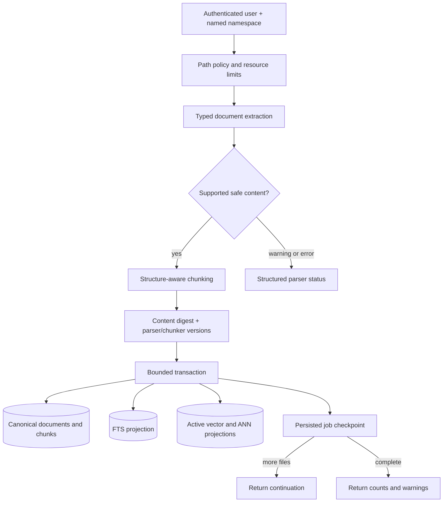
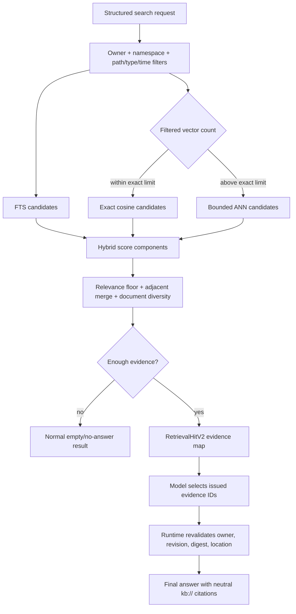
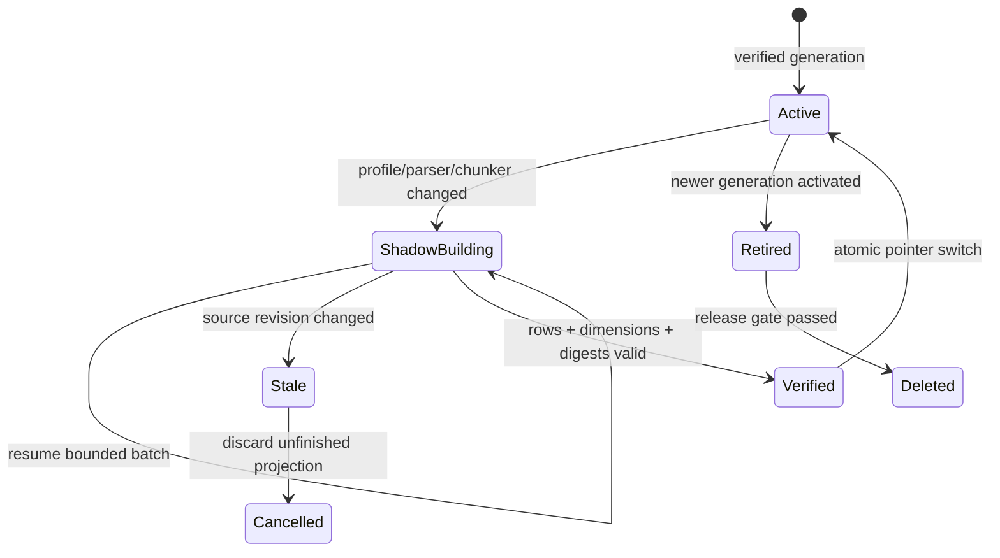

# RAG Knowledge Retrieval

<!-- ai-learning-stage: context-memory -->
<!-- ai-learning-audience: beginner,operator,developer -->

<!-- ai-learning-navigation:start -->
Previous: [Runtime resource admission and recovery](16-runtime-resource-recovery.md) |
[Architecture index](README.md)
<!-- ai-learning-navigation:end -->

The knowledge-base path turns user-managed documents into bounded, attributable evidence. The
agent loop decides whether a request needs knowledge retrieval. The runtime resolves that decision
through registry capabilities and treats every retrieved document as untrusted data, never as an
instruction or permission source.

## What Users Can Do

Users can ask the agent to add files to a named knowledge base, inspect available libraries and
their documents, search one library, update or remove documents, rebuild an index, and inspect or
resume long-running ingestion. These are ordinary `kb.*` capabilities, so the same actions work
from the browser Agent page, CLI, and bound communication channels. A user does not need to edit
the database or know its path.

Long operations are sliced into durable jobs. The user may leave the page while work continues,
then ask for status, resume the returned continuation, or cancel future batches. Already committed
documents remain searchable after cancellation.

## Ingestion and Storage

The canonical database belongs to the `kb` skill and is normally stored at
`data/skills/kb/state.db`. It is separate from the main runtime database and is scoped first by
authenticated `user_key`, then namespace. Runtime callers receive a skill-owned storage descriptor;
they do not receive or invent a general database path.

Supported extraction covers UTF-8 text and Markdown, JSON/JSONL, CSV/TSV, visible HTML, PDF text
layers, and DOCX/XLSX/PPTX structure. The extractors do not execute macros, scripts, embedded
objects, or remote resources. ZIP members, expansion ratio, pages, rows, cells, characters, file
count, bytes, chunks, traversal depth, and execution time are bounded. Scanned PDFs without a text
layer need an explicitly selected OCR capability.

Chunks retain useful source locations such as line range, section path, page, sheet, or slide.
Content SHA-256 plus parser and chunker versions define identity; modification time and file size
alone never prove that a document is unchanged.

## Retrieval and Citation

Filters are applied before limits. Search never fills an empty result with arbitrary recent or
first-document chunks. It combines lexical and current-generation vector evidence, reports score
components, merges only bounded adjacent chunks, and keeps document diversity. Exact scoring has a
hard corpus limit; larger filtered sets use a disposable ANN projection followed by bounded exact
reranking.

Every hit uses the `RetrievalHitV2` contract. Its `instruction_authority` is always `none`, source
references are neutral, and absolute paths or owner keys are not exposed to the model. The runtime
creates evidence IDs from source identity, document digest, and namespace revision. The model may
choose only those IDs; it cannot mint a citation. Immediately before final delivery, the runtime
checks ownership, revision, digest, and relative location again.

## Profile and Generation Recovery

The built-in offline embedding profile is `local-hash-v3`. It provides deterministic Unicode token
projection and same-token similarity; it does not claim general cross-language semantic matching.
A profile, parser, or chunker change cannot mix old and new vectors. A resumable shadow generation
is built in bounded batches, verified, and then activated by one pointer update. The old generation
is retained only through the rollback gate and is later physically deleted.

If vectors or ANN rows are missing or stale, search stays read-only and reports a structured
maintenance action. The agent loop may then explicitly start or resume reindexing. Search never
silently launches a write or performs an unbounded full-vector scan.

## Privacy and Safety

- Document text is evidence data only; it cannot grant tools, change sandbox/network policy,
  approve side effects, alter task state, or override the current user request.
- Ownership checks apply to namespace, document, chunks, jobs, generations, AiPP reads, artifacts,
  deletion, and account-key rebinding.
- Retrieval traces retain query digests, counts, timing, source references, scores, reasons, profile,
  generation, and degradation state. They do not retain raw query text, document bodies, secrets,
  owner keys, or absolute paths.
- Teaching mode shows a collapsed source summary. Raw machine trace fields are separately collapsed;
  it does not copy document bodies into browser storage.
- Remote embedding is opt-in, deadline bounded, circuit protected, and blocked for sensitive queries.
  The built-in profile needs no network or third-party key.

## Limits, Backup, and Recovery

Standard ingestion defaults to 500 files, 64 MiB source bytes, 10,000 produced chunks, and a
20-second cooperative slice. Constrained hosts default to 64 files, 16 MiB, 2,048 chunks, an
8-row vector batch, and a 10-second slice. Valid explicit values may override defaults within hard
limits. Persistent owner quotas cover namespaces, documents, chunks, vectors, database bytes, and
concurrent writers.

For backup, stop writers or use a consistent SQLite backup of the complete skill database, including
WAL state when required. After restore, run an integrity check, inspect namespace/job/generation
status, and resume interrupted jobs from their recorded cursor. Document and namespace removal is
transactional and removes corresponding canonical rows and projections. Disabling or uninstalling
the skill preserves private data by default; explicit deletion affects only the skill-owned store.

When diagnosing a problem, inspect in this order:

1. namespace and document status;
2. ingest job state, continuation, warnings, and resource limits;
3. active embedding profile and generation status;
4. structured search degradation and no-answer fields;
5. retrieval trace counts/timing without opening document bodies;
6. SQLite integrity, WAL checkpoint state, quota, and available disk space.

The deterministic release benchmark covers multilingual/token-boundary cases, typed PDF and Office
locations, filter-before-limit, no-answer, injection content, citation validity, tenant isolation,
update/reindex/delete lifecycle, 10k/100k scale, latency, RSS, and database growth.
