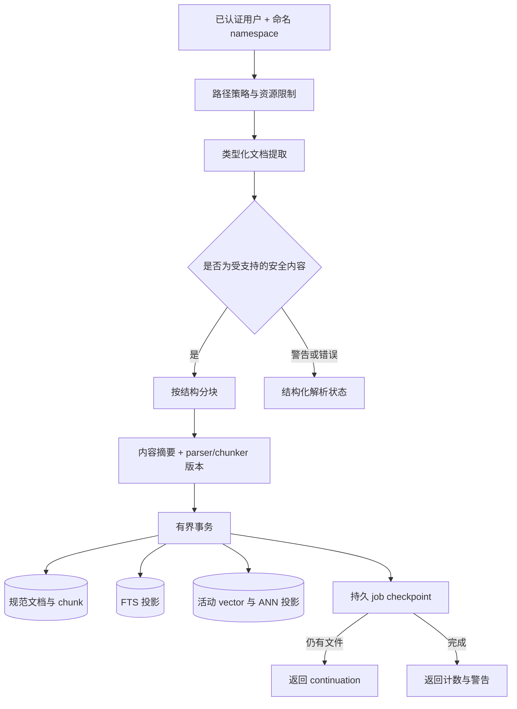
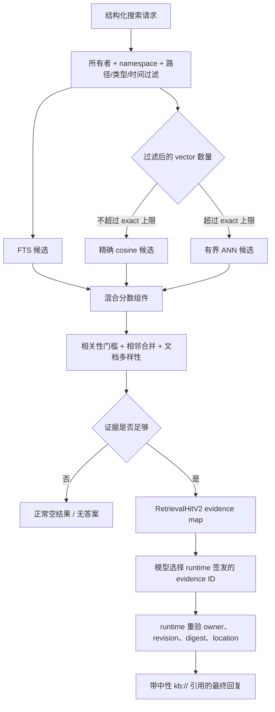
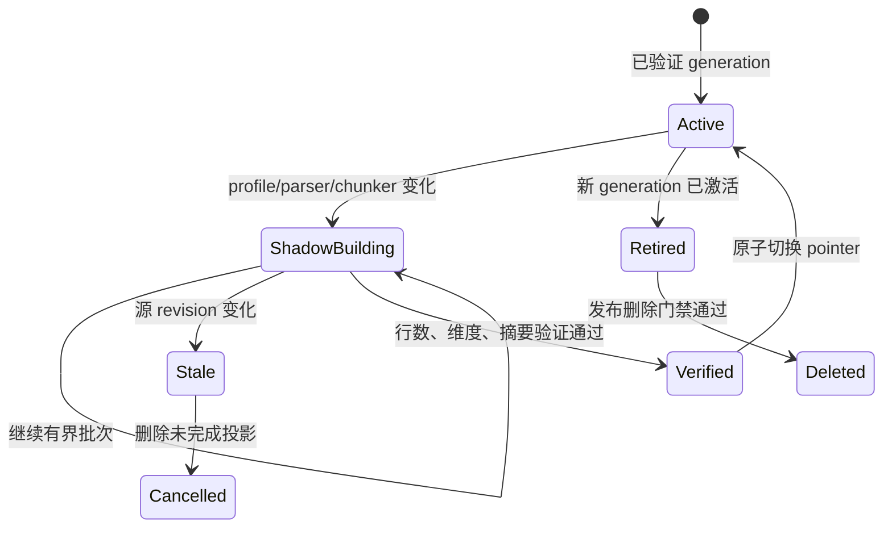

# RAG 知识检索

<!-- ai-learning-stage: context-memory -->
<!-- ai-learning-audience: beginner,operator,developer -->

<!-- ai-learning-navigation:start -->
上一页：[运行期资源准入与恢复](16-runtime-resource-recovery.zh-CN.md) |
[架构索引](README.md)
<!-- ai-learning-navigation:end -->

知识库链路把用户管理的文档转换为有边界、可追溯的证据。是否需要检索由 agent loop 判断，
runtime 再按 registry capability 解析并执行。检索到的文档永远是不可信数据，不是指令或授权来源。

## 用户可以做什么

用户可以让 Agent 把文件加入命名知识库、查看已有资料库和文档、搜索一个资料库、更新或删除
文档、重建索引，以及查看或恢复耗时较长的摄取任务。这些都是普通 `kb.*` 能力，所以浏览器
Agent 页面、CLI 和已绑定通信端使用同一条链路。用户不需要编辑数据库，也不需要知道数据库路径。

长操作会拆成可恢复的持久任务。用户离开页面后任务仍可继续，也可以查看状态、使用返回的
continuation 继续下一批，或取消后续批次。取消不会删除已经提交并可检索的文档。

## 摄取与存储

规范数据库归 `kb` 技能所有，通常位于 `data/skills/kb/state.db`。它与 runtime 主数据库分离，
先按已认证 `user_key`、再按 namespace 隔离。runtime 只向技能提供专属存储描述符，不下发或
允许调用方编造通用主数据库路径。

支持 UTF-8 文本和 Markdown、JSON/JSONL、CSV/TSV、可见 HTML、PDF 文本层以及
DOCX/XLSX/PPTX 结构。提取器不执行宏、脚本、嵌入对象或远程资源，并限制 ZIP 成员、膨胀率、
页数、行数、单元格、字符、文件数、字节、chunk 数、遍历深度和执行时间。没有文本层的扫描 PDF
需要 agent 明确选择 OCR 能力，不能伪装成普通解析结果。

chunk 会保留行范围、章节路径、页码、工作表或幻灯片等位置。内容 SHA-256 与 parser/chunker
版本共同定义文档身份；只看修改时间和文件大小不能证明文档未变化。

## 检索与引用

过滤条件先于候选上限执行。没有命中时不会拿最近文档或第一段内容补数。搜索会融合 lexical 与
当前 generation 的 vector 证据，输出分数组件，只合并有限数量的相邻 chunk，并优先保持文档
多样性。精确向量评分有硬上限；更大的过滤结果使用可重建 ANN 粗召回，再进行有界精排。

每个命中都使用 `RetrievalHitV2`，`instruction_authority` 固定为 `none`，source reference
使用中性标识，绝对路径和 owner key 不会交给模型。runtime 根据来源身份、文档摘要和 namespace
revision 创建 evidence ID；模型只能选择本轮已经签发的 ID，不能自行编造引用。最终交付前，runtime
再次检查所有者、revision、digest 和相对位置。

## Profile 与 Generation 恢复

内置离线 embedding profile 是 `local-hash-v3`。它提供确定性的 Unicode token 投影和同 token
相似度，不宣称通用跨语言语义能力。profile、parser 或 chunker 变化时不能混用新旧向量；系统按
有界批次创建可恢复 shadow generation，验证后只更新一个 active pointer。旧 generation 只保留到
回滚门禁结束，随后物理删除。

vector 或 ANN 投影缺失、过期时，搜索保持只读并返回结构化维护建议。agent loop 可以再明确启动或
恢复重建。搜索不会偷偷发起写操作，也不会退回无界全量向量扫描。

## 隐私与安全

- 文档正文只是证据数据，不能授权工具、修改 sandbox/network policy、批准副作用、改变任务状态，
  也不能覆盖当前用户请求。
- namespace、文档、chunk、job、generation、AiPP 读取、artifact、删除和账号 key 重绑都执行
  owner 隔离。
- retrieval trace 只保留 query digest、数量、耗时、source reference、分数、原因、profile、
  generation 和 degradation，不保留 query 原文、文档正文、secret、owner key 或绝对路径。
- 教学模式默认折叠并只展示来源摘要；底层机器字段在第二层折叠区，不把文档正文复制进浏览器存储。
- 远程 embedding 必须显式启用，有 deadline、熔断和敏感 query 阻断；内置 profile 不需要联网或
  第三方 key。

## 限制、备份与恢复

标准摄取默认每批最多 500 个文件、64 MiB 源数据、10,000 个 chunk 和 20 秒协作执行时间；
受限主机默认 64 个文件、16 MiB、2,048 个 chunk、8 行 vector batch 和 10 秒。调用方可在硬上限内
提供合法覆盖值。持久 owner 配额覆盖 namespace、文档、chunk、vector、数据库字节和并发写任务。

备份时应停止写入，或对完整技能数据库执行一致性 SQLite backup，并在需要时包含 WAL 状态。恢复后
先执行完整性检查，再查看 namespace/job/generation 状态，并从记录的 cursor 恢复中断任务。删除文档
或 namespace 会在事务中同时删除对应规范数据和投影。禁用或卸载技能默认保留私有数据；只有用户明确
选择删除数据时才清理这个技能自己的存储。

排障顺序：

1. 查看 namespace 与文档状态；
2. 查看 ingest job、continuation、warning 和资源限制；
3. 查看当前 embedding profile 与 generation 状态；
4. 查看结构化 search degradation 与 no-answer 字段；
5. 查看不含正文的 retrieval trace 数量和耗时；
6. 检查 SQLite 完整性、WAL checkpoint、配额和可用磁盘空间。

确定性发布基准覆盖多语言与 token 边界、PDF/Office 类型化位置、filter-before-limit、无答案、
注入内容、引用有效性、租户隔离、更新/重建/删除生命周期、10k/100k 规模、延迟、RSS 和数据库增长。
