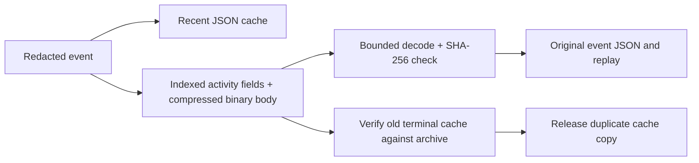

# Task-event storage

The archive is the durable replay source. Its sequence numbers, event hashes, previous hashes,
snapshot ranges and original redacted JSON remain logically unchanged. Storage compression does
not summarize events or change the public HTTP/SSE/CLI format.

`task_event_archive` and `task_event_artifacts` have host-owned `storage_version` and nullable
`storage_blob` columns. Version 0 is legacy JSON, 1 is inspected/plain JSON, and 2 stores a small
JSON projection plus an `EVJ1` binary body: projection flag, original byte length, SHA-256 and zlib
bytes. Indexed `event_kind`, `payload.skill` and `payload.requested_action_ref` values stay queryable.
Readers enforce the 16 MiB decoded limit, exact length, checksum, compression boundary and projection
consistency. Unknown versions and corruption fail visibly. A user-supplied JSON marker is never
treated as a storage encoding.

Bodies from 512 bytes through 16 MiB are compressed only when storage savings exceed the overhead
and threshold. Larger existing bodies remain intact as plain JSON. Artifact IDs and `payload_bytes`
describe original content. Archive snapshots remain intact and use original event hashes.

The maintenance tick inspects at most 128 legacy rows per dataset, marks committed rows durably,
and can resume after interruption. It releases at most 128 cache rows older than 24 hours, only
for terminal tasks with an identical archived hash and verified logical event content. Active or
waiting tasks and missing/mismatched archive copies retain their cache. Replay, progress reads,
deduplication and sequence allocation continue to work after the entire old cache is released.

## Offline compaction

Use the exact CI-built `task-event-maintenance` binary paired with the deployed runtime. Prepare a
maintenance window, stop runtime writers, checkpoint WAL successfully, and save a recoverable
database backup before modifying historical data. Preserve the matching old runtime binary.

1. `verify --database PATH` records ordered logical fingerprints for archive, artifacts, snapshots,
   tasks, memories, preferences and authentication records. It opens the database read-only.
2. `prepare --database PATH` upgrades storage columns and the legacy-row indexes idempotently.
3. `pack --database PATH` verifies every encoding round trip before committing bounded batches.
4. `prune --database PATH --before-ms TIMESTAMP` verifies and releases eligible duplicate cache.
5. Repeat `verify`; all recorded logical fingerprints must match. Cache removal is intentional;
   the archive retains the complete evidence.
6. With enough free space, `vacuum --database PATH --output NEW_PATH` creates a compact database.
   Existing outputs are refused. Verify its fingerprints and SQLite integrity before swapping it
   into place with all writers stopped and no outstanding WAL.

SQLite free pages are not returned to the filesystem by compression alone. VACUUM INTO needs space
for the compact output. Keep the backup through post-deployment replay, history, authentication and
task execution checks. A rollback to a runtime without this codec must restore its paired database
backup; replacing only the executable cannot decode version 2 records.

## Terminal result snapshots

Large `task_lifecycle.resume_executor_result_projection.final_result_json` objects (at least 16 KiB)
are verified and stored as immutable compressed task-event artifacts when the existing codec saves
space. The terminal row keeps `final_result_ref` with schema version, artifact ID, original length and
SHA-256; top-level replies, journals and checkpoint payloads remain intact. The reference is scoped
to the same task and resolves through the authenticated
`GET /v1/tasks/{task_id}/events/artifacts/{artifact_id}` contract. Snapshot publication and the result
row update commit in the same SQLite transaction. A corrupt existing object cannot replace inline
evidence. Existing running tasks are not rewritten by historical backfill.

The supervised maintenance tick and administrator storage action process bounded, resumable batches
of at most 64 result rows, verifying exact content before replacing an inline duplicate. The cursor
and cumulative logical savings are transactional. After reaching the end, a later sweep checks again
for tasks that completed through another writer. Normal artifact retention and delivery acknowledgment
rules remain authoritative; compression does not change them. Rolling back to a runtime that cannot
read these references requires the paired pre-upgrade database backup.
## Cold journal fields

Completed root `ask` tasks may archive only `task_journal.trace.rounds` and
`task_journal.trace.event_stream`. Checkpoints, step evidence, budgets, lifecycle,
summaries and final replies stay inline. Recent, active, failed and child tasks
are excluded. Immutable payloads are bound to their owning task, length and SHA-256;
invalid, missing, conflicting or corrupted references fail closed.

Task queries and teaching/debug queries restore the original JSON fields before
projection. History lists continue to avoid loading results. Deleting a task also
deletes its private journal payload. Automatic maintenance stays disabled until
an explicit `task-event-maintenance pack-journals --database <path> --before-ms <cutoff>`
operation enrolls the database. Backfill is transactional, resumable, capped at
64 row IDs and approximately 250 ms per batch, with bounded input/decompression.

Maintenance `verify` now emits `fingerprint_version=2`: task result JSON is compared
as canonical, fully restored JSON. Event/archive payloads and other columns keep
their existing byte/hash rules. Verify before and after maintenance, with a tested
backup and a stopped/fenced runtime. A rollback to an older host requires its
matching pre-migration database checkpoint, rather than a binary-only rollback.
