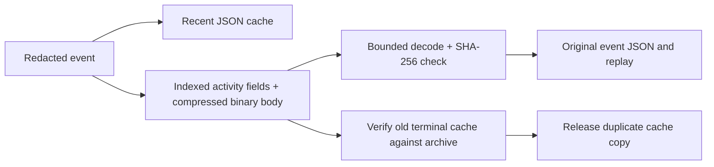

# Task-event storage

The archive is the durable replay source. Its sequence numbers, event hashes, previous hashes,
snapshot ranges and original redacted JSON remain logically unchanged. Storage compression does
not summarize events or change the public HTTP/SSE/CLI format.

`task_event_archive` and `task_event_artifacts` have host-owned `storage_version` and nullable
`storage_blob` columns. Version 0 is legacy JSON, 1 is inspected/plain JSON, and 2 stores a small
JSON projection plus an `EVJ1` binary body: projection flag, original byte length, SHA-256 and zlib
bytes. Indexed `event_kind`, `payload.skill` and `payload.requested_action_ref` values stay queryable.
Readers enforce the 16 MiB decoded limit, exact length, checksum, compression boundary and projection
consistency. Unknown versions and corruption fail visibly. A user-supplied JSON marker is never
treated as a storage encoding.

Bodies from 512 bytes through 16 MiB are compressed only when storage savings exceed the overhead
and threshold. Larger existing bodies remain intact as plain JSON. Artifact IDs and `payload_bytes`
describe original content. Archive snapshots remain intact and use original event hashes.

The maintenance tick inspects at most 128 legacy rows per dataset, marks committed rows durably,
and can resume after interruption. It releases at most 128 cache rows older than 24 hours, only
for terminal tasks with an identical archived hash and verified logical event content. Active or
waiting tasks and missing/mismatched archive copies retain their cache. Replay, progress reads,
deduplication and sequence allocation continue to work after the entire old cache is released.

## Offline compaction

Use the exact CI-built `task-event-maintenance` binary paired with the deployed runtime. Prepare a
maintenance window, stop runtime writers, checkpoint WAL successfully, and save a recoverable
database backup before modifying historical data. Preserve the matching old runtime binary.

1. `verify --database PATH` records ordered logical fingerprints for archive, artifacts, snapshots,
   tasks, memories, preferences and authentication records. It opens the database read-only.
2. `prepare --database PATH` upgrades storage columns and the legacy-row indexes idempotently.
3. `pack --database PATH` verifies every encoding round trip before committing bounded batches.
4. `prune --database PATH --before-ms TIMESTAMP` verifies and releases eligible duplicate cache.
5. Repeat `verify`; all recorded logical fingerprints must match. Cache removal is intentional;
   the archive retains the complete evidence.
6. With enough free space, `vacuum --database PATH --output NEW_PATH` creates a compact database.
   Existing outputs are refused. Verify its fingerprints and SQLite integrity before swapping it
   into place with all writers stopped and no outstanding WAL.

SQLite free pages are not returned to the filesystem by compression alone. VACUUM INTO needs space
for the compact output. Keep the backup through post-deployment replay, history, authentication and
task execution checks. A rollback to a runtime without this codec must restore its paired database
backup; replacing only the executable cannot decode version 2 records.
