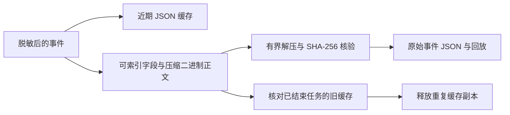

# 任务事件存储

归档是持久化回放源。事件序号、事件哈希、前序哈希、快照范围和原始脱敏 JSON 的逻辑内容保持
一致。存储压缩不概括事件，不改变 HTTP、SSE 和 CLI 返回格式。

`task_event_archive` 与 `task_event_artifacts` 增加宿主管理的 `storage_version` 和可空
`storage_blob` 列。0 表示旧 JSON，1 表示已检查的原文，2 表示少量 JSON 查询字段与 `EVJ1`
二进制正文，正文包含投影标志、原始字节数、SHA-256 和 zlib 压缩数据。技能活动索引所需的
`event_kind`、`payload.skill`、`payload.requested_action_ref` 继续可查询。

读取会检查 16 MiB 解压上限、精确长度、摘要、压缩流边界与查询字段一致性。未知版本或损坏会
明确报错；用户正文中的自定义 JSON 标记不会被当作存储协议。

512 字节至 16 MiB 的正文只在节省足够空间时压缩；更大的历史正文按原文保留。产物 ID 与
`payload_bytes` 仍对应原始内容。归档快照保留，继续使用原始事件哈希。

每轮后台维护对每种数据最多检查 128 条旧记录，提交后的版本列作为可恢复进度。每轮最多释放
128 条超过 24 小时的重复缓存，要求任务已结束、归档哈希相同且逻辑内容核验一致。运行中、
等待中、缺少归档或内容不一致的记录保留缓存。旧缓存全部释放后，回放、进度读取、去重和
事件序号追加仍继续工作。

## 离线瘦身

使用与部署版本匹配的 CI 产物 `task-event-maintenance`。安排维护窗口，停止运行时写入，确认
WAL checkpoint 成功，先保存可恢复的数据库备份与对应旧程序，再处理历史数据。

1. `verify --database PATH` 只读计算归档、事件产物、快照、任务、记忆、偏好和认证记录的有序
   逻辑摘要，作为处理前基线。
2. `prepare --database PATH` 幂等升级存储列和待处理索引。
3. `pack --database PATH` 逐条验证压缩往返一致，再分批提交；中断后可继续。
4. `prune --database PATH --before-ms TIMESTAMP` 核验并释放符合条件的重复缓存。
5. 再运行 `verify`，基线中的逻辑摘要必须全部一致。缓存减少是预期行为，完整证据保留在归档。
6. 空间足够时，用 `vacuum --database PATH --output NEW_PATH` 生成紧凑数据库；已有目标文件
   会被拒绝。核对新库的逻辑摘要和 SQLite 完整性后，在写入停止且 WAL 已清空时替换。

压缩产生的 SQLite 空闲页不会自动归还给文件系统；VACUUM INTO 需要足够空间保存紧凑副本。
部署后验证回放、技能历史、认证与任务执行，再按备份策略保留恢复副本。回滚到不支持本编码的
旧程序时，须同时恢复配套数据库备份；只替换程序无法读取版本 2 正文。
