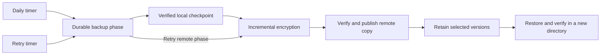

# Runtime operations protection

The host samples system, workspace, temporary, runtime-database and audit-database filesystems every 15 seconds. SQLite memory databases do not require a disk probe. Disk status is additive telemetry at authenticated `GET /v1/health` (`storage_pressure`), and the console displays a localized warning.

Warning reserve is the larger of 2 GiB or 3% of filesystem capacity. Critical reserve is the larger of 512 MiB or 1%. At critical or unavailable status, dispatch rechecks storage before starting capabilities whose approved action metadata permits filesystem writes (or does not establish read-only behavior). This check precedes execution isolation and artifact creation. Read-only capabilities, status, cancellation and recovery remain available; existing executions are not replayed. Background memory and embedding claims pause until storage admits writes. This reserve protects control-plane writes; it is not a per-file quota or a promise to abort an already running download.

Foreground execution, stale recovery, cleanup, scheduler, both message outboxes, memory generation and embedding workers use the same owned-future supervisor. Panics and lost progress trigger cancellation followed by a bounded restart delay. Successfully renewed memory/embedding leases preserve long executions. Started blocking ticks retain a guard until actual completion, so cancelling a waiter cannot overlap a replacement with a still-running database operation. Per-worker telemetry is under `worker_supervision.background_workers`.

Memory startup reconciliation preserves the source task's model selection when reconstructing an unbound task. Pinned model selection uses the catalog/vendor identity, while wire protocol remains a separate snapshot field. Recovery validates the reconstructed binding before queueing. It never stamps an empty override or selects the latest unrelated chat rows; historical recovery requires exact input and the canonical saved reply, with an unambiguous, owner-matched source pair. Unavailable model snapshots are not enqueued. Preflight failures are terminal immediately; transient provider/database failures alone use the bounded retry budget. `memory_jobs.error_code`, `retryable`, and `checkpoint_json.failure` retain machine classification, message key, phase and optional provider failure class. Provider responses, credentials and prompts are excluded. Extraction failures are no longer reported as successful jobs.

Recovered successful agent-loop ask turns commit their terminal result, canonical memory sources and generation outbox in one SQLite transaction. A lost completion claim writes no memory; a storage failure rolls the completion back for projection retry without replaying task actions. Current memory consent and quota still apply. The host dispatch envelope carries `answer_is_llm_reply` from the actual reply object; local or unattested results are never relabelled as model replies. Persistence performs no model request. Failed, cancelled and non-ask tasks do not enter this success path. Tool-poll and checkpoint-finalize projections retain their existing behavior and do not enqueue another turn for a previously published reply.

Authenticated `GET /v1/memory/jobs` returns the caller's latest 100 job snapshots, including errors. Explicit `POST /v1/memory/jobs/retry-unavailable` repairs at most 100 failed jobs belonging to that principal and matching the legacy `unavailable` model binding with zero progress, including audited legacy retries that failed at model binding before execution. It validates the authentic source task, current consent/revision/digest, principal ownership, source evidence and digests, quota and configured model before requeueing. It retains a `legacy_repair` audit checkpoint. Cancelled, progressed, differently pinned, cross-principal and revoked jobs are not replayed. No model is called during repair preflight. Settings failures remain diagnosed and blocked.

Detached launchers preserve the previous log before starting a daemon and then append to the new log. Each prior run is gzip-compressed, byte-verified and retained as `<component>.log.previous.<timestamp>.<pid>.log.gz`, with the newest 20 prior runs retained per component. Compression failure retains the uncompressed prior run and fails startup rather than truncating evidence. Never invoke the rotation helper against a live writer. Model I/O continues to use its existing daily rotation policy.

Validation runs through exact-SHA candidate workflows including `runtime-operations-ci.yml` on Linux and macOS, plus ARM64 cross compilation. Tests cover typed permanent/transient errors, model reconstruction, stale lease fencing, principal boundaries, stalled blocking work, disk thresholds, restart recovery and lossless log rotation including disk-write failure.

## Verified control-plane checkpoints

`python3 scripts/runtime_checkpoint.py create --root ROOT --destination BACKUP_ROOT`
creates an owner-private checkpoint on a different filesystem. It checks that foreground
and distributed work are idle and briefly stops the selected runtime service. After a
successful truncating WAL checkpoint it establishes an actual SQLite read transaction at
end-mark zero and requires the WAL to remain empty during pinning. This read fence prevents
writes to the main database file while allowing later runtime commits to append to WAL.
Non-WAL stores are compressed under their read fences before service recovery; WAL stores
are validated and compressed after the runtime is back online. Main-file identity, size
and timestamps are checked around compression; original SHA-256 and archive/member digests
are verified before publication. Reader fences are released as soon as each database is
packed. A source-space guard and bounded read-fence duration prevent unlimited WAL retention.
`--read-fence-seconds` sets a 1..3600 second limit, defaulting to 1800 seconds so multi-gigabyte
databases have time to compress on slower machines. The disk-space guard still aborts immediately
under pressure; an expired time budget closes readers, retains older checkpoints and recovers
the service. This limit does not delay service recovery while compression continues online.

Only control files need temporary copies, not the full database. Temporary space is
actually reserved before stopping a service, catching per-user quotas that statvfs cannot
see; tmpfs also requires RAM headroom. A private resume marker, SIGTERM cleanup and the
systemd timer's ExecStopPost recovery restart the service after an interrupted freeze.
An active task, unavailable service controller or insufficient destination space blocks the
operation. Older checkpoints are retired only after a complete new checkpoint is verified.
No build is performed. The default retention is one checkpoint; choose a larger value only
when the destination can accommodate the extra verified copy plus the next staging peak.

The scope includes runtime/audit and skill SQLite databases, configuration, local broker
credentials, runtime binaries, UI, admission generations and installed-package pointers.
This is a **control-plane checkpoint**, not a full machine backup. Keep task attachment
files, models, immutable installed package payloads and external connector storage
separately. The manifest lists these exclusions. A restored runtime requires the exact
matching installed packages and their receipts; never mix old programs with a newer database.

`verify --checkpoint PATH` rechecks every archive/member and original database digest.
`restore --checkpoint PATH --output NEW_DIRECTORY` refuses existing output, rejects
links/path escapes, verifies each restored digest and runs SQLite quick checks. It does
not replace or activate the live runtime. Retain the currently working installation until
the restored configuration, package receipts, authentication and a real task are verified.

`install_runtime_checkpoint_timer.py --root ROOT --destination BACKUP_ROOT --install`
installs a daily systemd timer on Linux; it uses the current operator account and the
existing non-interactive service-control permissions. Preview without `--install`.
Unsupported service managers return an explicit unsupported result; macOS supports
verified offline checkpoints/restores, with service quiescence managed by the operator.
The administrator console shows the latest attempted checkpoint status without exposing
backup paths or credentials. A failed attempt does not mean an older backup was removed.

## Historical memory job review

`GET /v1/memory/jobs/review` projects only the authenticated principal's latest 100 failed
jobs. `POST /v1/memory/jobs/:job_id/disposition` accepts `archive`, `unarchive`, or `retry`
with the current `review_token`. Stale, cross-principal and running-job mutations fail.
Archive is a reversible checkpoint annotation: it retains source evidence, errors, attempts
and job status and excludes that job from legacy bulk repair. Retry uses the existing
conservative legacy model-binding repair, including ownership/source/consent/quota/model
checks; an unsuccessful preflight never becomes a model call or an implicit success.

## Usage and shutdown diagnostics

Both OpenAI-compatible request paths request `stream_options.include_usage=true` for
streamed completions. Non-stream requests are unchanged. Terminal usage frames remain
separate from model text and survive bounded diagnostic logging. An interrupted stream or
a provider that omits usage still reports unknown cost, never zero or an invented estimate;
historical missing usage cannot be reconstructed from text length.

The last browser-service owner now cancels the background reaper and asks each bridge to
close its browser children before exiting. A bounded five-second grace period retains the
process-group kill fallback. Dropping one clone does not close another clone's sessions.
Regression tests require the original parent and all observed descendants to disappear;
failure diagnostics retain process-group members and `/proc` states on Linux.

Old deployment staging can be deduplicated with
`deduplicate_deployment_staging.py --root ROOT --apply`: only identical inactive regular
files with matching modes are hard-linked. Paths, database backups and evidence remain.
Never edit those historical staging files in place after deduplication; replace a path when
creating a different version. The command previews by default and refuses incomplete
process-reference audits.

The checkpoint followup CI can reuse a successful full native/Pi runtime ancestor only
when a strict path allowlist proves every later change is limited to checkpoint Python,
its tests/docs, this focused workflow and the checkpoint console card. It waits for that
ancestor to succeed, verifies ancestry/diffs, then runs the final exact-SHA Python and UI
checks on Linux/macOS. The signed deployment artifact is still built from the final SHA;
any Rust, Cargo, registry, prompt or other runtime change requires full native/Pi validation.

`runtime_checkpoint_remote.py --root ROOT --destination BACKUP_ROOT --host SSH_HOST
--remote-directory PRIVATE_DIRECTORY` transfers the latest verified checkpoint through
SSH with strict existing-host-key verification and batch authentication. It requires a
private owner-only destination, verifies every compressed/raw digest on the receiver,
pins the exact committed verification module by SHA-256 and records the matching tool
source revision. Only index-tracked previous checkpoints are retired after the new copy
and index are durable. It does not change the receiving host's application or services.

Add `--restore-test` for an isolated database recovery exercise on the receiving host.
It checks every restored database digest and SQLite quick-check result, preserves a
2 GiB free-space floor before and during restoration, and always removes its newly
created recovery directory. Existing output is refused and retained. Control-file archives
are still fully verified; the exercise restores database files only to limit temporary
disk use. Local/remote copies remain private compressed files at rest; SSH encrypts the
transport. This feature does not claim separate encryption of storage at rest.

The timer installer accepts `--remote-host SSH_HOST --remote-directory PRIVATE_DIRECTORY`.
A failed remote copy retains the verified local checkpoint and the previous remote copy;
the console distinguishes that state from a failed local checkpoint. An independent host
protects against loss of the local disk; two local partitions alone do not.

## Planner disclosure and background memory review

Background memory jobs may pair extraction and consolidation for the exact same
principal, source task/range/digest, scope, consent revision/policy and pinned
provider/model contract. Extraction can review the complete eligible turn in
its existing model call. Only an explicit typed
`summary_update_needed=false`, with no accepted or rejected memory writes, can
reuse an unchanged summary. Consolidation waits for its paired extraction; a
failed, cancelled, missing, differently scoped or stale review uses normal
consolidation. Reuse rechecks source hashes and the summary digest in the same
writer transaction as its completion checkpoint, has zero additional generation
charge, and preserves source rows. Persisted provider results never wait on a
review or replay a model request. The review has no execution or grant authority.
The extraction checkpoint pins whether review context was actually prepared
before a provider request; a later sibling cancellation cannot change a staged
response's original prompt or cause another provider request.

The first planner request keeps filesystem, command and plan tools available;
knowledge-base and media-delivery schemas load on demand through the existing
capability loader. Their complete discovery descriptions and exact expansion
references remain visible, and the same resolver, policy and receipt checks
apply after loading. Response schemas explicitly distinguish empty arrays from
objects and scalar lines from named JSON field delivery; runtime validation is
unchanged.

## Incremental encrypted payload backups and retry recovery

`runtime_backup_schedule.py` is the single daily/retry coordinator. Its private state
records the current phase and verified local checkpoint. Busy foreground/distributed work
defers the attempt without consuming the failure budget. Other transient failures use
bounded backoff; a failed remote phase reuses the verified local snapshot. The coordinator persists the library result before remote synchronization. An interrupted
run discovers and verifies a local checkpoint published before its status or phase state was saved,
and repairs a status pointer to a retired older copy without another service pause. It refuses
to replace a newer, unrelated checkpoint status. A changed
runtime cohort requires a fresh local checkpoint. Expired/permanent failures retain all
existing copies and expose an administrator notice instead of repeatedly replaying work.

The systemd installer now creates a daily timer and a separate 15-minute retry timer under
the operator account. Both share a process lock, retain ExecStopPost service recovery,
and invoke the same coordinator. Retry ticks also record an hourly storage sample without
creating agent tasks or calling a model. An older ExecStart drop-in must be reviewed before
installation can succeed; the installer will not silently enable a conflicting schedule.

Add `--vault-key-file PRIVATE_KEY --scopes packages models --retain-versions 3` to
`install_runtime_checkpoint_timer.py` to select encrypted backups. Install its pinned
optional dependency from `scripts/runtime_checkpoint_requirements.txt` using binary wheels.
The key is a 32-byte random recovery secret, stored owner-only **outside** the workspace
and outside the vault. Preserve an independent recovery copy before relying on encryption.
Never put it into Git, command-line values, application logs or the unprivileged receiver's
directory. The receiving account stores encrypted objects and has no decryption key.

Base checkpoints also preserve the host distributed-node runtime configuration. Transient
node work and hardware-bound identity files are not cloned automatically.

Encrypted vaults include the validated base checkpoint. Optional scopes add exact installed
package versions, runtime dependencies/toolchains (`packages`), local model files (`models`),
and committed task files (`attachments`). Package versions come from the frozen checkpoint's
host pointer schema, not a newly changed live current pointer. Source files and receipts are
retained. External system dependencies are recorded separately and must be available on a
recovery host; a backup is not an operating-system image or a new skill permission grant.

Four-MiB plaintext chunks use domain-separated keyed identities and authenticated encryption.
Unchanged chunks are reused across versions. Both file names and file manifests are encrypted.
Transfers use one SSH TAR stream instead of a separate network round trip for each file.
The receiver rejects links, traversal, duplicate members, corruption, excessive sizes and
space pressure. It publishes a durable index only after checking every referenced ciphertext
digest. Retention deletes only previously indexed snapshots and objects no retained snapshot
references. A transaction journal recovers interrupted publication and garbage collection;
a lost publication acknowledgement never deletes newly committed objects. Unknown files are
retained. The default is three encrypted versions, with a configurable bound of one to eight.

`runtime_vault_restore.py --host SSH_HOST --remote-directory VAULT_DIRECTORY --key-file
PRIVATE_KEY --verify-only` decrypts and checks all file hashes as a stream, avoiding a second
full database-sized temporary copy. It does not claim a new SQLite quick-check execution.
For an actual restore, replace `--verify-only` with `--output NEW_DIRECTORY`; optional repeated
`--prefix RELATIVE_PREFIX` selects a recovery subset. Restored SQLite files receive a real
quick-check. Content hashes, links, permissions and output ownership are verified in a new
private directory. Existing output is refused and the live runtime is never activated or
overwritten automatically. Verify matching package receipts and required external dependencies
before considering activation.

Capacity is checked before selecting clearly oversized attachment sets and continuously on
the receiver, which preserves a 2-GiB floor. A full attachment scope is not enabled merely
because the feature exists: it must fit the selected destination. No source attachment,
model or installed package is removed by backup retention.

## Storage trends and safe relocation

The administrator inventory includes category growth and volume-capacity estimates. Only
complete category samples at least an hour apart are comparable; volume estimates require
matching volume role and capacity. Negative growth is retained, missing/short/partial evidence
stays unknown, and estimates are not deletion or write-admission authority. Existing real-time
space guards remain authoritative. The history reader supports old category-only samples.

`storage_lifecycle.py policy` describes conservative retention: task files and models require
explicit user deletion, evidence is retained, installed packages follow admission/leases,
local checkpoints retire only after verified replacement, and encrypted versions follow the
verified index. `storage_lifecycle.py relocate --root ROOT --source ARCHIVE --destination
OTHER_FILESYSTEM` previews relocation of a cold `.release-backups/.../files.tar.gz` only.
It checks ownership, free space, active references and filesystem identity. `--apply` copies,
fsyncs and verifies the archive before atomically replacing the original path with a reference
to the verified copy. Databases, editable user files, models and installed packages are not
accepted as implicit relocation targets. No extra storage is assumed to exist.

## Native planner input size

Native model requests carry their exact argument contracts in tool definitions. The system
message uses a sorted complete capability-group index instead of repeating parameter schemas
and policy descriptions. Discovery retains every authorized reference and semantic tag; a
purpose is omitted from navigation only if its complete exact text is already supplied in
the corresponding native tool. A single catalog contract digest replaces repeated leaf
digests; individual digests and required parameters remain in explicit contract expansion.
The authorized discovery catalog, explicit contract expansion,
resolver, verifier, host permissions and generation pinning remain authoritative. Semantic
decisions still use the ordinary agent loop. Section and tool-surface budget telemetry remains
available for before/after measurements; input size must be assessed with real provider usage,
not inferred from output length.

## Generation source consistency

Generation job source bounds refer to canonical `memories.id` values. Consistency
scans match those bounds against `memory_source_events.source_memory_id` within
the same principal and source task. Per-turn `source_sequence` values restart
at one and do not identify that canonical range. Audits and repairs preserve
queued and actively generating jobs while their owned source exists; missing
or mismatched sources remain cancellable. A held-provider regression exercises
the scan during generation with record IDs far above the per-turn sequence.

Native response teaching distinguishes numbered presentation lists from bare
newline-separated payloads. Bare identifiers use `free_text`; `list` adds ordinal
numbers. Runtime response validation and bounded answer verification remain active.

## Run a scheduled job immediately

Use `clawcli automation-run-now --job-id JOB --request-id UUID` with the job owner's configured credential.
The authenticated HTTP equivalent is `POST /v1/tasks/automation-runs/trigger` with `job_id` and a UUID `request_id`.
Keep the same request ID when retrying a timed-out submission. A successful submission returns the registered run and task IDs. Check the task for completion and its schedule history for the separate channel receipt. A different request while a run is active returns HTTP 409. The scheduler uses the stored task, recipient and policy and preserves the next automatic run time.

The history distinguishes provider acceptance, confirmed delivery, read and final failure. A pending or partial delivery can still require investigation. Reconcile the exact task's schedule-terminal receipt before considering another send. Old ad-hoc test tasks can have a separate ordinary-channel attempt; retain both original audit records.

## Retaining deployment archives

Keep the current deployment and the verified component rollback for each deployed platform. Before retiring a superseded full package, match its size and SHA-256 to the signed verification record. Verify the successor deployment and check that the original signed package remains recoverable from an unexpired artifact for that exact commit. Record its artifact ID, digest and expiry, hash the rollback archive, and check for open file handles. Retire only the identified archive and record the measured bytes and free space. Preserve manifests, signatures, provenance and verification records. Where long-term offline restoration is required, retain a durable archive beyond the artifact expiry.
