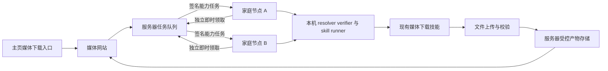

# 分布式媒体下载与即时任务领取实施计划

状态：媒体站、Core、本机与 Mac 下载节点已上线；图片阈值、普通 Agent 与网站节点两条路径、Mac 持久启动均已完成真实验收。
以下保留分阶段历史记录；当前版本、限制和验收状态以末尾 2026-10-24 记录为准。

日期：2026-10-23

## 目标与用户流程

用户在网页提交媒体完整链接、短链接或完整分享文案，服务器创建任务，多台家庭机器上的
Agent Runtime 领取任务，复用已安装和授权的媒体下载技能。节点把视频及用户要求的音频文件
上传至服务器，服务器确认文件可用后向原用户交付。用户无需安装浏览器插件。

网站范围明确为：在 `https://matrixai.one/` 主页增加“媒体下载”入口，指向
`https://media.matrixai.one/`。媒体站提供链接提交、视频或音频选项、排队与处理进度、
结果预览、下载、失败原因和取消功能。域名、DNS、TLS、主页入口和媒体站部署纳入网站阶段。
该域名是部署目标，不写入宿主身份、协议或技能默认值。

## 已有实现与复用位置

| 能力 | 当前源码 | 本次处理 |
| --- | --- | --- |
| 服务端队列和原子领取 | `../NNI/nni_server/distributed_work.mjs` | 复用队列、attempt、lease 和幂等结果提交 |
| Core 派单和控制回执签名 | `../NNI/nni_server/work_assignment_signing.mjs` | 保留验签和精确请求绑定 |
| 节点任务状态与能力执行 | `crates/clawd/src/http/ui_routes/nni_distributed_work.rs` | 复用本地持久化、恢复及 capability 执行 |
| 原心跳定时器 | `crates/clawd/src/http/ui_routes/nni_heartbeat_worker.rs` | 保留设备参与及奖励节奏，移出工作调度职责 |
| 通用能力入口 | `crates/clawd/src/worker/run_capability.rs` | 使用机器能力合同，不把链接重新交给模型选择技能 |
| 媒体解析与下载 | `optional_skills/media_download/` | 复用现有平台适配与专属浏览器登录态 |
| 任务产物交付 | `crates/clawd/src/task_artifacts.rs`、`crates/clawd/src/http/task_artifacts.rs` | 复用清单、摘要和归属鉴权 |

现有 `remote_executor` 另有协议结构，但执行 transport 仍返回 unavailable；本计划复用
已经实际接入 NNI 的工作通道，不把该结构当成已经可用的远程执行器。

## 第一阶段 随时领取通用任务

- [x] 任务领取、租约续期、结果回报从定期心跳解耦。
- [x] 使用节点主动发起的 HTTPS 长轮询，无需家庭公网 IP 或入站端口。
- [x] 空闲请求最多等待约 25 秒；创建匹配任务后立即唤醒，不等待长轮询超时。
- [x] 同一节点仅保持一个有效领取请求；服务端有连接总量上限和断线清理。
- [x] 等待期间不持有数据库事务，不使用逐连接高频查库。
- [x] 已有任务执行时独立续租，完成后唤醒工作通道并立即回报。
- [x] 结果在本机先持久化；只有有效 Core 签名确认后才能删除待回报状态。
- [x] 网络失败采用有上限的退避；未授权、未加入、工作领取关闭时不领取新任务。
- [x] 保留节点签名、资产授权、Core 信任公钥和本地执行权限检查。
- [x] 普通 NNI 心跳不领取任务，不提交工作结果，不增加奖励或改变奖励间隔。

该阶段同时修改本仓库与本机 `../NNI` 服务端源码。默认不部署、不重启服务、不修改现有
运行配置。两端升级时先收尾旧任务，再切换工作通道，避免旧客户端仍等待下一次心跳。

## 第二阶段 节点授权和能力匹配

节点显式加入工作池，并由宿主批准可以接收的 capability、资源额度和结果上传范围。
不得把“节点在线”或“技能自报低风险”视为运行授权。现有按本机管理员身份执行的桥接应
收敛为专用工作身份和受限授权，服务端声明只能收窄本机授权。

能力快照从已安装 registry generation、receipt、grant 和 enable state 生成。节点上报
平台、架构、可执行 capability 及摘要、空闲并发、浏览器与 FFmpeg 可用状态。
调度按结构化能力和资源匹配，平台适配留在技能中，不在主循环硬编码业务技能分支。
浏览器依赖需登录时，使用该节点技能专属授权会话；Cookie 和浏览器 profile 不回传服务器。

每次派单固定 capability 合同及所需版本；节点接受时固定本地 generation、技能版本、
receipt 和 policy digest。重启恢复继续相同本地任务和固定版本；不能按 current pointer
重新选版本，也不能在节点上悄悄安装或启用技能。

## 第三阶段 媒体下载和音频交付

媒体表单由业务服务构建 `media_download.download` 的结构化能力请求，完整保留分享内容。
普通聊天与通信端消息仍按现有规则进入 ask，不增加自然语言关键词路由。

首版只处理用户提交的单条媒体内容，不开放个人主页全量、推荐流或持续采集。具体平台支持
范围以已安装技能和实测为准。无水印表示取得平台实际可访问的无水印播放源；不承诺消除
已经压入画面的水印，也不将播放文件描述为作者原始母版。

现有音频辅助路径产出用于转写的 16 kHz 单声道 WAV，并带有 STT continuation；不能把
`text_conversion_scope=audio_only` 当作“只下载音乐”的接口。需在媒体技能包增加明确的
音轨导出参数或 capability，复用 FFmpeg，提供独立可交付音频；优先保留可直接封装的原音轨，
需要转码时明确格式。用户只要求音频时不自动启动转写、OCR 或人声伴奏分离。

新增合同同步 `skill.toml`、registry 元数据、`INTERFACE.md` 和生成技能文档。保持既有下载
默认行为，录入的 request 仍需宿主 grant，业务改动不扩散到 runtime 主流程。

## 第四阶段 文件上传与服务器交付

1. 本机下载结束后读取可信结构化产物清单，不解析回复文字或猜测本地路径。
2. 向服务器申请绑定 `job_id + attempt + node_id + artifact_id` 的短期上传授权。
3. 流式或分块上传实际文件，支持断点恢复；上传失败优先重传已有文件，避免重新抓取。
4. 服务器核对大小、摘要、实际媒体类型与必需产物角色，原子确认产物清单。
5. 服务器保存结果成功后，完成任务并返回受归属鉴权保护的下载入口。

二进制文件不进入心跳、工作控制 JSON、日志或模型上下文。服务器不接受节点任意指定
上传目标 URL 或本地文件路径；节点只能上传当前任务经 broker 批准的产物。
若采用对象存储，上传使用限定单任务对象的短期权限，下载继续经过用户归属鉴权。

本地技能成功与服务器交付成功分别记录。文件未上传或尚未校验时，网页显示上传中或等待
恢复；不能显示可以下载。部分产物失败时保留成功文件并标明未完成的用户要求。

## 第五阶段 媒体站和主页入口

- [ ] 媒体站以 `media.matrixai.one` 独立部署，主页增加清晰入口。
- [ ] 表单允许完整 URL、短链接和整段分享文案，提供视频、音频、视频及音频选项。
- [ ] 提交立即取得任务 ID；后续通过事件流或有界查询更新，不长时间挂起提交请求。
- [ ] 展示等待节点、下载中、处理音频、上传中、完成、失败和取消状态。
- [ ] 用户身份或匿名会话凭证绑定任务归属；不可仅凭可猜测任务 ID 查看结果。
- [ ] 节点管理提供加入、暂停接单、退出、在线状态、剩余额度和平台登录维护入口。
- [ ] 支持手机、浅色和深色主题，日志与原始协议放在第二层。
- [ ] 配置 DNS、TLS、反向代理长连接超时、上传限制和可恢复文件生命周期。

## 恢复与分布式约束

任务采用至少一次执行、幂等结果提交。唯一有效 `attempt/lease` 决定结果提交权，不能承诺
网络故障下绝不重复下载。旧 attempt 的迟到上传和完成消息不能覆盖新结果。
自动重派只对宿主明确批准可重新生成产物的能力开放；不把任意 capability 视为可安全重放。
发现已有成功文件时先协调上传状态；带外部不可逆副作用的任务继续走既有不明确状态对账。

取消先由服务器持久化并撤销提交权，再通知节点停止本地任务和上传。退出工作池停止新领取，
运行中任务按用户选择排空或取消。初期只接入管理员批准的可信家庭节点，不公开接受任意节点。

## 容量和验收指标

空闲长轮询保持约每节点一个连接。若采用每轮一次请求，25 秒超时对应 1,000 节点约
40 次空请求每秒；若使用每轮挑战和验签两步，则约 80 次请求每秒，另计签名操作。
这些是流量估算，不能替代压测。执行期间的续租、结果上报和文件传输另行计量。

首版验收应包含：

- [ ] 等待请求已建立后，新任务能在 2 秒内被空闲匹配节点领取，单独记录签名耗时。
- [ ] 无任务期间没有持续数据库轮询，断线连接及时释放。
- [ ] 多节点争抢、篡改派单、签名重放、撤权、掉线和旧 attempt 回报均有确定性测试。
- [ ] 任务领取和回报不依赖下一次 NNI 心跳，也不改变奖励记录。
- [ ] 模拟 100 和 1,000 个空闲连接，记录内存、请求率、DB 操作数与领取延迟。
- [ ] 至少两个真实节点完成单链接下载、音频导出、文件上传和用户鉴权下载。
- [ ] 树莓派低内存、Linux x86_64 和 macOS 分别记录真实验收或尚未覆盖的边界。

## 实施检查与交付

先完成协议和服务端/节点映射，再接媒体合同、文件回传和网站。各阶段分别验证，避免把
“能领取任务”误当成“媒体站已经上线”。Rust 代码按职责拆分，生产与测试独立维护。

实现时按改动范围运行节点与服务端定向测试，并运行产品身份 inventory/self-test、
`product_identity_tests.sh --with-ui`、长文件、跨平台、storage ownership 和任务 lifecycle
相关门禁。媒体合同改动还需技能文档同步、prompt、hotplug 和长任务合同检查；UI 改动运行
lint/build。不要覆盖工作区已有改动或为本计划部署真实服务。

参考：[长轮询收到消息时立即返回](https://docs.aws.amazon.com/AWSSimpleQueueService/latest/SQSDeveloperGuide/sqs-short-and-long-polling.html)、
[任务租约及重复交付语义](https://docs.aws.amazon.com/AWSSimpleQueueService/latest/SQSDeveloperGuide/sqs-visibility-timeout.html)、
[分块上传与失败分块重传](https://docs.aws.amazon.com/AmazonS3/latest/userguide/mpuoverview.html)。

## 本轮实现和验证记录

通用即时工作通道已实现，尚未部署。媒体网站、主页入口、媒体音轨导出和文件上传仍按后续阶段推进。
新增 `nni_work_poll.rs` 和共享签名交换模块，工作任务测试从生产模块拆出。服务端新增
`work_poll.mjs`，按匹配节点唤醒；普通心跳停止派发工作。

服务端已通过第一轮 28 项定向测试、7 项 HTTP 与代理检查，以及 25 项代理和部署合同检查。
1,000 个空闲 waiter 的本机队列模拟记录：1,000 次初始领取检查，等待期间无额外检查，
一个入队任务增加 1 次领取检查，一次模拟唤醒约 15 ms，heap 增量约 5 MB；该模拟不包含
TLS 或真实硬件签名，不能用于宣称线上容量。

产品身份 inventory/self-test、双身份 UI 构建、跨平台静态检查、storage ownership
self-test/检查和 task lifecycle 检查已通过。仓库长文件检查仍报告 main.rs、repo/tasks.rs、
verifier_tests.rs 和 kb/storage.rs 基线超限；这四个文件与 HEAD 内容一致，不属于本轮修改。
最终节点端 NNI 相关测试 103 项全部通过；服务端工作队列、HTTP 和恢复相关测试 23 项全部通过。

macOS ARM 交叉检查已尝试：本机虽安装 Apple Rust target，但依赖 aws-lc-sys 调用的 Linux
C 编译器不支持 `-arch` / `-mmacosx-version-min`，因此在编译依赖时失败；不能据此宣称
macOS 编译或实机验收通过。跨平台静态检查已通过，后续需要原生 macOS 环境验证。

工作通道还增加丢失派单响应的恢复：同一设备重试时重新签发同一个 attempt/lease，
不重复领取第二个任务；即使短期重发缓存丢失，持久租约也阻止该设备继续占用新任务。

补充回归包括限流、HTTP 安全、代理与部署合同、节点授权和主服务行为，共覆盖 146 项；
其中新增限流类别导致的健康接口清单断言已同步，并单独复测通过。MCP runtime
self-test/检查、旧 agent-mode payload 检查和用户可见硬编码语言扫描通过。

当前交付为本机两仓库源码与计划文档；没有提交、推送、重启、远端部署、DNS 修改、主页发布
或媒体站上线。后续部署应记录两端提交版本，并在旧任务排空后同步升级。

## 2026-10-23 完整流程实施进展

- 前端已部署并经 HTTPS 200 验证；新增中英文代码已完成测试，等待与后端统一发布。
- 本机访问异常确认为本地代理/DNS 路径；临时 hosts 条目只将媒体域名固定到 Cloudflare CDN IP，未绕过 TLS、AOP 或 origin 防火墙；原文件备份位于 /var/backups/media-site-hosts。
- 接单签名挑战改为 SHA-256 十六进制，真实 Python 签名子进程跨语言验证通过。
- 实施通用 artifact_delivery 元数据；节点须在本机明确授予执行身份、能力、参数约束和上传源站。
- 媒体技能增加 output_mode=video|audio|video_audio 与 public_only；独立音频不触发 STT，公共任务使用隔离的匿名浏览器 profile。
- 网站新增匿名安全会话、CSRF、幂等提交、独立任务库、受当前 Core lease 约束的流式上传、大小和 SHA-256 校验、按用户授权的下载/预览。
- 用户新增服务器缓存要求：公共链接规范化后按内容身份缓存；命中后创建当前用户自己的下载入口，直接复用文件，不分配节点任务。已测试跨会话缓存命中派发次数不增加、缺失缓存失效、摘要错误和越权拒绝。
- 当前限制：单文件 90 MiB，用户任务/入口保留 24 小时，公共文件缓存 1 GiB LRU；上传并发 2，公共在途任务上限 20。
- 当时待完成（后续已完成，见下方真实验收）：部署签名 Core 新协议、准入媒体新版本、运行/授权接单节点、部署网站 API 并开启入口、真实平台链接全流程和缓存复用验收。

## 新增约束：同一用户一次只允许一个任务

- 任一未完成任务存在时，不允许再次提交；成功、部分完成、失败、取消属于终态，终态后解除限制。派发中、排队中、节点执行中、上传与校验中均占用唯一名额。
- 前端在提交后禁用输入提交入口并解释需等待当前任务结束；页面加载、恢复可见或重新打开标签页时从服务器读取当前任务状态，不能依赖 localStorage 中的布尔开关授予提交权限。
- 后端在同一数据库事务中检查并创建任务，强制每个 owner 最多一个非终态任务；并发请求、多个标签页和直接调用 API 都遵循同一限制。相同幂等请求重试返回原任务，不占第二名额。拒绝新任务时返回稳定 error_code=active_job_exists（HTTP 409），前端按所选语言提示。
- 多个标签页共享 Secure/HttpOnly 的同源会话 cookie；可使用 BroadcastChannel 通知其他标签页刷新，但以服务器状态为准。刷新、关闭页面和重新打开页面不能解除后端限制。
- 缓存命中的提交也服从一个在途任务限制；当前无在途任务时直接创建已完成的自有下载入口，不分配节点工作。
- 当前匿名版本按浏览器会话 owner 识别；清除 cookie、隐私窗口、其他浏览器或设备会产生不同匿名身份。若要求这些情况仍视为同一用户，后续接入登录并按账号 ID 执行相同事务约束；IP 限额只用于防滥用，不能替代用户身份。
- 验收：同会话并发提交两个不同请求只能成功一个；两个标签页共享该限制；重试不重复创建；完成/失败/取消后可继续；缓存命中不派发任务。

用户确认：第一版仅按浏览器会话限制，并在同浏览器所有标签页共享；本轮不接账号登录。后端已加入事务约束，前端已加入初始锁定与多标签页刷新提示，待统一部署验收。

## 2026-10-23 上线与真实链路验收

- 已上线主页入口、媒体站中英文、双主题、输入过滤、单浏览器单在途任务、视频/音频分别下载、缓存命中提示与节点在线/忙碌计数。按用户最新要求删除常见平台展示，节点统计放到链接输入卡片底部。
- 前端与 API 共用 `media-site/public/share-policy.js`；当前支持域名以该模块为唯一名单。未知平台、多 URL、凭据、特殊端口、异常域名和 URL 解析歧义直接拒绝；已支持平台的 HTTP 分享升级为 HTTPS。
- 当前统计为配置的下载工作池；初始配置定向到已验证的本机 x86_64 节点。签名工作连接 90 秒无更新后离线，忙碌数来自有效 lease；网站合并并缓存统计查询 10 秒。实测在线 1、忙碌 0。多个同平台同架构且已授权的节点可在通用队列竞争领取；树莓派/其他平台的现场部署未在本轮验证。
- 实际公开抖音样例已完成：网页 HTTPS 提交 → Core 唤醒 → 本机已准入的 media_download 0.3.75 → 视频下载及音频导出 → 流式回传 → 服务器校验 → 按浏览器归属下载。原始任务 e81a5cac-b4fd-485f-a924-3415d5c42cbf。
- 下载视频 3,676,544 bytes，SHA-256 af479be42a1f90e57b9305a57807732393324c62c8fa80930780fea023f13881；音频 477,722 bytes，SHA-256 af85a378186069b7dbaa3f3d8483c7a69d6710a9a1c327364e87f8136f1cf905。两者均通过最终 HTTPS 下载字节核对。
- 再次提交同链接返回独立自有缓存入口 c0d5b25b-6e61-417e-8842-4ff09f1ff569，数据库确认没有 Core task_id，不再分配节点任务。B站多P视频缓存身份保留 p 参数，避免混用不同分P。
- 同浏览器同时提交另一请求，线上确认为 HTTP 409 active_job_exists；单位测试也验证并发请求仅成功一个。
- 节点本机已明确授予唯一媒体 capability、public_only=true 参数约束、执行 principal 与唯一上传源站；公共任务使用独立匿名 browser profile。采用当前已注册的软件签名身份做真实网络测试，本轮不声称验证了硬件签名芯片。
- 本机 clawd 已完成 optimized release 构建并运行；二进制 SHA-256 8ce9ef22e921d74493144c9b55646634a9344ea06f4d3912da62a3deec6aebc1。原二进制及部署记录保留在 data/runtime-upgrades/media-20261023。
- Core 已提交推送并部署 3ce6a23da9318b3f7cefe6c7c80396bd4f3dea3b；既有财务 ledger 备份与迁移演练通过。远端原源码两次摘要审计均无独有修改，未修改远端源码。
- 网站最新发布提交 d58fe14（完整 SHA d58fe1497da53e91e371a8b3c2c12ade45841001，已核对本机与远端一致）；UI 和 API 均从本机已推送的不可变源码同步。媒体技能 receipt/grant/generation 经 Skill Store 正式安装成功，未绕过准入。
- 验证证据：/tmp/media-nni-rust-final2.log（105 pass）、/tmp/media-node-telemetry-final-tests.log（24 pass）、/tmp/media-share-policy-final-tests.log（61 pass）、/tmp/media-live-flow-test.log、/tmp/media-live-flow-result.json、/tmp/media-live-cache-audit.jsonl。签名子进程、FFmpeg 真实音频提取、跨品牌 UI、registry/policy/storage/MCP/static 跨平台检查已验证。
- 原仓库已有的长文件/技能耦合 ratchet 债务未在本轮重构；未改动用户其他未提交工作。Apple target 检查受 aws-lc-sys Linux C 编译器不支持 -arch 等参数阻塞，没有声称通过 macOS 现场构建。
- 真实测试亦确认 YouTube 样例存在失效或需要登录的情况；公开网站不复用个人授权 profile，因此不能保证所有平台的所有链接都可匿名下载。当前限制仍为单文件 90 MiB、用户入口保留 24 小时、1 GiB 缓存 LRU。

## 大文件交付升级（2026-10-23，实施中）
- 用户反馈任务 a862be41-be1c-41af-a79c-b3f40fbeae66 已在节点完成下载，但视频 228,341,807 bytes 超过旧版 90 MiB 回传上限，导致网页交付失败；原文件保留，不将本地成功误认为网页交付成功。
- 新合同：单文件 512 MiB，8 MiB 分片，节点与服务端流式读取，持久化已收分片，重启后续传；逐片和全文件 SHA-256 校验、接收前后租约校验、空间和并发上限；不提高单个代理请求到 512 MiB。
- 错误通过稳定 error_code 返回，前端中英翻译，不向匿名用户透出文件路径、grant 或 provider 原始响应。
- 失败任务最多原地重试三次，保留浏览器所有权，旋转上传 grant，使用新的 Core 幂等键，留存旧任务关联。
- 分布式结构化请求经现有 capability resolver 解析，再进入 verified run_skill 队列；无普通 ask、planner 或 answer synthesis。需要 companion 的任务拒绝执行，不绕过宿主权限或 runner receipt/policy pin。
- 统计增加 queued 和 average_queue，平均排队数=排队任务/在线节点，零在线时显示未知；单节点保持最多一个活动租约，空闲节点即时领取下一任务。
- 前端已完成同仓库 React/TypeScript/Vite/Tailwind 双 HTML 入口，仍独立部署 media 域名，用户已放弃主站 SPA /media 路由。
- 本地验收：91 MiB 多分片传输、服务重启续传、重复确认、错误摘要/篡改/失效租约不发布，后端11项通过；Core28项通过；节点105项通过。正式编译及生产大视频复测仍待完成。

## 2026-10-24 当前部署和联合验收

### 已部署版本

- 节点源码：`b9058cf69da953ee288f9d12b4d44d56a4b0777f`，包含 `59a7231ee` 的宿主产物类型映射修复和 `eb2f5bc89` 的单图回传支持。
- 本机已运行新的 optimized release，SHA-256 为 `0e3ce7d87130e47e8cad45d64e5bfda42eb289bc01fb1aa26a439ffa74ac460b`，健康检查通过。该本机构建包含预先存在的用户工作区修改，部署记录明确保留此事实；不能将其描述为纯净源码可复现构建。
- 媒体技能正式准入并启用 `0.3.78-a1083313e95d`，generation 235，receipt digest 为 `49f5601b17b30b7e475c1b0f256b72c8ac733576b8167a06523bd918def3bf52`。没有绕过 Skill Store、receipt 或宿主授权。
- Core 已部署 `c7fd28439eed4e12e162ec8274a0c2168bebefe0`；网站前端、主站前端和 API 已部署 `38cfff85b804f5dc790b1b2c0a71f0311165b5d5`。本机提交、推送、远端只读同步和部署版本已核对。
- 主站和媒体站共用同仓库 React、TypeScript、Vite、Tailwind 构建，保留两个 HTML 入口与独立域名。用户已放弃主站 SPA `/media` 路由，不再实施该路由合并。

### 图片打包与交付规则

- 新增每次请求的 `image_archive_threshold` 非负整数参数。普通 Agent 调用明确传 `9`；兼容旧调用省略时的默认值 `9`。图片数量大于阈值才打 ZIP，`0` 表示有图片就打包；布尔值、负数、小数、字符串和 null 均拒绝。
- 网站后端固定传 `1`，不向前端增加阈值选项：一张图片直接交付、预览和下载，两张及以上打 ZIP。它不改变普通 Agent 的默认阈值。视频、音频和独立平台原文不因图片阈值被单独打 ZIP。
- 前端单图提供缩略图、放大预览和原文件下载；多图显示图片 ZIP 下载。原文独立展示，支持复制全文和 TXT 下载。音频仅在勾选后返回。
- 宿主真实产物类型为 `archive/application/zip`、`file/text/plain` 和 `image/image/*`。先按原 manifest 验证路径与摘要，再在上传 HTTP 边界投影为网站的 `file`、`text`、`image`，不改宿主持久化合同。
- 单图仅支持 JPEG、PNG、WebP、GIF、AVIF 栅格格式；SVG、HTML 不进入图片预览合同。图片、视频或 ZIP 为一个主媒体，可附音频和 TXT，总计最多三个交付文件。
- 新图片缓存记录阈值策略 1；未知旧策略的图片 ZIP 不直接当作新单图交付。旧历史文件保留，既有视频、音频、原文缓存继续复用。旧在途请求保留原参数，避免同一 Core 幂等键改变请求摘要。

### 大文件和服务器存储

- 单文件已提高到 512 MiB，8 MiB 分片，逐片和整文件 SHA-256、续传、前后租约校验及两个并发上传流保持有效。
- 原失败视频已真实完成网站交付：228,341,807 bytes，SHA-256 `744a32ff270b545c3b9eef57f8d976607544fe36db33da19850d1ea9a33f5780`。曾从最终 HTTPS 下载重新核对全文件。
- 按用户授权，已购买并挂载 Vultr 10 GB NVMe 专用媒体卷到 `/var/lib/media-service`。原数据已离线复制、逐文件校验、SQLite 检查并保留旧目录备份；systemd 依赖挂载，挂载失败不会退回系统盘继续写。
- 当前产物配额 6 GiB、缓存配额 2 GiB。缓存共享硬链接按物理 inode 计量，保留空间与分片预留共同限制磁盘使用。

### 已通过的真实网站验收

- 已知历史样本为旧普通 Agent 任务 `1a199d15-0ebc-41f2-822c-d6d36d917b45` 的 17 张抖音图片及平台原文。真实链接仅保存在受保护的本机测试文件，不提交历史分享文案或认证查询参数。
- 网站节点路径实际传入阈值 1，成功交付 ZIP 中 17 张图片和 TXT。逐张摘要及顺序与本次源图、旧历史 17 图均一致；ZIP 内 TXT 与独立 TXT 一致。节点本地执行任务为 `e1a65b25-4ca0-4de6-a441-03a35199d3de`，`kind=run_skill`、`_task_source=distributed_work`、LLM 调用 0 次。
- 两个用户共享同一个 Core 下载任务；一个用户取消并删除自己的记录，另一个仍成功收到结果。跨用户访问返回 404；之后缓存命中没有新的 Core task；删除另一个用户的记录不会破坏自己的缓存下载。
- 同一浏览器当前有任务时，第二个提交被拒绝；新标签页共享服务器会话约束，不能靠前端状态绕过。
- 单张 WebP 图片 90,010 bytes 已通过原文件摘要和 `disposition=inline` HTTP 响应校验；没有被打 ZIP。该次节点任务为 `cc07be05-7b25-48ff-a883-332be5899a08`，实际阈值 1，LLM 调用 0 次。
- 勾选音频后，同一单图内容从兼容缓存组合返回图片、平台原文及 4,160,589 bytes 音频，均已从 HTTPS 下载核对大小与摘要；未重复派发节点任务。
- 定向证据：`/tmp/media-over-nine-distributed-proof.json`、`/tmp/media-single-image-audio-proof.json`。前端经过静态渲染测试和真实 HTTP 交付检查，尚未声称实际浏览器点击验收。

### 普通 Agent 与 Mac 真实验收

- 正常普通 Agent 请求的真实 `kind=ask` 任务 `1ee91798-d391-4c6d-a9a9-c5d0c6b299e1` 已 `succeeded`。唯一媒体 capability 调用实际传 9，固定技能 0.3.78、receipt 与 generation 235，没有分布式任务来源标记。
- 最终宿主根 manifest 的 ZIP、TXT、默认背景音频均经用户归属 API 实际 GET 200，大小和 SHA-256 与 manifest 一致。ZIP 中 17 张原图的顺序、逐图摘要与本次源图、旧历史均一致，ZIP 内 TXT 与独立 TXT 一致。ZIP 为 13,181,452 bytes，SHA-256 `2d4df04ff22a6185886f71770f5432ce486a04c2c02d4e8eff0ce0826cf68693`。
- 该普通任务从提交到终态为 428.058 秒，观察到 8 轮模型 turn；下载完成后的计划收尾较慢。通过结论只对应上述真实终态及最终 API 字节检查，证据 `/tmp/media-ordinary-over-nine-simple-evidence.json`。
- 较复杂的前一个测试任务 `9ca135c1-f89a-4ab1-9949-f05c0b1df12a` 添加了只交付图文的约束，产生了重复采集和文件检查恢复循环，已通过正规 API 取消，不能计为通过。其首轮确实完整获得 17 图，第二轮源仍有 17 张但第 14 张读取超时，仅取得 16 张，ZIP 保留了当次全部 16 张；这些产物和失败证据单独保留，不能用首轮成功覆盖第二轮部分采集。
- 普通 Agent 有自然语言规划模型调用；节点的结构化下载与上传不调用模型，不进行 OCR 或 ASR。二者的模型统计应按各自 task ID 区分。
- 31 网段 Mac 当前为 `192.168.31.162`，旧 `.163` 不可达。旧安装为 Intel macOS release，技能 0.3.52；已保存源码与数据、旧二进制和 launchd 配置，确认没有需中断的业务任务。
- 旧 Mac 技能真实下载了 44,285,038 bytes MP4，SHA-256 `254e14a1f6dd1537cd47c0e812ffe9dbb992587810e324262ffad6ac57330d09`，LLM 调用 0 次。这仅证明旧下载环境可用，不代表新版匿名节点已验收。
- Mac 已原生构建已提交的 `b9058cf69`，二次 Cargo 构建无额外增量，`clawd`、runner、skillctl 均为 Mach-O x86_64。新 Mac `clawd` SHA-256 为 `534491ccc3cfe188856db140ac78df704cbdfe3ffdad2efeb9149f297a48ba64`。
- Mac 通过正式 Skill Store 安装并启用 0.3.78，generation 34；与安装前 policy.d 逐文件核对，十份宿主 grant 中仅媒体技能一份改变，其余九份未变。
- 新 Mac 匿名 `public_only=true` 自测成功，原视频仍为 44,285,038 bytes、SHA 与旧源一致，独立 AAC/M4A 为 2,547,478 bytes；LLM 调用 0 次。之后才开启正式领取。
- 新 Mac 真实网站任务 `30cd1f64-01a9-4538-9b9f-025d3d480ae1` 成功，Core 任务 `nni-work-73515c0b062d41290748dc366694c47a` 的 attempt 1 已核对为 Mac 本机公钥、macos/x86_64；Mac 本地任务 `97400e45-e5df-4541-ad6e-0e58a4ab3bd8` 实际参数为 1、public_only=true，来源为 distributed_work。
- Mac 已完成真实分片上传并收到 Core 签名 ACK，最终网站 HTTPS 下载再次核对：MP4 为 72,475,986 bytes，SHA-256 `ed8bc56a071cc809aa870a0161dd2b1293daf0ade0f453f80c793cb2f18ffcc8`；TXT 为 190 bytes，SHA-256 `4901cd04f31754bfe55d7f6632541188b5a6eeb5298be8b04789d8615ee375b1`，与 Mac 原文件完全一致。节点执行 LLM 调用 0 次。
- 此次 Mac 网站验收临时使用已有正规配置定向到 Mac，避免将 Linux 抢先领取误算为 Mac 成功；没有绕过缓存、伪造任务数据库或注册测试假节点。验收后已逐字节恢复原媒体环境配置，恢复共享池；线上已核对在线 2、忙碌 0、可用 2、排队 0。
- Mac 旧 one-shot launchd 入口退出时会清理同进程组，曾导致节点消失。宿主配置已备份并补齐进程组处理，真实网站任务结束且空闲后，切换至已存在的前台 `component_start/start-clawd.sh release`、异常退出自动重启与十秒节流；同一身份、环境和 worker ID 保留，原渠道服务未停止。前台 mainPID 与 clawd PID 一致，已连续观察 93 秒，runs=1、无重启循环、健康接口 HTTP 200，九次工作签名事件且无传输、控制或派单错误；没有修改或重新编译通用安装器。

### 定向检查与边界

- 节点 NNI 108 项、宿主 TaskArtifact 30 项、Python 74 项、网站后端 79 项、媒体前端 46 项通过；TypeScript 检查与主站和媒体站统一构建通过。
- Core 已使用实际 HTTP 服务及两个独立签名设备做跨平台能力匹配、关闭技能后转交、失败节点排除、重复旧回执隔离等定向验证。生产 Linux 与 Mac 的下载和文件回传也分别通过上述真实验收；Mac 的生产回传不是以节点数或隔离测试冒充。
- 下载池只接纳声明了当前可执行 capability、已启用技能和宿主授权、匹配上传源站和文件额度的节点；一般 NNI 心跳不等于具备媒体下载能力。现有任务租约仍为 60 分钟并每 20 秒续期；本轮未另改租约总时限。
- 已记录防作恶讨论：[分布式媒体下载节点防作恶学习笔记](../docs/distributed_media_worker_security_notes_20261024.zh-CN.md)。本轮不实施新的节点信誉、质押、可信执行或防作弊策略。
- 平台匿名访问仍可能遇到登录要求、限流、失效内容和单图网络失败。参数和打包成功不能代替采集完整性验收，应分别记录取得数量及可用组件。
