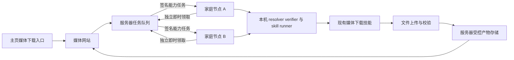

# 分布式媒体下载与即时任务领取实施计划

状态：第一阶段本地实现和定向验证完成，尚未部署。媒体网站与文件回传按后续阶段实施。

日期：2026-10-23

## 目标与用户流程

用户在网页提交媒体完整链接、短链接或完整分享文案，服务器创建任务，多台家庭机器上的
Agent Runtime 领取任务，复用已安装和授权的媒体下载技能。节点把视频及用户要求的音频文件
上传至服务器，服务器确认文件可用后向原用户交付。用户无需安装浏览器插件。

网站范围明确为：在 `https://matrixai.one/` 主页增加“媒体下载”入口，指向
`https://media.matrixai.one/`。媒体站提供链接提交、视频或音频选项、排队与处理进度、
结果预览、下载、失败原因和取消功能。域名、DNS、TLS、主页入口和媒体站部署纳入网站阶段。
该域名是部署目标，不写入宿主身份、协议或技能默认值。

## 已有实现与复用位置

| 能力 | 当前源码 | 本次处理 |
| --- | --- | --- |
| 服务端队列和原子领取 | `../NNI/nni_server/distributed_work.mjs` | 复用队列、attempt、lease 和幂等结果提交 |
| Core 派单和控制回执签名 | `../NNI/nni_server/work_assignment_signing.mjs` | 保留验签和精确请求绑定 |
| 节点任务状态与能力执行 | `crates/clawd/src/http/ui_routes/nni_distributed_work.rs` | 复用本地持久化、恢复及 capability 执行 |
| 原心跳定时器 | `crates/clawd/src/http/ui_routes/nni_heartbeat_worker.rs` | 保留设备参与及奖励节奏，移出工作调度职责 |
| 通用能力入口 | `crates/clawd/src/worker/run_capability.rs` | 使用机器能力合同，不把链接重新交给模型选择技能 |
| 媒体解析与下载 | `optional_skills/media_download/` | 复用现有平台适配与专属浏览器登录态 |
| 任务产物交付 | `crates/clawd/src/task_artifacts.rs`、`crates/clawd/src/http/task_artifacts.rs` | 复用清单、摘要和归属鉴权 |

现有 `remote_executor` 另有协议结构，但执行 transport 仍返回 unavailable；本计划复用
已经实际接入 NNI 的工作通道，不把该结构当成已经可用的远程执行器。

## 第一阶段 随时领取通用任务

- [x] 任务领取、租约续期、结果回报从定期心跳解耦。
- [x] 使用节点主动发起的 HTTPS 长轮询，无需家庭公网 IP 或入站端口。
- [x] 空闲请求最多等待约 25 秒；创建匹配任务后立即唤醒，不等待长轮询超时。
- [x] 同一节点仅保持一个有效领取请求；服务端有连接总量上限和断线清理。
- [x] 等待期间不持有数据库事务，不使用逐连接高频查库。
- [x] 已有任务执行时独立续租，完成后唤醒工作通道并立即回报。
- [x] 结果在本机先持久化；只有有效 Core 签名确认后才能删除待回报状态。
- [x] 网络失败采用有上限的退避；未授权、未加入、工作领取关闭时不领取新任务。
- [x] 保留节点签名、资产授权、Core 信任公钥和本地执行权限检查。
- [x] 普通 NNI 心跳不领取任务，不提交工作结果，不增加奖励或改变奖励间隔。

该阶段同时修改本仓库与本机 `../NNI` 服务端源码。默认不部署、不重启服务、不修改现有
运行配置。两端升级时先收尾旧任务，再切换工作通道，避免旧客户端仍等待下一次心跳。

## 第二阶段 节点授权和能力匹配

节点显式加入工作池，并由宿主批准可以接收的 capability、资源额度和结果上传范围。
不得把“节点在线”或“技能自报低风险”视为运行授权。现有按本机管理员身份执行的桥接应
收敛为专用工作身份和受限授权，服务端声明只能收窄本机授权。

能力快照从已安装 registry generation、receipt、grant 和 enable state 生成。节点上报
平台、架构、可执行 capability 及摘要、空闲并发、浏览器与 FFmpeg 可用状态。
调度按结构化能力和资源匹配，平台适配留在技能中，不在主循环硬编码业务技能分支。
浏览器依赖需登录时，使用该节点技能专属授权会话；Cookie 和浏览器 profile 不回传服务器。

每次派单固定 capability 合同及所需版本；节点接受时固定本地 generation、技能版本、
receipt 和 policy digest。重启恢复继续相同本地任务和固定版本；不能按 current pointer
重新选版本，也不能在节点上悄悄安装或启用技能。

## 第三阶段 媒体下载和音频交付

媒体表单由业务服务构建 `media_download.download` 的结构化能力请求，完整保留分享内容。
普通聊天与通信端消息仍按现有规则进入 ask，不增加自然语言关键词路由。

首版只处理用户提交的单条媒体内容，不开放个人主页全量、推荐流或持续采集。具体平台支持
范围以已安装技能和实测为准。无水印表示取得平台实际可访问的无水印播放源；不承诺消除
已经压入画面的水印，也不将播放文件描述为作者原始母版。

现有音频辅助路径产出用于转写的 16 kHz 单声道 WAV，并带有 STT continuation；不能把
`text_conversion_scope=audio_only` 当作“只下载音乐”的接口。需在媒体技能包增加明确的
音轨导出参数或 capability，复用 FFmpeg，提供独立可交付音频；优先保留可直接封装的原音轨，
需要转码时明确格式。用户只要求音频时不自动启动转写、OCR 或人声伴奏分离。

新增合同同步 `skill.toml`、registry 元数据、`INTERFACE.md` 和生成技能文档。保持既有下载
默认行为，录入的 request 仍需宿主 grant，业务改动不扩散到 runtime 主流程。

## 第四阶段 文件上传与服务器交付

1. 本机下载结束后读取可信结构化产物清单，不解析回复文字或猜测本地路径。
2. 向服务器申请绑定 `job_id + attempt + node_id + artifact_id` 的短期上传授权。
3. 流式或分块上传实际文件，支持断点恢复；上传失败优先重传已有文件，避免重新抓取。
4. 服务器核对大小、摘要、实际媒体类型与必需产物角色，原子确认产物清单。
5. 服务器保存结果成功后，完成任务并返回受归属鉴权保护的下载入口。

二进制文件不进入心跳、工作控制 JSON、日志或模型上下文。服务器不接受节点任意指定
上传目标 URL 或本地文件路径；节点只能上传当前任务经 broker 批准的产物。
若采用对象存储，上传使用限定单任务对象的短期权限，下载继续经过用户归属鉴权。

本地技能成功与服务器交付成功分别记录。文件未上传或尚未校验时，网页显示上传中或等待
恢复；不能显示可以下载。部分产物失败时保留成功文件并标明未完成的用户要求。

## 第五阶段 媒体站和主页入口

- [ ] 媒体站以 `media.matrixai.one` 独立部署，主页增加清晰入口。
- [ ] 表单允许完整 URL、短链接和整段分享文案，提供视频、音频、视频及音频选项。
- [ ] 提交立即取得任务 ID；后续通过事件流或有界查询更新，不长时间挂起提交请求。
- [ ] 展示等待节点、下载中、处理音频、上传中、完成、失败和取消状态。
- [ ] 用户身份或匿名会话凭证绑定任务归属；不可仅凭可猜测任务 ID 查看结果。
- [ ] 节点管理提供加入、暂停接单、退出、在线状态、剩余额度和平台登录维护入口。
- [ ] 支持手机、浅色和深色主题，日志与原始协议放在第二层。
- [ ] 配置 DNS、TLS、反向代理长连接超时、上传限制和可恢复文件生命周期。

## 恢复与分布式约束

任务采用至少一次执行、幂等结果提交。唯一有效 `attempt/lease` 决定结果提交权，不能承诺
网络故障下绝不重复下载。旧 attempt 的迟到上传和完成消息不能覆盖新结果。
自动重派只对宿主明确批准可重新生成产物的能力开放；不把任意 capability 视为可安全重放。
发现已有成功文件时先协调上传状态；带外部不可逆副作用的任务继续走既有不明确状态对账。

取消先由服务器持久化并撤销提交权，再通知节点停止本地任务和上传。退出工作池停止新领取，
运行中任务按用户选择排空或取消。初期只接入管理员批准的可信家庭节点，不公开接受任意节点。

## 容量和验收指标

空闲长轮询保持约每节点一个连接。若采用每轮一次请求，25 秒超时对应 1,000 节点约
40 次空请求每秒；若使用每轮挑战和验签两步，则约 80 次请求每秒，另计签名操作。
这些是流量估算，不能替代压测。执行期间的续租、结果上报和文件传输另行计量。

首版验收应包含：

- [ ] 等待请求已建立后，新任务能在 2 秒内被空闲匹配节点领取，单独记录签名耗时。
- [ ] 无任务期间没有持续数据库轮询，断线连接及时释放。
- [ ] 多节点争抢、篡改派单、签名重放、撤权、掉线和旧 attempt 回报均有确定性测试。
- [ ] 任务领取和回报不依赖下一次 NNI 心跳，也不改变奖励记录。
- [ ] 模拟 100 和 1,000 个空闲连接，记录内存、请求率、DB 操作数与领取延迟。
- [ ] 至少两个真实节点完成单链接下载、音频导出、文件上传和用户鉴权下载。
- [ ] 树莓派低内存、Linux x86_64 和 macOS 分别记录真实验收或尚未覆盖的边界。

## 实施检查与交付

先完成协议和服务端/节点映射，再接媒体合同、文件回传和网站。各阶段分别验证，避免把
“能领取任务”误当成“媒体站已经上线”。Rust 代码按职责拆分，生产与测试独立维护。

实现时按改动范围运行节点与服务端定向测试，并运行产品身份 inventory/self-test、
`product_identity_tests.sh --with-ui`、长文件、跨平台、storage ownership 和任务 lifecycle
相关门禁。媒体合同改动还需技能文档同步、prompt、hotplug 和长任务合同检查；UI 改动运行
lint/build。不要覆盖工作区已有改动或为本计划部署真实服务。

参考：[长轮询收到消息时立即返回](https://docs.aws.amazon.com/AWSSimpleQueueService/latest/SQSDeveloperGuide/sqs-short-and-long-polling.html)、
[任务租约及重复交付语义](https://docs.aws.amazon.com/AWSSimpleQueueService/latest/SQSDeveloperGuide/sqs-visibility-timeout.html)、
[分块上传与失败分块重传](https://docs.aws.amazon.com/AmazonS3/latest/userguide/mpuoverview.html)。

## 本轮实现和验证记录

通用即时工作通道已实现，尚未部署。媒体网站、主页入口、媒体音轨导出和文件上传仍按后续阶段推进。
新增 `nni_work_poll.rs` 和共享签名交换模块，工作任务测试从生产模块拆出。服务端新增
`work_poll.mjs`，按匹配节点唤醒；普通心跳停止派发工作。

服务端已通过第一轮 28 项定向测试、7 项 HTTP 与代理检查，以及 25 项代理和部署合同检查。
1,000 个空闲 waiter 的本机队列模拟记录：1,000 次初始领取检查，等待期间无额外检查，
一个入队任务增加 1 次领取检查，一次模拟唤醒约 15 ms，heap 增量约 5 MB；该模拟不包含
TLS 或真实硬件签名，不能用于宣称线上容量。

产品身份 inventory/self-test、双身份 UI 构建、跨平台静态检查、storage ownership
self-test/检查和 task lifecycle 检查已通过。仓库长文件检查仍报告 main.rs、repo/tasks.rs、
verifier_tests.rs 和 kb/storage.rs 基线超限；这四个文件与 HEAD 内容一致，不属于本轮修改。
最终节点端 NNI 相关测试 103 项全部通过；服务端工作队列、HTTP 和恢复相关测试 23 项全部通过。

macOS ARM 交叉检查已尝试：本机虽安装 Apple Rust target，但依赖 aws-lc-sys 调用的 Linux
C 编译器不支持 `-arch` / `-mmacosx-version-min`，因此在编译依赖时失败；不能据此宣称
macOS 编译或实机验收通过。跨平台静态检查已通过，后续需要原生 macOS 环境验证。

工作通道还增加丢失派单响应的恢复：同一设备重试时重新签发同一个 attempt/lease，
不重复领取第二个任务；即使短期重发缓存丢失，持久租约也阻止该设备继续占用新任务。

补充回归包括限流、HTTP 安全、代理与部署合同、节点授权和主服务行为，共覆盖 146 项；
其中新增限流类别导致的健康接口清单断言已同步，并单独复测通过。MCP runtime
self-test/检查、旧 agent-mode payload 检查和用户可见硬编码语言扫描通过。

当前交付为本机两仓库源码与计划文档；没有提交、推送、重启、远端部署、DNS 修改、主页发布
或媒体站上线。后续部署应记录两端提交版本，并在旧任务排空后同步升级。

## 2026-10-23 完整流程实施进展

- 前端已部署并经 HTTPS 200 验证；新增中英文代码已完成测试，等待与后端统一发布。
- 本机访问异常确认为本地代理/DNS 路径；临时 hosts 条目只将媒体域名固定到 Cloudflare CDN IP，未绕过 TLS、AOP 或 origin 防火墙；原文件备份位于 /var/backups/media-site-hosts。
- 接单签名挑战改为 SHA-256 十六进制，真实 Python 签名子进程跨语言验证通过。
- 实施通用 artifact_delivery 元数据；节点须在本机明确授予执行身份、能力、参数约束和上传源站。
- 媒体技能增加 output_mode=video|audio|video_audio 与 public_only；独立音频不触发 STT，公共任务使用隔离的匿名浏览器 profile。
- 网站新增匿名安全会话、CSRF、幂等提交、独立任务库、受当前 Core lease 约束的流式上传、大小和 SHA-256 校验、按用户授权的下载/预览。
- 用户新增服务器缓存要求：公共链接规范化后按内容身份缓存；命中后创建当前用户自己的下载入口，直接复用文件，不分配节点任务。已测试跨会话缓存命中派发次数不增加、缺失缓存失效、摘要错误和越权拒绝。
- 当前限制：单文件 90 MiB，用户任务/入口保留 24 小时，公共文件缓存 1 GiB LRU；上传并发 2，公共在途任务上限 20。
- 待完成：部署签名 Core 新协议、准入媒体新版本、运行/授权接单节点、部署网站 API 并开启入口、真实平台链接全流程和缓存复用验收。

## 新增约束：同一用户一次只允许一个任务

- 任一未完成任务存在时，不允许再次提交；成功、部分完成、失败、取消属于终态，终态后解除限制。派发中、排队中、节点执行中、上传与校验中均占用唯一名额。
- 前端在提交后禁用输入提交入口并解释需等待当前任务结束；页面加载、恢复可见或重新打开标签页时从服务器读取当前任务状态，不能依赖 localStorage 中的布尔开关授予提交权限。
- 后端在同一数据库事务中检查并创建任务，强制每个 owner 最多一个非终态任务；并发请求、多个标签页和直接调用 API 都遵循同一限制。相同幂等请求重试返回原任务，不占第二名额。拒绝新任务时返回稳定 error_code=active_job_exists（HTTP 409），前端按所选语言提示。
- 多个标签页共享 Secure/HttpOnly 的同源会话 cookie；可使用 BroadcastChannel 通知其他标签页刷新，但以服务器状态为准。刷新、关闭页面和重新打开页面不能解除后端限制。
- 缓存命中的提交也服从一个在途任务限制；当前无在途任务时直接创建已完成的自有下载入口，不分配节点工作。
- 当前匿名版本按浏览器会话 owner 识别；清除 cookie、隐私窗口、其他浏览器或设备会产生不同匿名身份。若要求这些情况仍视为同一用户，后续接入登录并按账号 ID 执行相同事务约束；IP 限额只用于防滥用，不能替代用户身份。
- 验收：同会话并发提交两个不同请求只能成功一个；两个标签页共享该限制；重试不重复创建；完成/失败/取消后可继续；缓存命中不派发任务。

用户确认：第一版仅按浏览器会话限制，并在同浏览器所有标签页共享；本轮不接账号登录。后端已加入事务约束，前端已加入初始锁定与多标签页刷新提示，待统一部署验收。
